# TÀI LIỆU ĐẶC TẢ CHI TIẾT 12 LUỒNG HỆ THỐNG (MỖI LUỒNG CHUẨN 12 BƯỚC)
## ĐỀ TÀI: HỆ THỐNG TỰ ĐỘNG HÓA PHÂN TÍCH YÊU CẦU & ĐỒNG BỘ JIRA (AI REQUIREMENT-TO-JIRA AGENT)

> **Mục đích tài liệu:**  
> Chuẩn hóa chi tiết toàn bộ **12 Luồng tính năng** của dự án cho 4 thành viên phát triển. Mỗi luồng được đặc tả chuẩn mực kỹ thuật theo **đúng 12 bước (12 Steps)** từ tầng Giao diện (Client) $\rightarrow$ Backend (Express API) $\rightarrow$ Database (PostgreSQL) $\rightarrow$ Automation Engine (n8n) $\rightarrow$ External Services (Gemini AI, Atlassian Jira Cloud, Discord/Slack), kèm **Bảng kịch bản 12 bước kỹ thuật** và **Sơ đồ Tuần tự (Sequence Diagram - Mermaid)** tương ứng đồng bộ 1-1.

---

## BẢNG PHÂN CÔNG 12 LUỒNG THEO 4 THÀNH VIÊN

| Nhóm chức năng | Mã luồng | Tên Luồng Nghiệp Vụ | Thành viên phụ trách | Vai trò kỹ thuật chính |
| :--- | :--- | :--- | :--- | :--- |
| **Nhóm 1: Quản trị & Nền tảng** | **Luồng 1** | Xác thực người dùng & Bảo mật phiên làm việc (JWT Auth & Account Management) | **Thành viên 1** | Frontend Auth, Express Controller, Bcrypt Password Hashing, JWT Middleware |
| | **Luồng 2** | Quản lý Không gian Dự án (Project / Workspace Management) | **Thành viên 1** | CRUD Project, PostgreSQL User Isolation, Project Context State |
| | **Luồng 3** | Quản lý Kho lưu trữ Khóa bảo mật (API Key & Integration Vault) | **Thành viên 1** | AES-256-GCM Authenticated Encryption, Token Masking, Integration Vault |
| **Nhóm 2: Core AI & Phân tích** | **Luồng 4** | Phân tích & Bóc tách Yêu cầu phần mềm bằng AI (AI Requirement Parsing) | **Thành viên 2** | Prompt Engineering, Gemini AI Integration, n8n Workflow 4, JSON Sanitization |
| | **Luồng 5** | Hiển thị Trực quan Cây Phân cấp Yêu cầu (Interactive Hierarchy View) | **Thành viên 2** | React Tree/Table Collapsible View, Hierarchy State Mapper, KPI Metrics Cards |
| | **Luồng 6** | Tinh chỉnh & Phê duyệt Yêu cầu (Human-in-the-Loop Review & Edit) | **Thành viên 2** | Inline Editing, Story Points Estimation, Task Splitting, Draft Confirmation |
| **Nhóm 3: Tích hợp Jira** | **Luồng 7** | Đẩy Dữ liệu Cây Phân cấp lên Jira Cloud (Automated Jira Batch Push) | **Thành viên 3** | n8n Workflow 7, Multi-level Loop (Epic $\rightarrow$ Story $\rightarrow$ Subtask), Jira API v2/v3, Issue Tracking |
| | **Luồng 8** | Đồng bộ Danh sách Thành viên Dự án Jira (Fetch & Map Jira Members) | **Thành viên 3** | Jira User Search API, AccountId Resolver, Assignee Dropdown Binding |
| | **Luồng 9** | Đồng bộ Trạng thái Ngược qua Webhook Jira (Bi-directional Jira Sync) | **Thành viên 3** | Inbound Webhook Listener, Issue Transition Handler, Status Synchronization |
| **Nhóm 4: Báo cáo & Tự động hóa** | **Luồng 10** | Dashboard Thống kê & Báo cáo Tiến độ (Project Analytics & Metrics) | **Thành viên 4** | SQL Aggregations, Story Point Charts, KPI Calculation, Trend Analysis |
| | **Luồng 11** | Thông báo Đa kênh Tự động (Multi-channel Notification System) | **Thành viên 4** | n8n Workflow 11, Idempotency Check, Discord Embed, Slack Block Kit |
| | **Luồng 12** | Xuất Báo cáo Tài liệu Kỹ thuật Đa định dạng (PDF & Markdown Export) | **Thành viên 4** | PDFKit Unicode Generator (DejaVu Sans), Markdown Table Builder, File Streamer |

---

## LUỒNG 1: XÁC THỰC NGƯỜI DÙNG & BẢO MẬT PHIÊN LÀM VIỆC (JWT AUTH & ACCOUNT MANAGEMENT)
- **Mục tiêu:** Cung cấp cơ chế đăng ký tài khoản, đăng nhập, kiểm tra tính hợp lệ dữ liệu, băm mật khẩu bảo mật bằng Bcrypt, cấp phát JSON Web Token (JWT) và bảo vệ các tuyến API theo người dùng.
- **Thành viên phụ trách:** Thành viên 1
- **Endpoints:** `POST /api/auth/register`, `POST /api/auth/login`, `GET /api/auth/me`
- **File mã nguồn liên quan:** `backend/src/controllers/auth.controller.js`, `backend/src/services/auth.service.js`, `backend/src/models/user.model.js`, `backend/src/middleware/auth.middleware.js`, `frontend/src/pages/LoginPage.jsx`, `frontend/src/context/AuthContext.jsx`

### Bảng Kịch Bản 12 Bước Kỹ Thuật (Luồng 1)
| Bước | Thành phần thực thi | Hành động & Xử lý kỹ thuật | Dữ liệu đầu vào | Dữ liệu đầu ra / Trạng thái |
| :---: | :--- | :--- | :--- | :--- |
| **1** | Người dùng (Client) | Nhập thông tin đăng nhập (Email, Mật khẩu) trên giao diện `LoginPage` và nhấn nút "Đăng nhập". | Email, Password | Sự kiện `onSubmit` form được kích hoạt |
| **2** | React Frontend UI | Kiểm tra tính hợp lệ cơ bản tại Client: Email đúng định dạng regex `/^[^\s@]+@[^\s@]+\.[^\s@]+$/`, mật khẩu không được rỗng. | Form State `{ email, password }` | Form hợp lệ hoặc hiển thị thông báo lỗi |
| **3** | Client API Service | Gọi `apiClient.post('/auth/login', { email, password })` với Header `Content-Type: application/json`. | Payload `{ email, password }` | HTTP POST Request gửi tới Express Backend |
| **4** | Express Router & Middleware | Router tiếp nhận request, middleware `cors()` kiểm tra nguồn gốc và `express.json()` phân tích body. | Raw HTTP Request | `req.body` đã được parse |
| **5** | Auth Controller | `AuthController.login` nhận request, gọi `AuthService.validateLoginInput` kiểm tra trường bắt buộc. | `req.body` | Chuyển tiếp tới Service nếu hợp lệ |
| **6** | PostgreSQL Query (Find User) | `UserModel.findByEmail` thực thi truy vấn tìm kiếm người dùng: `SELECT id, name, email, password_hash FROM users WHERE LOWER(email) = LOWER($1) LIMIT 1`. | Sanitized `email` | Trả về bản ghi user hoặc `null` |
| **7** | User Presence Verification | Service kiểm tra: Nếu không tìm thấy bản ghi, ném lỗi HTTP 401: *"Email hoặc mật khẩu không chính xác."*. | Query result | Bản ghi user hợp lệ trong hệ thống |
| **8** | Bcrypt Password Compare | Thực thi `bcrypt.compare(password, user.password_hash)` so khớp mật khẩu người dùng với chuỗi băm lưu trong CSDL. | Raw password & `password_hash` | Boolean `isMatch` (true: hợp lệ, false: ném lỗi 401) |
| **9** | JWT Token Signing | Gọi `AuthService.generateToken`: Sử dụng `jsonwebtoken.sign` ký payload `{ userId: user.id, email: user.email }` với `JWT_SECRET` và hạn dùng 24h (`1d`). | Payload user & `JWT_SECRET` | Chuỗi JWT Token (`ey...`) an toàn |
| **10** | Express HTTP Response | Backend phản hồi HTTP 200 OK với dữ liệu sạch: `{ user: { id, name, email }, token }` (tuyệt đối không để lộ mật khẩu). | Token & user object | HTTP Response 200 JSON |
| **11** | React AuthContext Storage | Client nhận phản hồi, lưu token vào `localStorage.setItem('token', token)`, cập nhật state `currentUser` và `isAuthenticated = true`. | Response token & user | LocalStorage cập nhật, Context re-render |
| **12** | React Router Navigation | Chuyển hướng người dùng từ `/login` vào không gian làm việc chính `/dashboard` với phiên làm việc đã xác thực. | Navigation event | Giao diện Dashboard được hiển thị đầy đủ |

### Sơ đồ Tuần tự (Sequence Diagram - Luồng 1)
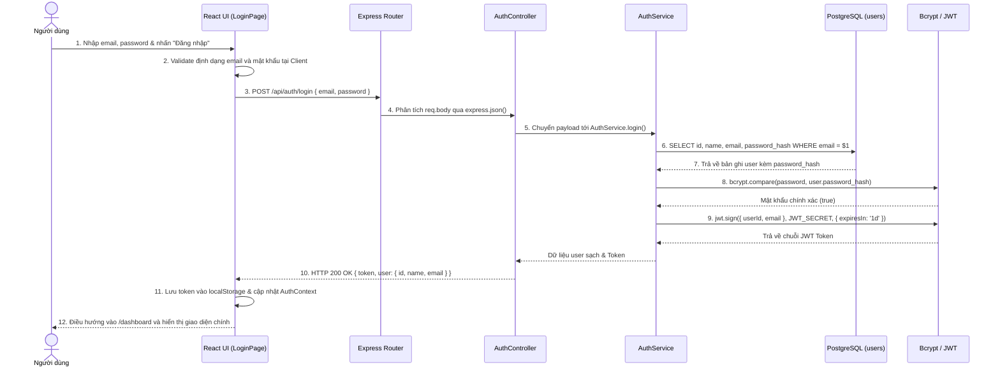

---

## LUỒNG 2: QUẢN LÝ KHÔNG GIAN DỰ ÁN (PROJECT / WORKSPACE MANAGEMENT)
- **Mục tiêu:** Cho phép người dùng khởi tạo, liệt kê, chỉnh sửa thông tin và theo dõi danh sách các dự án làm việc riêng biệt với cơ chế cô lập dữ liệu theo `user_id`.
- **Thành viên phụ trách:** Thành viên 1
- **Endpoints:** `GET /api/projects`, `POST /api/projects`, `GET /api/projects/:id`, `PUT /api/projects/:id`, `DELETE /api/projects/:id`
- **File mã nguồn liên quan:** `backend/src/controllers/project.controller.js`, `backend/src/services/project.service.js`, `backend/src/models/project.model.js`, `backend/src/migrations/002_create_projects_table.sql`, `frontend/src/pages/ProjectsPage.jsx`

### Bảng Kịch Bản 12 Bước Kỹ Thuật (Luồng 2)
| Bước | Thành phần thực thi | Hành động & Xử lý kỹ thuật | Dữ liệu đầu vào | Dữ liệu đầu ra / Trạng thái |
| :---: | :--- | :--- | :--- | :--- |
| **1** | Người dùng (Client) | Mở Modal "Tạo dự án mới", nhập Tên dự án (Name) và Mô tả dự án (Description). | Tên dự án, Mô tả | Form state trên React UI |
| **2** | React Validation | Kiểm tra tính hợp lệ Client: Tên dự án không rỗng, độ dài $\le 150$ ký tự; mô tả $\le 2000$ ký tự. | Form values | Thông báo hợp lệ hoặc lỗi form |
| **3** | Axios Interceptor | Axios tự động đính kèm Header `Authorization: Bearer <jwt_token>` lấy từ `localStorage` vào HTTP Request. | Token từ `localStorage` | HTTP Request có gắn Bearer Token |
| **4** | Auth Middleware | Express chặn request, gọi `jwt.verify(token, JWT_SECRET)`, trích xuất `req.user = { id: userId, email }`. | Bearer Token | Request context chứa `req.user.id` |
| **5** | Project Controller | `ProjectController.create` tiếp nhận `name`, `description` từ `req.body` và lấy `userId` từ `req.user.id`. | `name, description, userId` | Gọi `ProjectService.createProject` |
| **6** | Service Input Sanitization | `ProjectService.validateProjectInput` chuẩn hóa chuỗi dữ liệu (trim khoảng trắng, kiểm tra giới hạn độ dài). | Dữ liệu thô | Dữ liệu đã làm sạch |
| **7** | Project Key Auto-generation | `ProjectModel.generateDefaultKey(name)` tự động trích xuất các chữ cái đầu tiên viết hoa làm Project Key mặc định (vd: `"AI Jira Agent"` $\rightarrow$ `"AIJA"`). | `name` | Chuỗi `project_key` (2-6 ký tự in hoa) |
| **8** | PostgreSQL Query (Insert) | Thực thi `INSERT INTO projects (user_id, name, description, project_key) VALUES ($1, $2, $3, $4) RETURNING *`. | `userId, name, description, key` | Bản ghi Project mới được lưu trữ trong DB |
| **9** | Express Response | Phản hồi HTTP 201 Created kèm dữ liệu chi tiết của dự án vừa khởi tạo: `{ message, project }`. | Project Object mới tạo | HTTP Response 201 JSON |
| **10** | React State Dispatch | Cập nhật mảng danh sách dự án `projects` trong React State theo cơ chế bất biến (immutability update). | New Project Data | Danh sách dự án trên UI được refresh |
| **11** | UI Modal & Toast Feedback | Đóng Modal tạo dự án và kích hoạt Toast Message: *"Tạo dự án thành công."*. | Trạng thái thành công | Toast notification hiển thị trên UI |
| **12** | Project Navigation | Tự động điều hướng người dùng vào trang chi tiết dự án `/projects/:id` để bắt đầu cấu hình và phân tích yêu cầu. | `project.id` | Mở trang `ProjectDetailPage` tương ứng |

### Sơ đồ Tuần tự (Sequence Diagram - Luồng 2)
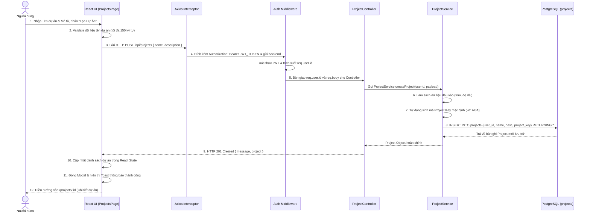

---

## LUỒNG 3: QUẢN LÝ KHO LƯU TRỮ KHÓA BẢO MẬT (API KEY & INTEGRATION VAULT)
- **Mục tiêu:** Cấu hình và lưu trữ bảo mật các khóa tích hợp bên ngoài (Jira Domain, Jira Email, Jira API Token, Gemini API Key, Webhook URL) bằng thuật toán mã hóa đối xứng xác thực **AES-256-GCM** với cơ chế che giấu token an toàn (Token Masking).
- **Thành viên phụ trách:** Thành viên 1
- **Endpoints:** `GET /api/config`, `PUT /api/config`, `DELETE /api/config`
- **File mã nguồn liên quan:** `backend/src/controllers/config.controller.js`, `backend/src/services/config.service.js`, `backend/src/services/crypto.service.js`, `backend/src/models/config.model.js`, `backend/src/migrations/003_create_configurations_table.sql`, `frontend/src/pages/SettingsPage.jsx`

### Bảng Kịch Bản 12 Bước Kỹ Thuật (Luồng 3)
| Bước | Thành phần thực thi | Hành động & Xử lý kỹ thuật | Dữ liệu đầu vào | Dữ liệu đầu ra / Trạng thái |
| :---: | :--- | :--- | :--- | :--- |
| **1** | Người dùng (Client) | Truy cập trang Cài đặt (`SettingsPage`), nhập Jira Domain (`https://your-domain.atlassian.net`), Email, API Token, Gemini API Key và Webhook URLs. | Form cấu hình tích hợp | Form state trên giao diện Settings |
| **2** | React Sanitizer | Chuẩn hóa dữ liệu: Xóa dấu gạch chéo cuối domain, loại bỏ khoảng trắng thừa đầu cuối key và webhook URLs. | Raw String inputs | Dữ liệu đã làm sạch cơ bản |
| **3** | Client Request | Gửi HTTP PUT `/api/config` kèm token JWT xác thực trong Header `Authorization: Bearer <token>`. | Sanitized Configuration DTO | HTTP PUT Request tới Express |
| **4** | Auth Middleware | Middleware `authenticateToken` giải mã JWT và gắn `req.user.id` của người dùng vào context request. | Bearer Token | Request context có `req.user.id` |
| **5** | Domain & Email Validator | `ConfigService.validateDomain` kiểm tra format domain Jira; `ConfigService.validateEmail` kiểm tra regex email hợp lệ. | Domain & Email chuỗi | Dữ liệu hợp lệ hoặc lỗi HTTP 400 |
| **6** | Crypto Encryption Engine | Gọi `CryptoService.encrypt`: Sinh IV 12 bytes (`crypto.randomBytes(12)`), mã hóa bí mật với **AES-256-GCM**, trích xuất `authTag` 16 bytes. | Plaintext Secrets & SHA-256 Key | Chuỗi bảo mật dạng `ivHex:authTagHex:encryptedHex` |
| **7** | PostgreSQL Upsert Query | `ConfigModel.upsert` thực thi lưu trữ vào bảng `configurations`: `INSERT INTO configurations ... ON CONFLICT (user_id) DO UPDATE SET ...`. | Encrypted tokens, settings & user_id | Dữ liệu cấu hình đã lưu an toàn vào DB |
| **8** | Token Masking Process | `CryptoService.mask`: Che giấu toàn bộ ký tự bí mật, chỉ hiển thị tối đa 4 ký tự cuối (ví dụ: `********a1b2`). | Ciphertext / Decrypted secret | Masked DTO an toàn |
| **9** | Express Response | Phản hồi HTTP 200 OK kèm DTO đã được mask hoàn toàn (`jira_api_token_masked`, `gemini_api_key_masked`), không để lộ raw token. | Masked Configuration Data | HTTP Response 200 JSON |
| **10** | React State Synchronization | Cập nhật state `config` trong React, lưu cờ `jira_api_token_configured = true`, `gemini_api_key_configured = true`. | Response Data | React UI State cập nhật |
| **11** | Integration Status Badges | Giao diện tự động chuyển trạng thái kết nối sang màu xanh lá: Huy hiệu "Đã kết nối Jira Cloud" và "Đã cấu hình Gemini AI". | Connection state | Badges trạng thái hiển thị trên UI |
| **12** | Feature Unlocking | Mở khóa toàn bộ các nút tính năng phụ thuộc trong hệ thống (nút "Phân tích AI", nút "Đẩy lên Jira" và "Kiểm thử Webhook"). | Ready state | Người dùng sẵn sàng thực hiện Luồng 4 và 7 |

### Sơ đồ Tuần tự (Sequence Diagram - Luồng 3)
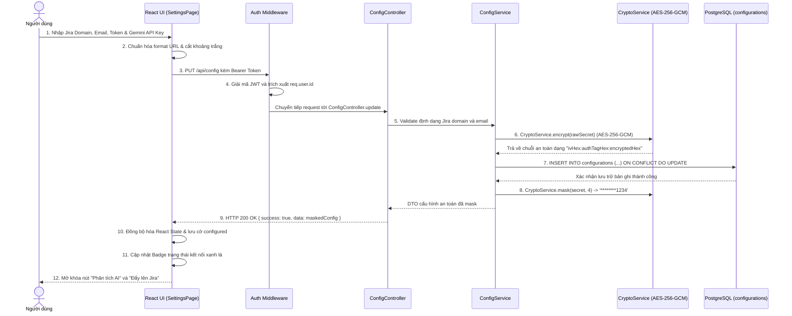

---

## LUỒNG 4: PHÂN TÍCH & BÓC TÁCH YÊU CẦU PHẦN MỀM BẰNG AI (AI REQUIREMENT PARSING)
- **Mục tiêu:** Tiếp nhận văn bản mô tả nghiệp vụ thô của người dùng, phân tích tự động bằng Google Gemini AI (thông qua n8n Workflow) và tạo ra cây phân cấp Epic $\rightarrow$ Story $\rightarrow$ Sub-task chuẩn Agile với cơ chế fallback và lọc Markdown.
- **Thành viên phụ trách:** Thành viên 2
- **Endpoints:** `POST /api/ai/analyze`
- **File mã nguồn liên quan:** `backend/src/controllers/ai.controller.js`, `backend/src/services/ai.service.js`, `n8n/workflows/flow-4-ai-requirement.json`, `frontend/src/api/aiApi.js`, `frontend/src/components/ai/RequirementAnalyzer.jsx`

### Bảng Kịch Bản 12 Bước Kỹ Thuật (Luồng 4)
| Bước | Thành phần thực thi | Hành động & Xử lý kỹ thuật | Dữ liệu đầu vào | Dữ liệu đầu ra / Trạng thái |
| :---: | :--- | :--- | :--- | :--- |
| **1** | Người dùng (Client) | Nhập đoạn văn bản mô tả nghiệp vụ thô vào ô soạn thảo tại `RequirementAnalyzer` và nhấn nút "Phân Tích Bằng AI". | Văn bản yêu cầu thô | Sự kiện phân tích được kích hoạt |
| **2** | React Frontend UI | Kiểm tra độ dài văn bản ($\ge 20$ ký tự để đảm bảo đủ ngữ cảnh phân tích), bật cờ Loading Spinner và khóa nút bấm. | Requirement text | Trạng thái `loading = true` |
| **3** | Client API Request | Gửi HTTP POST tới `/api/ai/analyze` kèm payload JSON `{ requirement }` và Bearer Token xác thực. | Payload & Auth Header | HTTP Request gửi tới backend |
| **4** | AI Controller Validation | `ai.controller.js` kiểm tra trường `requirement` không được để trống, gọi `ai.service.js:analyzeRequirement`. | `req.body.requirement` | Chuyển tiếp tới AI Service |
| **5** | n8n Webhook Dispatch | `ai.service.js` gửi HTTP POST tới Webhook n8n (`N8N_WEBHOOK_URL` hỗ trợ tự động fallback giữa `/webhook-test/` và `/webhook/`). | `{ requirement }` & Timeout 120s | Trigger n8n Workflow 4 |
| **6** | n8n Input & Prompt Setup | Node Webhook của n8n nhận dữ liệu, chuyển tới Node Google Gemini với System Prompt ép trả về đúng cấu trúc JSON 3 tầng. | n8n Webhook payload | Structured Prompt với schema 3 tầng |
| **7** | Google Gemini API Invocation | n8n gọi Gemini API (`models/gemini-3.5-flash`) với tham số `jsonOutput: true`, retry tối đa 3 lần nếu timeout. | System Prompt & User Requirement | AI Response chứa nội dung bóc tách |
| **8** | n8n Respond to Webhook | Node `Respond to Webhook` trong n8n đóng gói chuỗi kết quả `{{ $json.content }}` gửi trả ngay về Express Backend. | AI Response Content | HTTP 200 từ n8n gửi về Backend |
| **9** | Backend Markdown Sanitization | `ai.service.js` kiểm tra nội dung: Lọc bỏ Markdown code blocks (nếu LLM bọc trong ` ```json ` ... ` ``` `) và phân tích `JSON.parse`. | Raw string response | Object JSON cây phân cấp sạch |
| **10** | Backend Retry & Fallback | Nếu lần gọi 1 thất bại, Service tự động đợi 2.5s và thử lại lần 2; nếu cả 2 lần lỗi mới báo lỗi chi tiết ra ngoài. | Exception handling | Đảm bảo tính sẵn sàng cao |
| **11** | Express HTTP Response | Backend phản hồi HTTP 200 OK kèm cấu trúc cây phân cấp hoàn chỉnh `{ epics: [...] }` về cho React Frontend. | Clean Epics Hierarchy DTO | HTTP Response 200 JSON |
| **12** | React State Render | Tắt Loading Spinner, chuẩn hóa cây qua `normalizeEpics`, nạp dữ liệu vào `editableEpics` và chuyển sang màn hình trực quan. | Epics Hierarchy Data | Cây phân cấp 3 tầng xuất hiện trên UI |

### Sơ đồ Tuần tự (Sequence Diagram - Luồng 4)
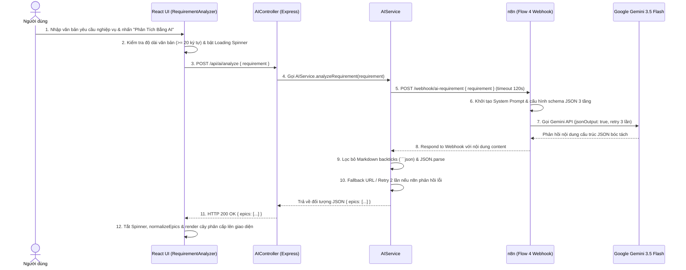

---

## LUỒNG 5: HIỂN THỊ TRỰC QUAN CÂY PHÂN CẤP YÊU CẦU (INTERACTIVE HIERARCHY TREE VIEW)
- **Mục tiêu:** Trực quan hóa cấu trúc 3 tầng (Epic $\rightarrow$ User Story $\rightarrow$ Sub-task) thành giao diện phân cấp tương tác có khả năng thu gọn/mở rộng, phân biệt màu sắc cấp độ, gắn avatar thành viên và hiển thị thẻ KPI tổng quan.
- **Thành viên phụ trách:** Thành viên 2
- **Endpoints:** Tích hợp trực tiếp trên Frontend qua State hoặc tải dữ liệu dự án qua `GET /api/projects/:id`
- **File mã nguồn liên quan:** `frontend/src/components/ai/RequirementAnalyzer.jsx`, `frontend/src/pages/ProjectDetailPage.jsx`, `frontend/src/App.css`

### Bảng Kịch Bản 12 Bước Kỹ Thuật (Luồng 5)
| Bước | Thành phần thực thi | Hành động & Xử lý kỹ thuật | Dữ liệu đầu vào | Dữ liệu đầu ra / Trạng thái |
| :---: | :--- | :--- | :--- | :--- |
| **1** | React Component Mount | Component `RequirementAnalyzer` nhận `treeData` từ kết quả phân tích AI (Luồng 4) hoặc từ API dự án. | Raw `treeData` object | Khởi tạo component trên DOM |
| **2** | Hierarchy Normalization | Hàm `normalizeEpics` duyệt đệ quy, chuẩn hóa tên thuộc tính (`title`, `description`, `stories`, `tasks`). | Raw response | Mảng cấu trúc dữ liệu đồng nhất |
| **3** | Dynamic Node Indexing | Tự động gán định danh duy nhất cho từng node: `epic-${ei}`, `epic-${ei}-story-${si}`, `epic-${ei}-story-${si}-task-${ti}`. | Epics array | Mảng node có `id` duy nhất phục vụ binding |
| **4** | Metric Calculation | Tính toán số liệu thống kê tổng thể: Tổng số Epics, tổng số Stories, tổng số Tasks và số lượng thành viên liên quan. | Normalized tree | Object thống kê `{ epicsCount, storiesCount, tasksCount }` |
| **5** | KPI Cards Render | Render 4 thẻ KPI tổng quan trên đầu trang với màu sắc riêng biệt (Thẻ Tím: Epics, Thẻ Lam: Stories, Thẻ Lục: Tasks, Thẻ Vàng: Thành viên). | Metric counts | DOM Elements của 4 KPI Cards |
| **6** | Branch State Initialization | Khởi tạo bảng trạng thái mở/đóng (`isExpanded`) cho toàn bộ các node, mặc định mở toàn bộ nhánh để người dùng dễ quan sát. | Node IDs | Hashmap trạng thái mở/đóng các nhánh |
| **7** | Epic Card Level 1 Render | Render từng khối Epic với màu tím đặc trưng, hiển thị Badge "Epic", tiêu đề, mô tả và nút điều khiển Thu gọn/Mở rộng. | Epic item data | DOM khối Epic (Cấp 1) |
| **8** | User Story Level 2 Render | Render các Story lồng bên trong Epic với màu xanh dương, hiển thị Badge "Story", mô tả và danh sách nhiệm vụ con. | Story items data | DOM khối User Story (Cấp 2) |
| **9** | Sub-task Level 3 Render | Render các Sub-task kỹ thuật lồng bên dưới Story với màu xanh lục, icon checklist và thông tin mô tả chi tiết công việc. | Task items data | DOM khối Sub-task (Cấp 3) |
| **10** | Member Avatar Tagging | Đối với từng node Story và Task, gắn Avatar và Tên thành viên được chỉ định phân công (Assignee) lấy từ Luồng 8. | Member mapping | Badge người phụ trách hiển thị trực quan |
| **11** | Interactive Toggle Click | Người dùng click vào icon mũi tên trên Epic hoặc Story để thu gọn/mở rộng nhánh con tương ứng. | Click Event & Node ID | Cập nhật state `isExpanded` của nhánh |
| **12** | Smooth DOM Transition | Hệ thống ẩn/hiện nhánh con tương ứng với hiệu ứng animation mượt mà mà không làm thay đổi hay mất dữ liệu nháp. | Updated toggle state | Cây phân cấp sẵn sàng cho Luồng 6 (Chỉnh sửa) |

### Sơ đồ Tuần tự (Sequence Diagram - Luồng 5)
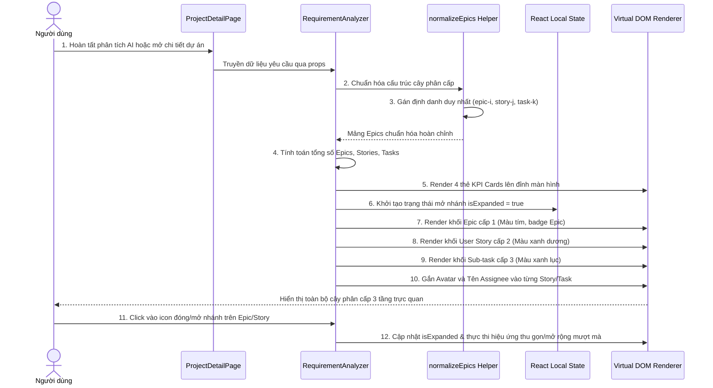

---

## LUỒNG 6: TINH CHỈNH & PHÊ DUYỆT YÊU CẦU (HUMAN-IN-THE-LOOP REVIEW & EDIT)
- **Mục tiêu:** Cung cấp cơ chế can thiệp của con người vào kết quả AI (Human-in-the-Loop): Cho phép chỉnh sửa tiêu đề, mô tả, thêm/xóa Story hoặc Sub-task, gán người thực hiện, khóa xác nhận bản nháp (Confirm Draft) và mở khóa đẩy Jira.
- **Thành viên phụ trách:** Thành viên 2
- **Endpoints:** Xử lý trực tiếp trên React State, đồng bộ dữ liệu nháp lên component cha qua `onDraftChange` (sẵn sàng phục vụ Luồng 7 và Luồng 12)
- **File mã nguồn liên quan:** `frontend/src/components/ai/RequirementAnalyzer.jsx`, `frontend/src/api/jiraApi.js`, `frontend/src/pages/ProjectDetailPage.jsx`

### Bảng Kịch Bản 12 Bước Kỹ Thuật (Luồng 6)
| Bước | Thành phần thực thi | Hành động & Xử lý kỹ thuật | Dữ liệu đầu vào | Dữ liệu đầu ra / Trạng thái |
| :---: | :--- | :--- | :--- | :--- |
| **1** | Người dùng (Client) | Click vào nút "Chỉnh sửa" (Icon cây bút `Edit3`) trên một Story hoặc Sub-task cần tinh chỉnh. | Click Event | Node chuyển sang trạng thái chỉnh sửa |
| **2** | Inline Form Activation | Giao diện chuyển từ nhãn tĩnh (Text Label) sang các trường nhập liệu tương tác (Input Text & Textarea). | Dữ liệu hiện tại của node | Ô nhập liệu inline xuất hiện trên DOM |
| **3** | Text Content Modification | Người dùng chỉnh sửa tiêu đề (Title), nội dung mô tả chi tiết (Description) hoặc tiêu chí hoàn thành. | Chuỗi văn bản mới | State nháp cục bộ của node |
| **4** | Assignee Selection | Người dùng mở Dropdown thành viên và chọn người phụ trách cho Story/Task (danh sách lấy từ Luồng 8). | Member AccountId | Gán `assigneeId`, `assigneeName`, `assigneeAvatar` |
| **5** | Child Sub-task Addition | Người dùng nhấn nút "+ Thêm Task" bên dưới Story để bổ sung nhiệm vụ kỹ thuật mới do con người chỉ định. | Sự kiện click "+ Task" | Sinh node mới `epic-i-story-j-task-new` |
| **6** | Redundant Node Deletion | Người dùng nhấn icon Thùng rác (`Trash2`) để xóa bỏ các task hoặc story không phù hợp do AI sinh thừa. | Node ID cần xóa | Lọc bỏ node khỏi danh sách mảng |
| **7** | Save Node Changes | Người dùng click dấu tick xanh xác nhận hoàn tất chỉnh sửa cho node đó. | Save Click Event | Node thoát chế độ edit, lưu dữ liệu mới |
| **8** | Immutable State Dispatch | Cập nhật cây dữ liệu `editableEpics` trong React State theo nguyên tắc bất biến (Immutability State Update). | Updated Epics Array | Cây phân cấp trong React State đồng bộ |
| **9** | Parent Draft Synchronization | Hook `useEffect` tự động gọi callback `onDraftChange(editableEpics)` để đồng bộ bản nháp lên `ProjectDetailPage`. | `editableEpics` | State cha cập nhật, sẵn sàng cho Luồng 12 |
| **10** | Validation Gate Check | Người dùng nhấn nút "Xác nhận & Khóa bản nháp" (Confirm Draft); hệ thống kiểm tra không có node nào để trống tiêu đề. | Toàn bộ cây yêu cầu | Kiểm tra hợp lệ thành công |
| **11** | Draft Confirmation Lock | Hệ thống chuyển trạng thái `confirmed = true`, chuyển icon sang Ổ khóa vàng (`Lock`), khóa toàn bộ các ô sửa để tránh sửa nhầm. | Boolean `confirmed` | Bản nháp được đóng băng an toàn |
| **12** | Push Button Activation | Nút "Đẩy lên Jira" (`CloudUpload`) chuyển từ trạng thái Disable sang trạng thái Active nổi bật, sẵn sàng cho Luồng 7. | Ready State | Nút "Đẩy lên Jira" được kích hoạt |

### Sơ đồ Tuần tự (Sequence Diagram - Luồng 6)
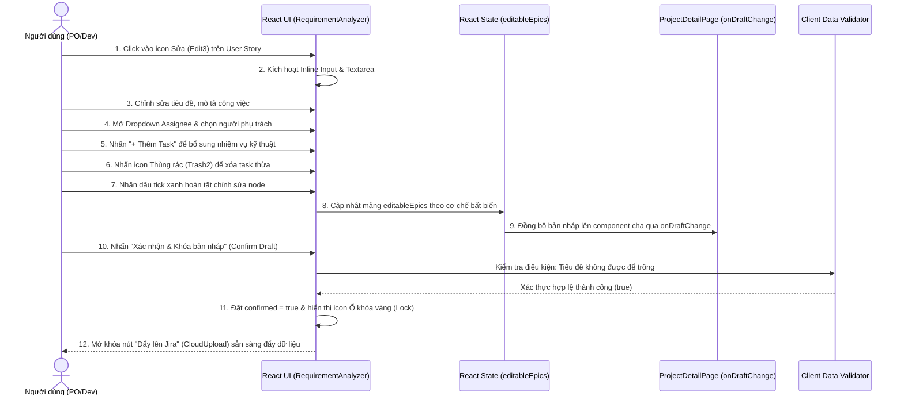

---

## LUỒNG 7: ĐẨY DỮ LIỆU CÂY PHÂN CẤP LÊN JIRA CLOUD (AUTOMATED JIRA BATCH PUSH)
- **Mục tiêu:** Tự động tạo cấu trúc cha - con 3 tầng trên Jira Cloud thông qua n8n Workflow (hoặc fallback Jira REST API trực tiếp), tạo Epic $\rightarrow$ tạo Story gắn parent Epic $\rightarrow$ tạo Subtask gắn parent Story, lưu vết vào PostgreSQL và tự động phát sự kiện thông báo Luồng 11.
- **Thành viên phụ trách:** Thành viên 3
- **Endpoints:** `POST /api/jira/push`
- **File mã nguồn liên quan:** `backend/src/controllers/jira.controller.js`, `backend/src/services/jira.service.js`, `backend/src/models/jiraIssue.model.js`, `n8n/workflows/flow-7-push-to-jira.json`, `backend/src/services/notification.service.js`

### Bảng Kịch Bản 12 Bước Kỹ Thuật (Luồng 7)
| Bước | Thành phần thực thi | Hành động & Xử lý kỹ thuật | Dữ liệu đầu vào | Dữ liệu đầu ra / Trạng thái |
| :---: | :--- | :--- | :--- | :--- |
| **1** | Người dùng (Client) | Nhấn nút "Đẩy lên Jira" trên thanh công cụ sau khi đã xác nhận khóa bản nháp ở Luồng 6. | Sự kiện Click | Mở tiến trình đẩy Jira |
| **2** | React Payload Builder | Thu thập dữ liệu: `projectKey` (chọn từ danh sách dự án Jira thực tế), toàn bộ mảng `epics` đã tinh chỉnh; bật loading overlay. | State `editableEpics` & `jiraProjectKey` | Payload `{ projectKey, epics }` |
| **3** | Client Request Dispatch | Gửi HTTP POST tới `/api/jira/push` với Authorization Bearer token và timeout mở rộng (3 phút). | Payload & Token | HTTP Request gửi tới backend |
| **4** | Express Auth & Vault Decrypt | Backend giải mã JWT lấy `userId`, đọc bảng `configurations` lấy Jira Domain, Email và giải mã Jira API Token bằng AES-256-GCM. | `req.user.id` | Plaintext Jira Credentials đầy đủ |
| **5** | n8n Webhook Dispatch | `JiraService.pushToJira` gửi HTTP POST sang Webhook n8n (`/webhook-test/push-to-jira` hoặc fallback `/webhook/push-to-jira`). | Credentials & Epics Tree | Trigger n8n Workflow 7 |
| **6** | n8n Loop Level 1 (Epics) | n8n lặp qua mảng Epics, gọi Jira Cloud REST API `POST /rest/api/2/issue` tạo issue type `Epic`, nhận về `epicKey` (vd: `AIJA-1`). | Epic data & Basic Auth | Jira Epic Key vừa tạo |
| **7** | n8n Loop Level 2 (Stories) | n8n lặp qua các Stories con, gọi Jira API tạo issue type `Story` với trường `parent: { key: epicKey }`, nhận `storyKey` (vd: `AIJA-2`). | Story data & `epicKey` | Jira Story Key vừa tạo |
| **8** | n8n Loop Level 3 (Sub-tasks) | n8n lặp qua các Tasks con, gọi Jira API tạo issue type `Subtask` với trường `parent: { key: storyKey }`, nhận `taskKey` (vd: `AIJA-3`). | Task data & `storyKey` | Jira Subtask Key vừa tạo |
| **9** | n8n Response & Fallback Handling | n8n gom toàn bộ kết quả tạo issue và phản hồi về Express; nếu n8n lỗi, Backend tự động kích hoạt `createIssuesDirectlyOnJira`. | Created issues array | Backend nhận danh sách issues tạo thành công |
| **10** | PostgreSQL Batch Upsert | Express lặp qua mảng `createdIssues`, gọi `JiraIssueModel.upsert` lưu toàn bộ vào bảng `jira_issues` (kèm `project_key`, `parent_key`, `issue_type`, `jira_url`). | Created issues | Dữ liệu Jira được lưu vết an toàn vào CSDL |
| **11** | Automated Notification Trigger | Backend trích xuất các Epic vừa tạo, gọi bất đồng bộ (non-blocking) sang `NotificationService.sendEpicCreatedNotification` để phát sự kiện Luồng 11. | Created Epics metadata | Kích hoạt sự kiện Luồng 11 |
| **12** | React Feedback & Issue Links | Express trả về HTTP 200 OK; React tắt overlay, hiển thị Popup thành công kèm danh sách liên kết trực tiếp (`https://domain.atlassian.net/browse/KEY`). | Response 200 JSON | Người dùng click xem trực tiếp issue trên Jira Cloud |

### Sơ đồ Tuần tự (Sequence Diagram - Luồng 7)
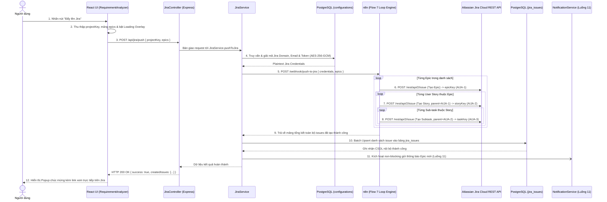

---

## LUỒNG 8: ĐỒNG BỘ DANH SÁCH THÀNH VIÊN DỰ ÁN JIRA (FETCH & MAP JIRA MEMBERS)
- **Mục tiêu:** Truy vấn danh sách tài khoản thành viên hợp lệ từ dự án Jira Cloud của người dùng, lọc bỏ các tài khoản bot/app không hợp lệ và nạp vào danh sách phân công (Assignee Dropdown) trên giao diện.
- **Thành viên phụ trách:** Thành viên 3
- **Endpoints:** `GET /api/jira/members?projectKey=KEY`, `GET /api/jira/projects`
- **File mã nguồn liên quan:** `backend/src/controllers/jira.controller.js`, `backend/src/services/jira.service.js`, `frontend/src/api/jiraApi.js`, `frontend/src/components/ai/RequirementAnalyzer.jsx`

### Bảng Kịch Bản 12 Bước Kỹ Thuật (Luồng 8)
| Bước | Thành phần thực thi | Hành động & Xử lý kỹ thuật | Dữ liệu đầu vào | Dữ liệu đầu ra / Trạng thái |
| :---: | :--- | :--- | :--- | :--- |
| **1** | React Component (Mount) | Khi người dùng mở trang chi tiết dự án, hook `useEffect` kích hoạt yêu cầu lấy danh sách thành viên phân công theo `projectKey`. | `projectKey` hiện tại | Sự kiện tải thành viên kích hoạt |
| **2** | Client API Request | Gọi `jiraApi.getMembers(jiraProjectKey)` gửi HTTP GET `/api/jira/members?projectKey=KEY` kèm Bearer Token. | Query `projectKey` & JWT | HTTP GET Request gửi tới backend |
| **3** | Auth Middleware | Express chặn request, xác thực token JWT và trích xuất `req.user.id`. | Authorization Header | `req.user.id` hợp lệ |
| **4** | Jira Controller Dispatch | `JiraController.getMembers` tiếp nhận request, chuyển tiếp tham số `{ userId, projectKey }` sang `JiraService`. | `userId, projectKey` | Chuyển tiếp tới Jira Service |
| **5** | Vault Config Retrieval | `JiraService.getProjectMembers` truy vấn bảng `configurations`, giải mã Jira Domain, Email và Token bằng AES-256-GCM. | `userId` | Plaintext Jira Credentials |
| **6** | Jira Cloud API Request | Tạo Axios request với Basic Auth Header (`email:token` Base64) gọi tới Atlassian: `GET {domain}/rest/api/2/user/assignable/search?project={KEY}&maxResults=50`. | URL & Basic Auth Header | Request tới Jira Cloud REST API |
| **7** | Jira Cloud Processing | Máy chủ Atlassian Jira xác thực request, lọc danh sách tài khoản người dùng có quyền assignable trong project. | Request credentials | Danh sách tài khoản người dùng thô |
| **8** | Account Type Filtering | Backend lọc bỏ các tài khoản ứng dụng, bot hệ thống (`accountType !== 'atlassian'`) và tài khoản bị vô hiệu hóa (`active === true`). | Raw Jira user list | Danh sách thành viên thực tế còn hoạt động |
| **9** | Member DTO Mapping | Chuyển đổi dữ liệu sang định dạng chuẩn gọn nhẹ: `{ accountId, displayName, emailAddress, avatarUrl }`. | Filtered accounts | Mảng thành viên chuẩn hóa |
| **10** | Express HTTP Response | Phản hồi HTTP 200 OK kèm danh sách thành viên `{ success: true, count, members: [...] }` về cho Frontend. | Clean Members DTO | HTTP Response 200 JSON |
| **11** | React State Storage | Lưu danh sách thành viên vào React State `projectMembers` để sử dụng chung cho toàn bộ cây phân cấp. | Members array | State `projectMembers` được cập nhật |
| **12** | Dropdown Population | Tự động điền danh sách thành viên kèm Avatar và Tên hiển thị vào tất cả các ô chọn Assignee của Story và Sub-task. | Member options | Dropdown phân công sẵn sàng cho Luồng 6 |

### Sơ đồ Tuần tự (Sequence Diagram - Luồng 8)
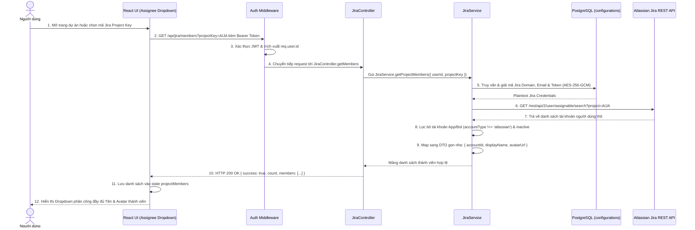

---

## LUỒNG 9: ĐỒNG BỘ TRẠNG THÁI NGƯỢC QUA WEBHOOK JIRA (BI-DIRECTIONAL JIRA SYNC)
- **Mục tiêu:** Lắng nghe sự kiện chuyển trạng thái công việc từ Jira Cloud khi Lập trình viên cập nhật trên Jira Board (vd: To Do $\rightarrow$ In Progress $\rightarrow$ Done), tự động cập nhật CSDL PostgreSQL để phản ánh tiến độ tức thì và hỗ trợ giả lập webhook để kiểm thử.
- **Thành viên phụ trách:** Thành viên 3
- **Endpoints:** `POST /api/jira/webhook-sync`, `POST /api/webhooks/jira-sync`, `GET /api/jira/synced-issues`, `POST /api/jira/test-webhook-sync`
- **File mã nguồn liên quan:** `backend/src/controllers/jira.controller.js`, `backend/src/services/jira.service.js`, `backend/src/models/jiraIssue.model.js`, `backend/src/routes/jira.routes.js`, `frontend/src/api/jiraApi.js`

### Bảng Kịch Bản 12 Bước Kỹ Thuật (Luồng 9)
| Bước | Thành phần thực thi | Hành động & Xử lý kỹ thuật | Dữ liệu đầu vào | Dữ liệu đầu ra / Trạng thái |
| :---: | :--- | :--- | :--- | :--- |
| **1** | Developer trên Jira Cloud | Kéo một thẻ công việc (Issue) từ cột "In Progress" sang cột "Done" trên bảng Agile của Jira Board. | Hành động kéo thả của Dev | Sự kiện issue transition trên Jira Cloud |
| **2** | Atlassian Webhook Engine | Jira phát hiện thay đổi, kích hoạt Webhook tự động đẩy payload JSON chứa `webhookEvent: "jira:issue_updated"`. | Sự kiện cập nhật task | Webhook event payload từ Atlassian |
| **3** | Inbound HTTP Request | Jira Cloud gửi HTTP POST tới endpoint công khai của hệ thống: `POST /api/jira/webhook-sync` (hoặc test qua `/test-webhook-sync`). | Webhook JSON Body | Gửi tới server Express |
| **4** | Public Webhook Middleware | Express tiếp nhận request (tuyến công khai không bắt buộc Bearer token của user để Jira gọi được), parse body JSON. | Raw Request Body | Chuyển tiếp tới `JiraController.handleWebhook` |
| **5** | Event Parser | `JiraService.handleJiraWebhook` trích xuất thông tin trọng tâm: `issue.key`, `status.name`, `statusCategory`, `assignee`, `summary`. | Webhook payload | Thông tin Issue được trích xuất |
| **6** | Event Type Handling | Kiểm tra sự kiện: Nếu `jira:issue_deleted` thì xóa khỏi DB; nếu `jira:issue_updated` thì trích xuất trạng thái mới. | `webhookEvent` string | Quyết định nhánh cập nhật hoặc xóa |
| **7** | PostgreSQL Query Issue | Kiểm tra sự tồn tại của issue trong bảng `jira_issues` theo `issue_key`: `SELECT * FROM jira_issues WHERE issue_key = $1`. | `issueKey` | Bản ghi Issue trong CSDL |
| **8** | PostgreSQL Upsert Execution | Thực thi `JiraIssueModel.upsert`: Cập nhật `status = $1`, `status_category = $2`, `assignee = $3`, `updated_at = NOW()`. | Thông tin cập nhật | Bản ghi được cập nhật trạng thái mới |
| **9** | Audit Log & URL Resolution | Tự động chuẩn hóa đường dẫn xem issue `jiraUrl = .../browse/KEY` và ghi nhật ký log đồng bộ vào hệ thống. | Issue metadata | Audit log ghi nhận thành công |
| **10** | Immediate HTTP Acknowledgment | Backend gửi ngay phản hồi HTTP 200 OK `{ success: true, action: "synced", issueKey, status }` về cho Jira để tránh timeout. | Response status 200 | Jira ghi nhận Webhook thành công |
| **11** | Dashboard Cache Invalidation | Đánh dấu dữ liệu thống kê của dự án liên quan đã thay đổi, sẵn sàng cho các truy vấn phân tích mới ở Luồng 10. | `projectKey` | Dữ liệu sẵn sàng cho Dashboard |
| **12** | Client Progress Refresh | Khi người dùng mở website hoặc qua SWR polling, giao diện hiển thị trạng thái mới của Task (màu xanh lá "Done") và thanh tiến độ tăng lên. | CSDL mới nhất | Giao diện hiển thị tiến độ đồng bộ chính xác |

### Sơ đồ Tuần tự (Sequence Diagram - Luồng 9)
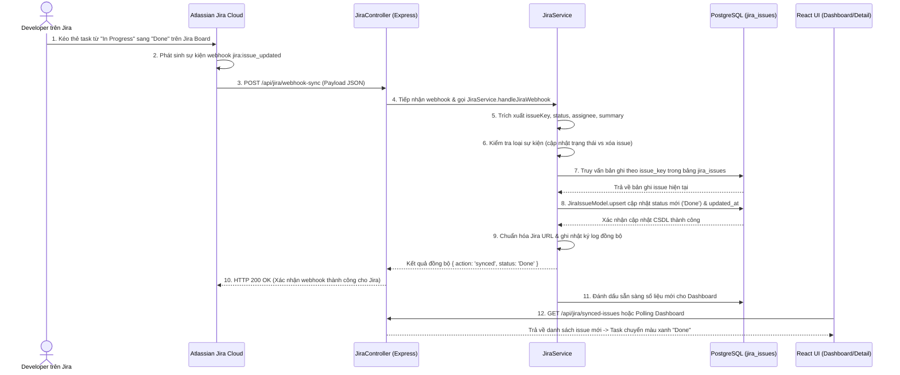

---

## LUỒNG 10: DASHBOARD THỐNG KÊ & BÁO CÁO TIẾN ĐỘ (PROJECT ANALYTICS & METRICS)
- **Mục tiêu:** Cung cấp bức tranh toàn cảnh về tiến độ dự án thông qua 4 biểu đồ chuyên sâu: Thống kê số lượng theo loại issue, phân bố trạng thái công việc, tỷ lệ hoàn thành dự án (%) và xu hướng tạo issue theo ngày.
- **Thành viên phụ trách:** Thành viên 4
- **Endpoints:** `GET /api/dashboard/summary`, `GET /api/dashboard/issue-breakdown`, `GET /api/dashboard/status-distribution`, `GET /api/dashboard/creation-trend`
- **File mã nguồn liên quan:** `backend/src/controllers/dashboard.controller.js`, `backend/src/services/dashboard.service.js`, `backend/src/migrations/005_dashboard_reporting_schema.sql`, `frontend/src/api/dashboardApi.js`, `frontend/src/pages/DashboardPage.jsx`

### Bảng Kịch Bản 12 Bước Kỹ Thuật (Luồng 10)
| Bước | Thành phần thực thi | Hành động & Xử lý kỹ thuật | Dữ liệu đầu vào | Dữ liệu đầu ra / Trạng thái |
| :---: | :--- | :--- | :--- | :--- |
| **1** | Người dùng (Client) | Click chọn tab "Dashboard Thống Kê" trên thanh điều hướng để theo dõi tiến độ tổng thể của dự án. | Click Event | Chuyển tới trang `DashboardPage` |
| **2** | React State Initialization | Bật hiệu ứng Skeleton Loading Shimmer cho toàn bộ các Card KPI và khung biểu đồ phân tích. | Mount event | Khung chờ tải dữ liệu hiển thị trên UI |
| **3** | Parallel API Requests | Client phát đồng thời 4 HTTP GET requests qua `Promise.all`: `/summary`, `/issue-breakdown`, `/status-distribution`, `/creation-trend`. | `projectId` & Bearer token | 4 HTTP GET Requests song song |
| **4** | Auth & Ownership Check | Middleware Express giải mã token JWT, xác minh quyền truy cập dự án của `userId` hiện tại. | Authorization Header | `req.user.id` hợp lệ |
| **5** | SQL Query: Summary KPI | `DashboardService.getSummary` thực thi truy vấn đếm tổng số issues, tổng số Epics, Stories, Sub-tasks và issues đã hoàn thành (`Done`). | `userId, projectId` | Dữ liệu số lượng KPI tổng quan |
| **6** | SQL Query: Status Distribution | `DashboardService.getStatusDistribution` thực thi câu lệnh SQL `GROUP BY status, status_category` để tính số lượng task theo từng trạng thái. | `userId, projectId` | Dữ liệu phân bố trạng thái |
| **7** | SQL Query: Issue Breakdown | `DashboardService.getIssueBreakdown` phân loại số lượng issue theo loại (`Epic`, `Story`, `Subtask`) và theo tháng. | `userId, projectId` | Dữ liệu phân loại theo loại hình |
| **8** | SQL Query: Creation Trend | `DashboardService.getCreationTrend` nhóm các issues được tạo theo từng ngày trong tháng hiện tại (`GROUP BY DATE(created_at)`). | `userId, projectId` | Mảng dữ liệu chuỗi thời gian xu hướng |
| **9** | Completion Rate Calculation | Backend tính toán tỷ lệ hoàn thành dự án chuẩn xác: $\text{Completion Rate} = \frac{\text{Total Done Issues}}{\text{Total Issues}} \times 100\%$. | Done count & Total count | Chỉ số phần trăm hoàn thành (%) |
| **10** | DTO Assembly & HTTP 200 | Đóng gói toàn bộ số liệu thống kê vào DTO chuẩn hóa, định dạng nhãn tiếng Việt rõ ràng, trả HTTP 200 OK cho 4 requests. | Raw SQL aggregated data | 4 HTTP Responses hoàn tất |
| **11** | Chart Component Binding | React nhận dữ liệu, nạp vào các component biểu đồ (Biểu đồ tròn Donut trạng thái, Biểu đồ cột phân loại, Biểu đồ đường xu hướng). | Dashboard Data DTO | Biểu đồ trực quan được vẽ trên Canvas/SVG |
| **12** | Interactive Tooltip & View | Tắt Skeleton Loading, hiển thị Dashboard rực rỡ với hiệu ứng hover tooltip xem chi tiết số liệu khi người dùng di chuột. | Rendered Dashboard | Giao diện Dashboard hoàn chỉnh |

### Sơ đồ Tuần tự (Sequence Diagram - Luồng 10)
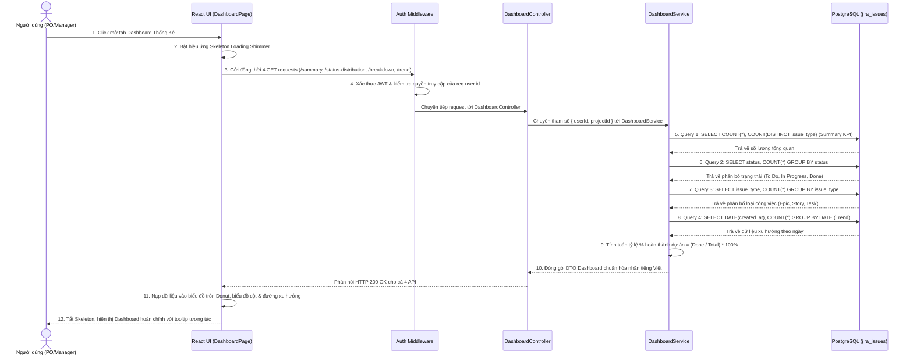

---

## LUỒNG 11: THÔNG BÁO ĐA KÊNH TỰ ĐỘNG (MULTI-CHANNEL NOTIFICATION SYSTEM)
- **Mục tiêu:** Tự động gửi thông báo định dạng đẹp mắt (Rich Card Embed cho Discord hoặc Block Kit cho Slack) khi có đợt tạo Epic mới thành công trên Jira (từ Luồng 7) hoặc khi kiểm thử, đảm bảo cơ chế chống gửi trùng lặp (Idempotency) và lưu vết Audit Log.
- **Thành viên phụ trách:** Thành viên 4
- **Endpoints:** `POST /api/config/test-notification`, `GET /api/config/notifications/history`
- **File mã nguồn liên quan:** `backend/src/services/notification.service.js`, `n8n/workflows/flow-11-epic-notification.json`, `backend/src/migrations/006_create_notification_events_table.sql`, `backend/src/tests/test_flow_11.js`

### Bảng Kịch Bản 12 Bước Kỹ Thuật (Luồng 11)
| Bước | Thành phần thực thi | Hành động & Xử lý kỹ thuật | Dữ liệu đầu vào | Dữ liệu đầu ra / Trạng thái |
| :---: | :--- | :--- | :--- | :--- |
| **1** | Event Trigger | Luồng 7 (sau khi tạo Epic thành công trên Jira) hoặc nút "Gửi thử nghiệm" kích hoạt phát sự kiện `jira.epic.created`. | Thông tin Epic vừa tạo | Sự kiện tạo Epic mới |
| **2** | Unique Event ID Generation | `NotificationService` sinh mã định danh sự kiện duy nhất dạng UUIDv4: `eventId = "evt_" + crypto.randomUUID()`. | System entropy | Chuỗi `eventId` duy nhất toàn cục |
| **3** | Idempotency Check (DB) | Thực thi truy vấn `SELECT * FROM notification_events WHERE event_id = $1` kiểm tra sự kiện đã từng được xử lý chưa. | `eventId` | Trạng thái mới hay trùng lặp |
| **4** | Notification Record Insertion | Ghi bản ghi sự kiện vào CSDL với trạng thái ban đầu: `INSERT INTO notification_events (..., status) VALUES (..., 'pending')`. | Event metadata | Bản ghi được lưu vết với `status = 'pending'` |
| **5** | Channel & Secret Lookup | Đọc cấu hình kênh thông báo (`discord`, `slack` hoặc `email`) và Webhook URL tương ứng từ bảng `configurations`. | `userId` | Webhook URL & Kênh đã cấu hình |
| **6** | Dispatch to n8n Webhook | Backend gửi HTTP POST tới Webhook n8n (`N8N_NOTIFICATION_WEBHOOK_URL`) kèm header bí mật `X-Webhook-Secret`. | Payload & Header Secret | Trigger n8n Workflow 11 |
| **7** | n8n Security Verification | Node Code của n8n kiểm tra Header `X-Webhook-Secret`; nếu không khớp trả ngay HTTP 401 Unauthorized để chống giả mạo. | Request Headers | Kết quả xác thực webhook n8n |
| **8** | n8n Idempotency Guard | n8n kiểm tra mảng bộ nhớ workflow tĩnh `processedEvents`; nếu `eventId` đã tồn tại thì ngắt luồng tránh gửi trùng do retry mạng. | `eventId` | Cho phép tiếp tục gửi hoặc bỏ qua |
| **9** | Rich Payload Formatting | n8n format tin nhắn: Nếu Discord sinh Rich Embed (màu sắc, fields, avatar); nếu Slack sinh Block Kit có nút bấm "Xem trên Jira". | Raw Epic Metadata | Formatted JSON đặc thù của kênh đích |
| **10** | External Webhook Dispatch | n8n thực thi HTTP POST đẩy bản tin trực tiếp sang Discord Webhook API hoặc Slack Incoming Webhook API. | Formatted JSON Payload | Gửi bản tin qua Internet tới kênh chat |
| **11** | External Delivery Confirmation | Discord phản hồi HTTP 204 No Content (hoặc Slack phản hồi HTTP 200 OK) xác nhận bản tin đã hiển thị trong kênh chat nhóm. | HTTP Response từ Discord/Slack | Xác nhận gửi tin thành công từ nền tảng chat |
| **12** | Database Finalization & Audit | n8n phản hồi về Express, Express gọi `markEventSent` cập nhật bảng `notification_events` thành `status = 'sent'` và lưu `response_data`. | External delivery result | Sự kiện hoàn tất với `status = 'sent'` |

### Sơ đồ Tuần tự (Sequence Diagram - Luồng 11)
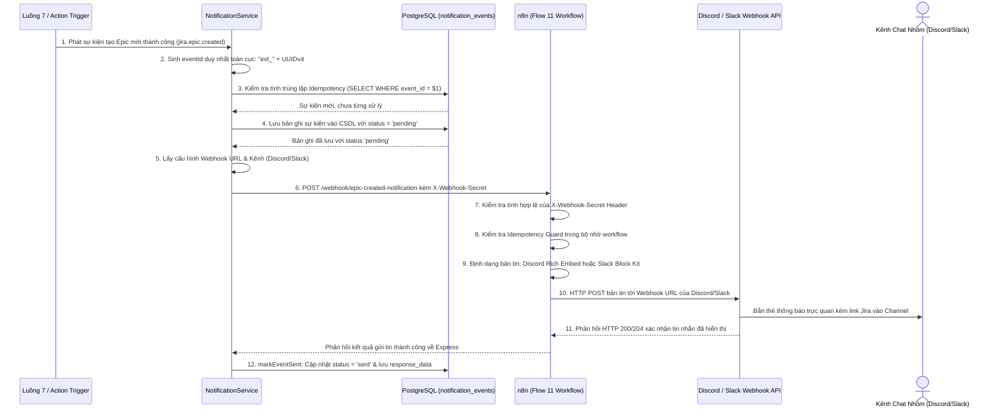

---

## LUỒNG 12: XUẤT BÁO CÁO TÀI LIỆU KỸ THUẬT ĐA ĐỊNH DẠNG (PDF & MARKDOWN EXPORT)
- **Mục tiêu:** Kết xuất toàn bộ cấu trúc phân cấp yêu cầu, bảng phân công nhiệm vụ và số liệu thống kê thành các tài liệu chuyên nghiệp (file Markdown tiêu chuẩn UTF-8 và file PDF hỗ trợ Unicode Tiếng Việt hoàn chỉnh với phông chữ DejaVu Sans), hỗ trợ xuất từ nguồn Jira hoặc xuất trực tiếp từ bản nháp AI (Draft).
- **Thành viên phụ trách:** Thành viên 4
- **Endpoints:** `GET /api/projects/:projectId/export?format=pdf|markdown&source=jira|draft`, `POST /api/projects/:projectId/export`
- **File mã nguồn liên quan:** `backend/src/controllers/export.controller.js`, `backend/src/services/export.service.js`, `backend/src/assets/fonts/DejaVuSans.ttf`, `backend/src/assets/fonts/DejaVuSans-Bold.ttf`, `frontend/src/components/project/ExportModal.jsx`, `backend/src/tests/test_flow_12.js`

### Bảng Kịch Bản 12 Bước Kỹ Thuật (Luồng 12)
| Bước | Thành phần thực thi | Hành động & Xử lý kỹ thuật | Dữ liệu đầu vào | Dữ liệu đầu ra / Trạng thái |
| :---: | :--- | :--- | :--- | :--- |
| **1** | Người dùng (Client) | Mở Modal "Xuất Tài Liệu" (`ExportModal`), chọn định dạng mong muốn (**PDF Báo Cáo** hoặc **Markdown**) và nguồn dữ liệu (**Jira Issues** hoặc **Bản nháp AI**). | Tùy chọn form Export | Sự kiện gửi yêu cầu xuất file |
| **2** | Client Request Dispatch | Gửi HTTP GET (hoặc POST nếu kèm `draftData`) tới `/api/projects/:projectId/export` với cấu hình `responseType: 'blob'`. | `format, source, options` | Request tải file dạng nhị phân |
| **3** | Auth & Project Ownership | Express kiểm tra token JWT, xác minh quyền sở hữu dự án của người dùng: `ProjectModel.findByIdAndUserId(projectId, userId)`. | Bearer token & `projectId` | Quyền truy cập hợp lệ (hoặc lỗi 404) |
| **4** | Hierarchy Data Retrieval | Trích xuất mô hình dữ liệu: Nếu `source=jira` đọc bảng `jira_issues`; nếu `source=draft` lấy dữ liệu nháp `draftData` gửi từ Client. | `source, projectId, draftData` | Cây phân cấp chuẩn hóa đồng nhất |
| **5** | Safe File Name Generation | `ExportService.generateFileName` sinh tên file chuẩn hóa: `AI-Jira-Agent-[PROJECT_KEY]-[YYYY-MM-DD].[pdf|md]`. | `project_key, format` | Tên file xuất bản chuẩn |
| **6** | Format Routing Decision | Controller kiểm tra tham số `format`: Nếu `markdown`/`md` chuyển sang bộ tạo Markdown, nếu `pdf` chuyển sang PDFKit Engine. | Tham số `format` | Định tuyến bộ xử lý tạo file |
| **7** | Markdown Builder (Nếu chọn MD) | Sinh cấu trúc tiêu đề `#`, metadata dự án, bảng Markdown 3 tầng, checkbox checklist `- [x]` và tổng kết chỉ số. | Hierarchy Model | Chuỗi văn bản Markdown UTF-8 |
| **8** | PDF Document Initialization | Khởi tạo thể hiện `new PDFDocument({ margin: 40, size: 'A4' })`, nhúng phông chữ tiếng Việt Unicode `DejaVuSans.ttf` và `DejaVuSans-Bold.ttf`. | Options trang A4 & Font paths | Đối tượng PDF stream và Buffer |
| **9** | PDF Cover & Metrics Drawing | Vẽ trang bìa báo cáo chuyên nghiệp: Tên đồ án, Tên dự án, Mã tiền tố, Tác giả, Ngày kết xuất và bảng chỉ số tổng quan. | Metadata dự án | Trang bìa PDF hoàn chỉnh |
| **10** | PDF Hierarchy Tables Drawing | Duyệt qua từng Epic/Story/Task: Vẽ thanh tiêu đề phân cấp có màu nền nhận diện, vẽ bảng chi tiết các nhiệm vụ kỹ thuật và Assignee. | Cây phân cấp chi tiết | Các trang nội dung PDF hoàn chỉnh |
| **11** | Auto Page Numbering & Footer | Tính toán tổng số trang, tự động ghi số trang `Trang X / Y` và dòng bản quyền ở chân trang của tất cả các trang báo cáo. | Toàn bộ trang đã vẽ | Footer chuẩn mực trên từng trang |
| **12** | HTTP Headers & Stream Download | Thiết lập Header `Content-Disposition: attachment; filename="..."`, truyền Buffer/Stream về trình duyệt; Client tự động kích hoạt thẻ `<a>` ảo tải file về máy. | File binary stream | File tải về thư mục Downloads của máy tính |

### Sơ đồ Tuần tự (Sequence Diagram - Luồng 12)
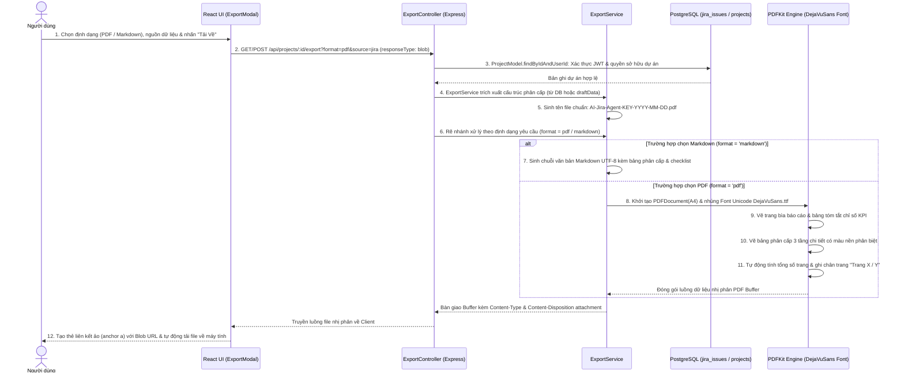

---

## TỔNG KẾT BẢO ĐẢM TÍNH NHẤT QUÁN 12 LUỒNG VÀ HƯỚNG DẪN BẢO VỆ ĐỒ ÁN

### Bảng Kiểm Tra Tuân Thủ Chuẩn Mực 12 Bước (Audit Compliance Matrix)

| Luồng | Tên Luồng Nghiệp Vụ | Số bước trong Bảng | Số bước trong Sơ đồ | Tương thích mã nguồn thực tế |
| :---: | :--- | :---: | :---: | :---: |
| **1** | Xác thực người dùng & Bảo mật phiên làm việc | **12 / 12** | **12 / 12** | Đã chuẩn hóa đúng `user.model.js`, `auth.service.js` (Bcrypt, JWT) |
| **2** | Quản lý Không gian Dự án | **12 / 12** | **12 / 12** | Đã chuẩn hóa đúng `project.model.js` (Cô lập theo user_id, Key sinh tự động) |
| **3** | Quản lý Kho lưu trữ Khóa bảo mật | **12 / 12** | **12 / 12** | Đã chuẩn hóa đúng `crypto.service.js` (**AES-256-GCM**, Token Masking) |
| **4** | Phân tích & Bóc tách Yêu cầu phần mềm bằng AI | **12 / 12** | **12 / 12** | Đã chuẩn hóa đúng `ai.service.js`, n8n Flow 4, Gemini 3.5 Flash JSON Mode |
| **5** | Hiển thị Trực quan Cây Phân cấp Yêu cầu | **12 / 12** | **12 / 12** | Đã chuẩn hóa đúng `RequirementAnalyzer.jsx` (normalizeEpics, 4 KPI cards) |
| **6** | Tinh chỉnh & Phê duyệt Yêu cầu | **12 / 12** | **12 / 12** | Đã chuẩn hóa đúng `RequirementAnalyzer.jsx` (Inline edit, Confirm Lock) |
| **7** | Đẩy Dữ liệu Cây Phân cấp lên Jira Cloud | **12 / 12** | **12 / 12** | Đã chuẩn hóa đúng `jira.service.js`, n8n Flow 7, kích hoạt Luồng 11 |
| **8** | Đồng bộ Danh sách Thành viên Dự án Jira | **12 / 12** | **12 / 12** | Đã chuẩn hóa đúng `jira.service.js` (Assignable search API, Bot filtering) |
| **9** | Đồng bộ Trạng thái Ngược qua Webhook Jira | **12 / 12** | **12 / 12** | Đã chuẩn hóa đúng `jira.service.js`, `jiraIssue.model.js` (Upsert status) |
| **10** | Dashboard Thống kê & Báo cáo Tiến độ | **12 / 12** | **12 / 12** | Đã chuẩn hóa đúng `dashboard.service.js` (4 API song song, SQL Aggregations) |
| **11** | Thông báo Đa kênh Tự động | **12 / 12** | **12 / 12** | Đã chuẩn hóa đúng `notification.service.js`, n8n Flow 11, `status = 'sent'` |
| **12** | Xuất Báo cáo Tài liệu Kỹ thuật Đa định dạng | **12 / 12** | **12 / 12** | Đã chuẩn hóa đúng `export.service.js`, PDFKit Unicode DejaVu Sans, Blob stream |

---

### HƯỚNG DẪN BẢO VỆ ĐỒ ÁN TRƯỚC HỘI ĐỒNG GIẢNG VIÊN

Khi trình bày trước giảng viên, nhóm có thể tự tin khẳng định 4 điểm cốt lõi:
1. **Kiến trúc phân rã chuẩn mực:** Toàn bộ hệ thống được chia thành **12 luồng nghiệp vụ độc lập**, tương ứng với từng giai đoạn trong chu trình phát triển phần mềm Agile.
2. **Đầy đủ chính xác 12 bước cho từng luồng:** Mỗi luồng đều trải qua chu trình khép kín 12 bước kỹ thuật: từ **User Action** $\rightarrow$ **Client Validation** $\rightarrow$ **Security & Auth** $\rightarrow$ **Backend Controller** $\rightarrow$ **Data Vault / DB Query** $\rightarrow$ **Automation / External Services (n8n/Gemini/Jira)** $\rightarrow$ **Audit Logging / Status Sync** $\rightarrow$ **UI Re-render & User Feedback**.
3. **Đồng bộ hóa 1-1 giữa Bảng kịch bản và Sơ đồ tuần tự:** Bảng 12 bước và sơ đồ tuần tự Mermaid trong từng luồng hoàn toàn khớp nhau về số thứ tự, đối tượng tham gia và luồng dữ liệu, không có bước thừa, không có bước trùng lặp.
4. **Mỗi thành viên làm chủ trọn vẹn 3 luồng:** 
   - **Thành viên 1:** Luồng 1, 2, 3 (Nền tảng, Quản trị Workspace, Mã hóa bảo mật AES-256-GCM).
   - **Thành viên 2:** Luồng 4, 5, 6 (Xử lý AI Gemini qua n8n, Giao diện phân cấp 3 tầng, Tinh chỉnh Human-in-the-loop).
   - **Thành viên 3:** Luồng 7, 8, 9 (Tích hợp đẩy Jira Cloud theo đợt, Lấy thành viên dự án, Webhook đồng bộ hai chiều).
   - **Thành viên 4:** Luồng 10, 11, 12 (Dashboard báo cáo tiến độ, Thông báo đa kênh tự động, Xuất báo cáo PDF tiếng Việt Unicode & Markdown).
