# TÀI LIỆU ĐẶC TẢ CHI TIẾT 12 LUỒNG HỆ THỐNG (MỖI LUỒNG 12 BƯỚC)
## ĐỀ TÀI: HỆ THỐNG TỰ ĐỘNG HÓA PHÂN TÍCH YÊU CẦU & ĐỒNG BỘ JIRA (AI REQUIREMENT-TO-JIRA AGENT)

> **Mục đích tài liệu:**  
> Chuẩn hóa chi tiết toàn bộ **12 Luồng tính năng** của dự án cho 4 thành viên phát triển. Mỗi luồng được đặc tả chuẩn mực kỹ thuật theo **đúng 12 bước (12 Steps)** từ tầng Giao diện (Client) $\rightarrow$ Backend (Express API) $\rightarrow$ Database (PostgreSQL) $\rightarrow$ Automation Engine (n8n) $\rightarrow$ External Services (Gemini AI, Atlassian Jira Cloud, Discord/Slack), kèm **Sơ đồ Tuần tự (Sequence Diagram - Mermaid)** tương ứng.

---

## BẢNG PHÂN CÔNG 12 LUỒNG THEO 4 THÀNH VIÊN

| Nhóm chức năng | Mã luồng | Tên Luồng Nghiệp Vụ | Thành viên phụ trách | Vai trò kỹ thuật chính |
| :--- | :--- | :--- | :--- | :--- |
| **Nhóm 1: Quản trị & Nền tảng** | **Luồng 1** | Xác thực người dùng & Phân quyền đa vai trò (JWT Auth & RBAC) | **Thành viên 1** | Frontend Auth, Express Controller, Bcrypt, JWT Middleware |
| | **Luồng 2** | Quản lý Không gian Dự án (Project / Workspace Management) | **Thành viên 1** | CRUD Project, PostgreSQL Relation, Project Context State |
| | **Luồng 3** | Quản lý Kho lưu trữ Khóa bảo mật (API Key & Integration Vault) | **Thành viên 1** | AES-256-CBC Encryption/Decryption, Token Masking, Config Vault |
| **Nhóm 2: Core AI & Phân tích** | **Luồng 4** | Phân tích & Bóc tách Yêu cầu phần mềm bằng AI (AI Requirement Parsing) | **Thành viên 2** | Prompt Engineering, Gemini AI Integration, n8n Workflow 4 |
| | **Luồng 5** | Hiển thị Trực quan Cây Phân cấp Yêu cầu (Interactive Hierarchy View) | **Thành viên 2** | React Tree/Table Collapsible View, Hierarchy State Mapper |
| | **Luồng 6** | Tinh chỉnh & Phê duyệt Yêu cầu (Human-in-the-Loop Review & Edit) | **Thành viên 2** | Inline Editing, Story Points Estimation, Task Splitting & Validation |
| **Nhóm 3: Tích hợp Jira** | **Luồng 7** | Đẩy Dữ liệu Cây Phân cấp lên Jira Cloud (Automated Jira Batch Push) | **Thành viên 3** | n8n Workflow 7, Multi-level Loop (Epic $\rightarrow$ Story $\rightarrow$ Subtask), Jira API v2/v3 |
| | **Luồng 8** | Đồng bộ Danh sách Thành viên Dự án Jira (Fetch & Map Jira Members) | **Thành viên 3** | Jira User Search API, AccountId Resolver, Assignee Dropdown |
| | **Luồng 9** | Đồng bộ Trạng thái Ngược qua Webhook Jira (Bi-directional Jira Sync) | **Thành viên 3** | Inbound Webhook Listener, Issue Transition Handler, Status Synchronization |
| **Nhóm 4: Báo cáo & Tự động hóa** | **Luồng 10** | Dashboard Thống kê & Báo cáo Tiến độ (Project Analytics & Metrics) | **Thành viên 4** | SQL Aggregations, Story Point Charts, KPI Calculation, Trend Analysis |
| | **Luồng 11** | Thông báo Đa kênh Tự động (Multi-channel Notification System) | **Thành viên 4** | n8n Workflow 11, Idempotency Check, Discord Embed, Slack Block Kit |
| | **Luồng 12** | Xuất Báo cáo Tài liệu Kỹ thuật Đa định dạng (PDF & Markdown Export) | **Thành viên 4** | PDFKit Unicode Generator, Markdown Table Builder, File Streamer |

---

## LUỒNG 1: XÁC THỰC NGƯỜI DÙNG & PHÂN QUYỀN ĐA VAI TRÒ (AUTH & RBAC)
- **Mục tiêu:** Cung cấp cơ chế đăng ký tài khoản (hỗ trợ chọn vai trò: *Product Owner, Scrum Master, Developer, QA/Tester, Project Manager*), đăng nhập, băm mật khẩu bảo mật và cấp phát JSON Web Token (JWT).
- **Thành viên phụ trách:** Thành viên 1
- **Endpoints:** `POST /api/auth/register`, `POST /api/auth/login`, `GET /api/auth/me`
- **File mã nguồn liên quan:** `backend/src/controllers/auth.controller.js`, `backend/src/models/user.model.js`, `backend/src/middleware/auth.middleware.js`, `frontend/src/App.jsx`

### Bảng Kịch Bản 12 Bước Kỹ Thuật (Luồng 1)
| Bước | Thành phần thực thi | Hành động & Xử lý kỹ thuật | Dữ liệu đầu vào | Dữ liệu đầu ra / Trạng thái |
| :---: | :--- | :--- | :--- | :--- |
| **1** | Người dùng (Client) | Nhập form đăng ký/đăng nhập (Email, Password, Name, Role) và nhấn Submit. | Dữ liệu form nhập liệu | Sự kiện `onSubmit` được kích hoạt |
| **2** | React Frontend UI | Kiểm tra tính hợp lệ cơ bản tại Client (Regex email, độ dài mật khẩu $\ge 6$, chọn role hợp lệ). | Form values | Form error messages hoặc kích hoạt request |
| **3** | Client API Service | Axios đóng gói HTTP POST, cấu hình Header `Content-Type: application/json`. | Payload `{ email, password, role, name }` | HTTP Request gửi tới backend |
| **4** | Express CORS & Parser | Middleware `cors()` và `express.json()` phân tích body và kiểm tra domain cho phép. | HTTP Raw Request | `req.body` đã được parse |
| **5** | Auth Controller | Nhận request, kiểm tra các trường bắt buộc (`validate input presence`). | `req.body` | Chuyển tiếp tới Model nếu hợp lệ |
| **6** | PostgreSQL Query (Check) | Truy vấn bảng `users` kiểm tra email đã tồn tại hay chưa: `SELECT * FROM users WHERE email = $1`. | `email` | Trả về thông tin user hoặc rỗng |
| **7** | Bcrypt Hashing / Compare | Nếu Đăng ký: Gọi `bcrypt.hash(password, 10)`. Nếu Đăng nhập: Gọi `bcrypt.compare(password, hash)`. | Raw password & Salt/Hash | Mã hash mật khẩu hoặc boolean xác thực |
| **8** | PostgreSQL Query (Insert/Update) | Ghi nhận user mới vào DB: `INSERT INTO users (name, email, password, role) VALUES (...) RETURNING id...`. | Name, email, hashed_password, role | Bản ghi User mới tạo trong CSDL |
| **9** | JWT Token Signing | Sử dụng `jsonwebtoken.sign()` để tạo token mang payload `{ userId, email, role }` với hạn dùng 24h. | Payload user & `JWT_SECRET` | Chuỗi JWT Token (`ey...`) |
| **10** | Express Response | Trả về HTTP 200/201 kèm payload `{ success: true, token, user: { id, name, email, role } }`. | Token & thông tin user sạch | HTTP Response Payload |
| **11** | React State Manager | Lưu JWT Token vào `localStorage`, cập nhật State `currentUser` và trạng thái `isAuthenticated = true`. | Token & user object | LocalStorage cập nhật, Context re-render |
| **12** | React Router Redirect | Chuyển hướng người dùng vào màn hình Quản lý Dự án (Dashboard/Workspace) với đầy đủ quyền hạn theo vai trò. | Trạng thái đăng nhập | Giao diện Workspace được hiển thị |

### Sơ đồ Tuần tự (Sequence Diagram - Luồng 1)
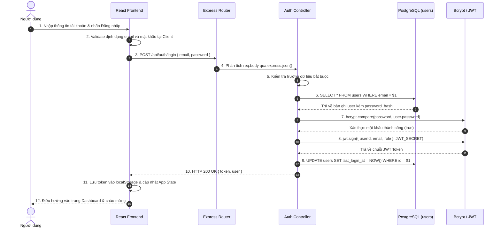

---

## LUỒNG 2: QUẢN LÝ KHÔNG GIAN DỰ ÁN (PROJECT / WORKSPACE MANAGEMENT)
- **Mục tiêu:** Cho phép người dùng khởi tạo, liệt kê, chỉnh sửa thông tin và theo dõi danh sách các dự án làm việc riêng biệt.
- **Thành viên phụ trách:** Thành viên 1
- **Endpoints:** `GET /api/projects`, `POST /api/projects`, `GET /api/projects/:id`, `PUT /api/projects/:id`, `DELETE /api/projects/:id`
- **File mã nguồn liên quan:** `backend/src/controllers/project.controller.js`, `backend/src/models/project.model.js`, `backend/src/migrations/002_create_projects_table.sql`

### Bảng Kịch Bản 12 Bước Kỹ Thuật (Luồng 2)
| Bước | Thành phần thực thi | Hành động & Xử lý kỹ thuật | Dữ liệu đầu vào | Dữ liệu đầu ra / Trạng thái |
| :---: | :--- | :--- | :--- | :--- |
| **1** | Người dùng (Client) | Mở Modal "Tạo dự án mới", nhập Tên dự án, Mã tiền tố (Project Key vd: `AIJIRA`), Mô tả dự án. | Thông tin form dự án | Form state trên React UI |
| **2** | React Validation | Kiểm tra Project Key theo chuẩn Atlassian Jira (2-10 ký tự in hoa, chỉ chứa chữ cái `A-Z`). | Project Key chuỗi thô | Thông báo hợp lệ hoặc lỗi định dạng |
| **3** | Axios Interceptor | Tự động đính kèm Header `Authorization: Bearer <jwt_token>` vào HTTP Request. | Token từ `localStorage` | HTTP Request có gắn Bearer Token |
| **4** | Auth Middleware | Express chặn request, gọi `jwt.verify(token, JWT_SECRET)`, gắn `req.userId` vào request context. | Bearer Token | Context request có `req.userId` |
| **5** | Project Controller | Tiếp nhận `name`, `project_key`, `description` từ `req.body` và lấy `userId` từ middleware. | Dữ liệu tạo dự án | Chuẩn bị dữ liệu Model |
| **6** | PostgreSQL Check Key | Kiểm tra tính duy nhất của Project Key đối với tài khoản: `SELECT id FROM projects WHERE project_key = $1 AND user_id = $2`. | `project_key, user_id` | Kết quả kiểm tra xung đột mã dự án |
| **7** | PostgreSQL Insert | Thực thi câu lệnh `INSERT INTO projects (user_id, name, project_key, description) VALUES (...) RETURNING *`. | Thông tin dự án sạch | Bản ghi Project mới được lưu trữ |
| **8** | DB Event Log | Ghi log khởi tạo dự án và thiết lập cấu hình mặc định ban đầu cho project mới. | `project_id, user_id` | Dữ liệu log khởi tạo |
| **9** | Express Response | Trả về HTTP 201 Created kèm dữ liệu chi tiết của Project vừa khởi tạo. | Project Object mới tạo | HTTP Response 201 |
| **10** | React State Dispatch | Cập nhật mảng danh sách dự án `projectsList` trong React State (immutability update). | New Project Data | Danh sách dự án trên UI được refresh |
| **11** | UI Notification | Đóng Modal và kích hoạt Toast Message: *"Dự án [AIJIRA] đã được tạo thành công!"*. | Trạng thái thành công | Toast notification hiển thị 3 giây |
| **12** | Workspace Navigation | Tự động chọn dự án mới làm Active Workspace và tải các thông tin phụ trợ tương ứng. | `activeProjectId` | Điều hướng vào Workspace chi tiết của dự án |

### Sơ đồ Tuần tự (Sequence Diagram - Luồng 2)
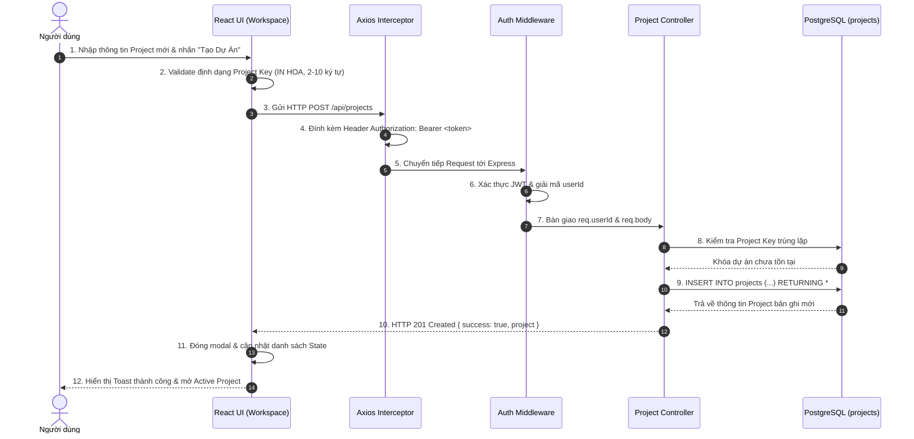

---

## LUỒNG 3: QUẢN LÝ KHO LƯU TRỮ KHÓA BẢO MẬT (API KEY & INTEGRATION VAULT)
- **Mục tiêu:** Cấu hình và lưu trữ bảo mật các khóa tích hợp bên ngoài (Jira Domain, Jira Email, Jira API Token, Gemini API Key, Webhook URL) bằng thuật toán mã hóa đối xứng AES-256-CBC.
- **Thành viên phụ trách:** Thành viên 1
- **Endpoints:** `GET /api/config`, `PUT /api/config`, `DELETE /api/config`
- **File mã nguồn liên quan:** `backend/src/controllers/config.controller.js`, `backend/src/models/config.model.js`, `backend/src/migrations/003_create_configurations_table.sql`

### Bảng Kịch Bản 12 Bước Kỹ Thuật (Luồng 3)
| Bước | Thành phần thực thi | Hành động & Xử lý kỹ thuật | Dữ liệu đầu vào | Dữ liệu đầu ra / Trạng thái |
| :---: | :--- | :--- | :--- | :--- |
| **1** | Người dùng (Client) | Truy cập tab "Cấu hình Tích hợp", nhập Jira Domain (`https://example.atlassian.net`), Email, API Token, Gemini API Key. | Form thiết lập tích hợp | State form cấu hình trên UI |
| **2** | React Sanitizer | Chuẩn hóa dữ liệu: xóa dấu gạch chéo cuối domain, loại bỏ khoảng trắng thừa đầu cuối key. | Raw Strings | Chuỗi dữ liệu chuẩn hóa |
| **3** | Client Request | Gửi HTTP PUT `/api/config` kèm JWT token qua Axios. | Sanitized Configuration | HTTP PUT Request |
| **4** | Auth Middleware | Xác thực phiên đăng nhập, trích xuất `req.userId`. | JWT Header | `req.userId` xác thực |
| **5** | Config Controller | Kiểm tra format Jira Domain (phải có dạng `.atlassian.net` hoặc HTTP URL hợp lệ). | `req.body` | Dữ liệu hợp lệ để mã hóa |
| **6** | Crypto Encryption Engine | Sử dụng module `crypto` của Node.js tạo Initialization Vector (`crypto.randomBytes(16)`), mã hóa dữ liệu với AES-256-CBC. | Plaintext Key & `ENCRYPTION_KEY` | Chuỗi ciphertext (`iv:encrypted_data`) |
| **7** | PostgreSQL Upsert | Thực thi câu lệnh lưu trữ Upsert vào bảng `configurations`: `INSERT INTO configurations ... ON CONFLICT (user_id) DO UPDATE...`. | Encrypted tokens & user_id | Dữ liệu đã lưu an toàn vào DB |
| **8** | DB Integrity Verification | Xác nhận số dòng ảnh hưởng (`rowCount === 1`), đảm bảo dữ liệu ghi thành công. | DB Response | Trạng thái ghi dữ liệu |
| **9** | Token Masking Process | Tạo bản sao dữ liệu an toàn để phản hồi: Che dấu token, chỉ hiển thị 4 ký tự cuối (vd: `••••••••••••a1b2`). | Ciphertext / Plaintext | Masked Configuration DTO |
| **10** | Express Response | Phản hồi HTTP 200 OK kèm thông tin cấu hình đã mask, không bao giờ lộ raw secret ra ngoài. | Masked Config Data | HTTP Response an toàn |
| **11** | React State Update | Lưu trạng thái cấu hình `isConfigured = true`, hiển thị huy hiệu "Đã kết nối Jira & AI". | Response data | UI hiển thị trạng thái kết nối xanh |
| **12** | User Feedback | Kích hoạt hiệu ứng visual xác nhận và mở khóa các tính năng phụ thuộc (Phân tích AI, Đẩy Jira). | Trạng thái tích hợp sẵn sàng | Các nút chức năng AI và Jira được kích hoạt |

### Sơ đồ Tuần tự (Sequence Diagram - Luồng 3)
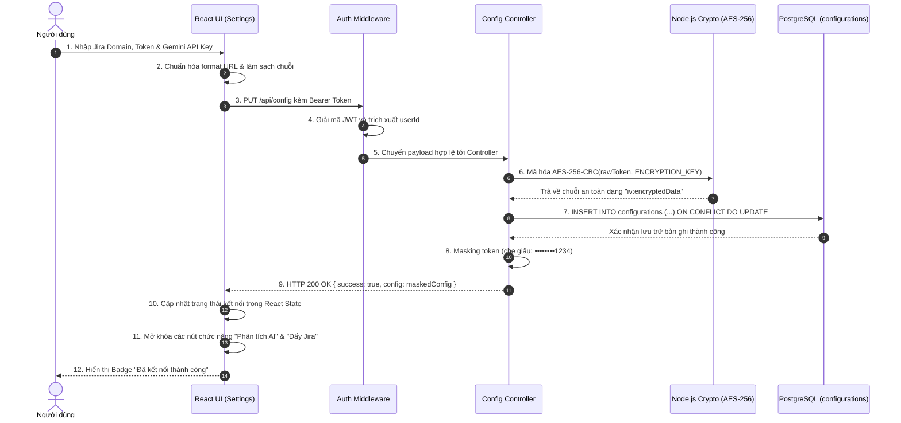

---

## LUỒNG 4: PHÂN TÍCH & BÓC TÁCH YÊU CẦU PHẦN MỀM BẰNG AI (AI REQUIREMENT PARSING)
- **Mục tiêu:** Tiếp nhận văn bản mô tả nghiệp vụ thô của người dùng, phân tích tự động bằng Google Gemini AI (thông qua n8n Workflow) và tạo ra cây phân cấp Epic $\rightarrow$ Story $\rightarrow$ Sub-task chuẩn Agile.
- **Thành viên phụ trách:** Thành viên 2
- **Endpoints:** `POST /api/ai/analyze`
- **File mã nguồn liên quan:** `backend/src/controllers/ai.controller.js`, `backend/src/services/ai.service.js`, `n8n/workflows/flow-4-ai-requirement.json`

### Bảng Kịch Bản 12 Bước Kỹ Thuật (Luồng 4)
| Bước | Thành phần thực thi | Hành động & Xử lý kỹ thuật | Dữ liệu đầu vào | Dữ liệu đầu ra / Trạng thái |
| :---: | :--- | :--- | :--- | :--- |
| **1** | Người dùng (Client) | Nhập đoạn văn bản nghiệp vụ thô (Requirement Text) vào ô soạn thảo và nhấn nút "Phân Tích AI". | Văn bản yêu cầu thô | Sự kiện kích hoạt phân tích |
| **2** | React Frontend | Kiểm tra độ dài văn bản ($\ge 20$ ký tự để đảm bảo đủ ngữ cảnh phân tích), bật cờ Loading Spinner. | Requirement text | Trạng thái `isLoading = true` trên UI |
| **3** | Client Request | Gửi HTTP POST tới `/api/ai/analyze` kèm payload `{ requirement, projectId }`. | Payload & JWT | HTTP Request |
| **4** | Auth & Context Retrieval | Backend xác thực user, truy vấn bảng `configurations` để lấy Gemini API Key (giải mã AES-256). | `userId, projectId` | Plaintext Gemini API Key |
| **5** | n8n Webhook Dispatch | Backend gửi HTTP POST tới n8n Workflow Webhook `/webhook/ai-requirement` kèm payload JSON. | Requirement & API Key | Trigger n8n Workflow 4 |
| **6** | n8n Input Validator | n8n kiểm tra tính toàn vẹn của body, kiểm tra API key và chuẩn bị System Prompt chuyên sâu. | n8n Webhook Payload | Structured Prompt Payload |
| **7** | Google Gemini API Call | n8n gọi Gemini 2.0 / 3.5 Flash với chế độ `jsonOutput: true`, ép trả về schema 3 tầng. | Structured Prompt | JSON Output từ Gemini AI |
| **8** | n8n Clean & Sanitize | n8n lọc bỏ các ký tự Markdown backticks (nếu có), validate cấu trúc JSON bằng Javascript Code Node. | Raw AI response | Cây JSON Epics chuẩn tắc |
| **9** | n8n Respond to Webhook | n8n hoàn tất quy trình và gửi HTTP 200 kèm mảng Epics hoàn chỉnh về lại Express Backend. | Clean Epics Tree | Express nhận phản hồi từ n8n |
| **10** | Backend Post-Processing | Express tính toán bổ sung tổng số Story Points dự kiến, tổng số Task và chuẩn hóa định dạng. | Epics Tree từ n8n | DTO cây phân cấp hoàn chỉnh |
| **11** | Express HTTP Response | Trả về HTTP 200 OK cho React Frontend kèm cấu trúc cây phân cấp đã hoàn thiện. | Enriched Hierarchy Data | HTTP Response 200 |
| **12** | React State Render | Tắt Spinner, cập nhật cây dữ liệu vào React State, tự động chuyển người dùng sang màn hình Duyệt cây yêu cầu. | Tree Data | Giao diện Cây phân cấp xuất hiện |

### Sơ đồ Tuần tự (Sequence Diagram - Luồng 4)
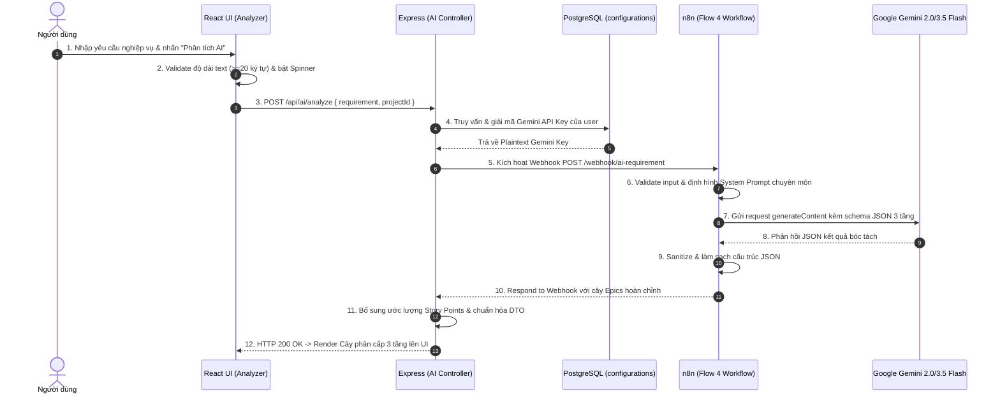

---

## LUỒNG 5: HIỂN THỊ TRỰC QUAN CÂY PHÂN CẤP YÊU CẦU (INTERACTIVE HIERARCHY TREE VIEW)
- **Mục tiêu:** Trực quan hóa cấu trúc 3 tầng (Epic $\rightarrow$ User Story $\rightarrow$ Sub-task) thành sơ đồ cây tương tác có khả năng thu gọn/mở rộng, phân biệt màu sắc cấp độ và hiển thị huy hiệu trạng thái.
- **Thành viên phụ trách:** Thành viên 2
- **Endpoints:** Tích hợp trực tiếp trên Frontend dựa trên dữ liệu từ Luồng 4 hoặc `GET /api/projects/:id`
- **File mã nguồn liên quan:** `frontend/src/components/ai/RequirementAnalyzer.jsx`, `frontend/src/pages/ProjectDetailPage.jsx`

### Bảng Kịch Bản 12 Bước Kỹ Thuật (Luồng 5)
| Bước | Thành phần thực thi | Hành động & Xử lý kỹ thuật | Dữ liệu đầu vào | Dữ liệu đầu ra / Trạng thái |
| :---: | :--- | :--- | :--- | :--- |
| **1** | React Component Mount | Component `RequirementAnalyzer` nhận `treeData` từ Props hoặc State sau khi AI bóc tách. | `treeData` object | Khởi tạo component |
| **2** | State Flattening & Indexing | Hệ thống tạo mảng chỉ mục phẳng và gắn định danh tạm thời (`tempId`) cho từng node (Epic, Story, Task). | Cấu trúc cây lồng nhau | Tree map với các node có ID duy nhất |
| **3** | Metric Aggregation | Tính toán các chỉ số thống kê tức thời: Tổng số Epics, số Stories, số Sub-tasks và tổng Story Points dự kiến. | Node list | Thống kê KPI tóm tắt |
| **4** | KPI Cards Render | Render các thẻ thống kê tổng quan ở phía trên cùng màn hình (Tổng Epic, Story, Task, Points). | Metric values | Giao diện Header Cards |
| **5** | Expand/Collapse State Init | Khởi tạo bảng trạng thái mở/đóng (`isExpanded`) cho toàn bộ các node, mặc định mở cấp Epic và Story. | Node IDs | Hashmap `{ [nodeId]: boolean }` |
| **6** | Epic Node Render | Render từng khối Epic màu tím đặc trưng kèm Icon, Tiêu đề, Mô tả và nút bấm Thu gọn/Mở rộng. | Epic item data | DOM Elements của cấp Epic |
| **7** | User Story Node Render | Phía dưới mỗi Epic, render các Story con với màu xanh dương, hiển thị Story Points, Độ ưu tiên (Priority Badge). | Story items data | DOM Elements của cấp Story |
| **8** | Sub-task Node Render | Dưới mỗi Story, render các Sub-task thực thi với màu xanh lục, hiển thị thời gian ước tính (Hours). | Sub-task items data | DOM Elements của cấp Sub-task |
| **9** | Member Badge Attachment | Đối với mỗi node, hiển thị Avatar hoặc Tên thành viên được chỉ định phụ trách (Assignee). | Assignee mapping | Assignee Tag trên UI |
| **10** | Toggle Interaction | Người dùng click vào icon mũi tên trên một Epic hoặc Story để đóng/mở nhánh con tương ứng. | Click Event & Node ID | Cập nhật State `isExpanded` |
| **11** | Dynamic Re-calculation | Khi nhánh con bị đóng, hệ thống ẩn các node con với animation mượt mà mà không làm mất dữ liệu trong bộ nhớ. | Toggle State | CSS Transitions & DOM update |
| **12** | Layout Ready for Edit | Cây hiển thị hoàn chỉnh, kích hoạt sẵn các nút tương tác (Sửa, Xóa, Thêm con) sẵn sàng cho Luồng 6. | DOM hoàn chỉnh | Trạng thái sẵn sàng cho Human Review |

### Sơ đồ Tuần tự (Sequence Diagram - Luồng 5)
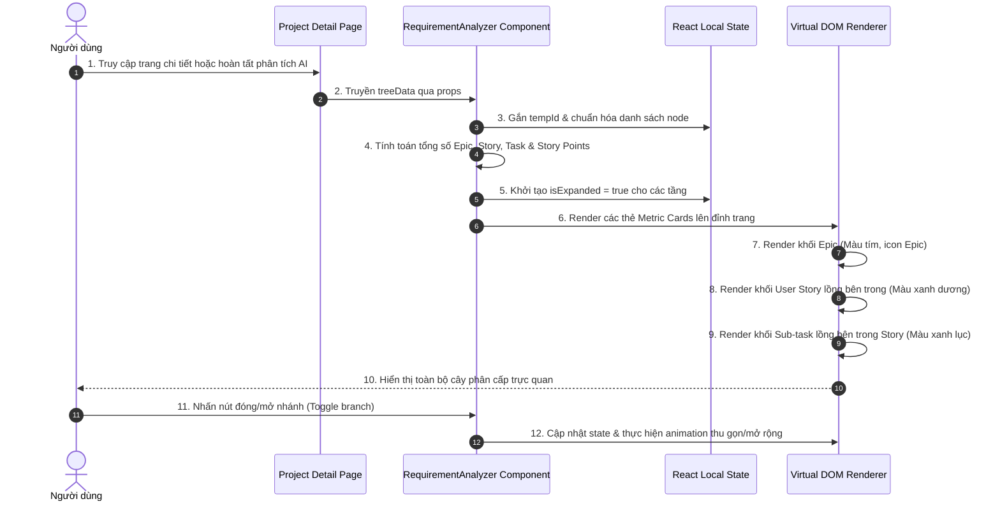

---

## LUỒNG 6: TINH CHỈNH & PHÊ DUYỆT YÊU CẦU (HUMAN-IN-THE-LOOP REVIEW & EDIT)
- **Mục tiêu:** Cung cấp tính năng can thiệp của con người vào kết quả AI: Cho phép sửa đổi tiêu đề, mô tả, thêm/xóa Story hoặc Sub-task, phân bổ lại Story Points và gán người thực hiện trước khi đẩy lên Jira.
- **Thành viên phụ trách:** Thành viên 2
- **Endpoints:** Thực thi trên React State, lưu nháp qua `PUT /api/projects/:id`
- **File mã nguồn liên quan:** `frontend/src/components/ai/RequirementAnalyzer.jsx`, `frontend/src/api/aiApi.js`

### Bảng Kịch Bản 12 Bước Kỹ Thuật (Luồng 6)
| Bước | Thành phần thực thi | Hành động & Xử lý kỹ thuật | Dữ liệu đầu vào | Dữ liệu đầu ra / Trạng thái |
| :---: | :--- | :--- | :--- | :--- |
| **1** | Người dùng (Client) | Click vào nút "Chỉnh sửa" (Icon cây bút) hoặc click trực tiếp vào văn bản tiêu đề/mô tả của một Story. | Click Event | Node kích hoạt chế độ `isEditing = true` |
| **2** | Inline Form Activation | Node chuyển từ chế độ xem (Label) sang ô nhập liệu tương tác (Input Text / Textarea). | Dữ liệu cũ của node | Form chỉnh sửa tại chỗ |
| **3** | User Edit Execution | Người dùng thay đổi nội dung tóm tắt, mô tả yêu cầu hoặc chỉnh sửa tiêu chí chấp nhận (Acceptance Criteria). | Nội dung văn bản mới | Temporary edit state |
| **4** | Priority & Points Adjustment | Người dùng thay đổi Dropdown độ ưu tiên (`Highest`, `High`, `Medium`, `Low`) hoặc thay đổi Story Points (1, 2, 3, 5, 8). | Giá trị Dropdown mới | Cập nhật thuộc tính của Story |
| **5** | Add Child Sub-task | Người dùng nhấn nút "+ Thêm Sub-task" bên dưới Story để bổ sung công việc kỹ thuật cụ thể. | Sự kiện click "+ Sub-task" | Modal/Input tạo Sub-task mới |
| **6** | Delete Redundant Node | Người dùng nhấn nút Thùng rác để xóa bỏ các task hoặc story thừa thãi do AI sinh ra không cần thiết. | Node ID cần xóa | Mở dialog xác nhận xóa |
| **7** | Assignee Selection | Người dùng mở Dropdown thành viên và chọn người phụ trách cho Story/Task (dữ liệu lấy từ Luồng 8). | Member ID / AccountId | Gán `assigneeId` vào node |
| **8** | Save Node Changes | Người dùng click dấu tick xanh (Save) hoặc nhấn phím `Enter` để lưu thay đổi cho node. | Save event | Thoát chế độ edit, cập nhật object |
| **9** | Client Tree Immutability Update | React State cập nhật cây dữ liệu theo cơ chế bất biến (Immutable State Update), đảm bảo UI re-render chính xác. | Cây dữ liệu mới | Cây dữ liệu trong State được đồng bộ |
| **10** | Recalculate Project Metrics | Tự động tính lại tổng điểm Story Points của Epic cha và tổng Story Points của toàn bộ dự án. | Updated node tree | Dashboard metrics được làm mới |
| **11** | Validation Gate Check | Hệ thống kiểm tra điều kiện phê duyệt: Tất cả các node phải có tiêu đề, không để trống nội dung. | Toàn bộ cây dữ liệu | Boolean `isValidForPush` |
| **12** | Approval & Readiness State | Nút "Phê duyệt & Đẩy lên Jira" chuyển sang trạng thái Active (Màu xanh lá rực rỡ), sẵn sàng cho Luồng 7. | Ready State | Nút "Đẩy lên Jira" được mở khóa |

### Sơ đồ Tuần tự (Sequence Diagram - Luồng 6)
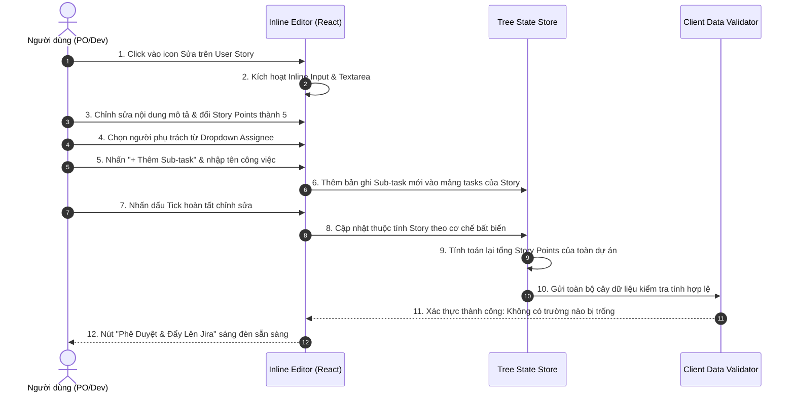

---

## LUỒNG 7: ĐẨY DỮ LIỆU CÂY PHÂN CẤP LÊN JIRA CLOUD (AUTOMATED JIRA BATCH PUSH)
- **Mục tiêu:** Tự động tạo cấu trúc cha - con 3 tầng trên Jira Cloud thông qua n8n Workflow, tạo Epic $\rightarrow$ tạo Story gắn parent Epic $\rightarrow$ tạo Subtask gắn parent Story, và lưu vết vào CSDL nội bộ.
- **Thành viên phụ trách:** Thành viên 3
- **Endpoints:** `POST /api/jira/push`
- **File mã nguồn liên quan:** `backend/src/controllers/jira.controller.js`, `backend/src/services/jira.service.js`, `n8n/workflows/flow-7-push-to-jira.json`, `backend/src/models/jiraIssue.model.js`

### Bảng Kịch Bản 12 Bước Kỹ Thuật (Luồng 7)
| Bước | Thành phần thực thi | Hành động & Xử lý kỹ thuật | Dữ liệu đầu vào | Dữ liệu đầu ra / Trạng thái |
| :---: | :--- | :--- | :--- | :--- |
| **1** | Người dùng (Client) | Nhấn nút "Đẩy Lên Jira" (Push to Jira) trên thanh công cụ sau khi đã duyệt cây dữ liệu. | Sự kiện Click | Mở dialog xác nhận đẩy Jira |
| **2** | React Payload Builder | Thu thập dữ liệu: `projectId`, `projectKey`, toàn bộ mảng `epics` đã chuẩn hóa, bật màn hình chờ Tiến trình. | Tree state | Payload `{ projectId, projectKey, epics }` |
| **3** | Client Request | Gửi HTTP POST tới `/api/jira/push` kèm Header `Authorization: Bearer <token>`. | Payload đẩy Jira | Request tới Express |
| **4** | Express Auth & Vault Decrypt | Backend xác thực user, truy vấn bảng `configurations` lấy `jiraDomain`, `jiraEmail`, `jiraApiToken` (giải mã AES-256). | `req.userId` | Thông tin kết nối Jira đầy đủ |
| **5** | n8n Webhook Invocation | Backend chuyển tiếp toàn bộ payload kèm thông tin xác thực Jira sang n8n Webhook `/webhook/push-to-jira`. | Credentials & Epics Tree | Trigger n8n Workflow 7 |
| **6** | n8n Input Verification | n8n kiểm tra kết nối, định dạng Basic Auth (`jiraEmail:jiraApiToken` Base64) và chuẩn bị danh sách Epics. | n8n payload | Chuẩn bị vòng lặp Batch |
| **7** | n8n Loop Level 1 (Epics) | n8n gọi Jira REST API `POST /rest/api/2/issue` tạo Issue type `Epic`, nhận về `epicKey` (vd: `PROJ-101`). | Epic data | Jira Epic Issue Key |
| **8** | n8n Loop Level 2 (Stories) | Duyệt từng Story thuộc Epic, gọi Jira API tạo Issue type `Story` với `parent: { key: epicKey }`, nhận `storyKey`. | Story data & `epicKey` | Jira Story Issue Key |
| **9** | n8n Loop Level 3 (Sub-tasks) | Duyệt từng Task thuộc Story, gọi Jira API tạo Issue type `Sub-task` với `parent: { key: storyKey }`, nhận `taskKey`. | Sub-task data & `storyKey` | Jira Subtask Issue Key |
| **10** | n8n Aggregation & Respond | n8n gom toàn bộ danh sách kết quả (Key, ID, URL, Type) và trả HTTP 200 về cho Express Backend. | Created issues array | Phản hồi tổng kết từ n8n |
| **11** | PostgreSQL Batch Insert | Express lặp qua danh sách issues được tạo, lưu vào bảng `jira_issues` (gắn `project_id`, `issue_key`, `issue_type`, `parent_key`). | Created issues list | Dữ liệu Jira được lưu vào CSDL nội bộ |
| **12** | React Feedback & Links | Express phản hồi 200, React hiển thị Modal thành công kèm danh sách liên kết trực tiếp (`https://domain.atlassian.net/browse/KEY`). | Success response & URLs | Người dùng có thể click xem ngay trên Jira |

### Sơ đồ Tuần tự (Sequence Diagram - Luồng 7)
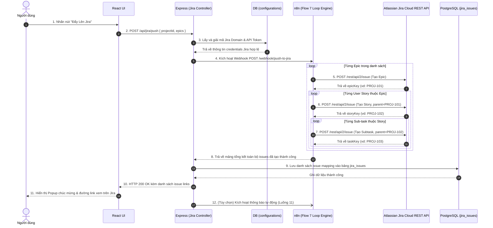

---

## LUỒNG 8: ĐỒNG BỘ DANH SÁCH THÀNH VIÊN DỰ ÁN JIRA (FETCH & MAP JIRA MEMBERS)
- **Mục tiêu:** Truy vấn danh sách tài khoản hợp lệ từ dự án Jira Cloud của người dùng để nạp vào danh sách phân công (Assignee Dropdown) trên giao diện.
- **Thành viên phụ trách:** Thành viên 3
- **Endpoints:** `GET /api/jira/members?project=KEY`
- **File mã nguồn liên quan:** `backend/src/controllers/jira.controller.js`, `backend/src/services/jira.service.js`, `frontend/src/api/jiraApi.js`

### Bảng Kịch Bản 12 Bước Kỹ Thuật (Luồng 8)
| Bước | Thành phần thực thi | Hành động & Xử lý kỹ thuật | Dữ liệu đầu vào | Dữ liệu đầu ra / Trạng thái |
| :---: | :--- | :--- | :--- | :--- |
| **1** | React Component (Mount) | Khi người dùng mở trang Dự án, hook `useEffect` kích hoạt yêu cầu lấy danh sách thành viên Jira có thể phân công. | `projectKey` hiện tại | Sự kiện tải danh sách thành viên |
| **2** | Client API Request | Gửi HTTP GET `/api/jira/members?project=PROJECT_KEY` kèm Authorization Bearer token. | Query `project` & JWT | HTTP GET Request |
| **3** | Auth Middleware | Express giải mã token, xác minh quyền hạn truy cập của người dùng đối với dự án. | JWT Header | `req.userId` đã xác thực |
| **4** | Jira Service | Gọi hàm `JiraService.getMembers(userId, projectKey)`. | `userId, projectKey` | Chuyển tiếp sang tầng nghiệp vụ |
| **5** | Vault Config Query | Truy vấn bảng `configurations`, giải mã `jiraDomain`, `jiraEmail`, `jiraApiToken`. | `userId` | Plaintext Jira Credentials |
| **6** | Jira Cloud API Request | Tạo Axios request gửi tới Atlassian: `GET https://{domain}/rest/api/3/user/assignable/search?project={projectKey}` kèm Basic Auth. | URL & Basic Auth Header | Request tới Jira Cloud |
| **7** | Jira Cloud Processing | Atlassian Jira xác thực request, lọc danh sách người dùng có quyền được assign task trong project này. | Request credentials | Danh sách tài khoản từ Atlassian |
| **8** | Response Filtering | Nhận mảng người dùng từ Jira, lọc bỏ các tài khoản dạng ứng dụng/bot (`accountType !== 'atlassian'`) và tài khoản không hoạt động (`active === true`). | Raw Jira user list | Danh sách thành viên hợp lệ |
| **9** | Member DTO Mapping | Chuyển đổi dữ liệu sang format gọn nhẹ: `{ accountId, displayName, emailAddress, avatarUrl }`. | Valid Atlassian accounts | Mảng thành viên chuẩn hóa |
| **10** | Express HTTP Response | Phản hồi HTTP 200 OK kèm danh sách thành viên đã lọc về cho Frontend. | Member list DTO | HTTP Response 200 |
| **11** | React State Storage | Lưu danh sách vào React State hoặc React Context (`projectMembers`), sẵn sàng sử dụng ở nhiều component. | Members array | `projectMembers` trong State |
| **12** | Dropdown Population | Tự động điền danh sách thành viên kèm ảnh đại diện vào tất cả các ô chọn Assignee trên cây yêu cầu. | Member options | Dropdown có đầy đủ danh sách thành viên |

### Sơ đồ Tuần tự (Sequence Diagram - Luồng 8)
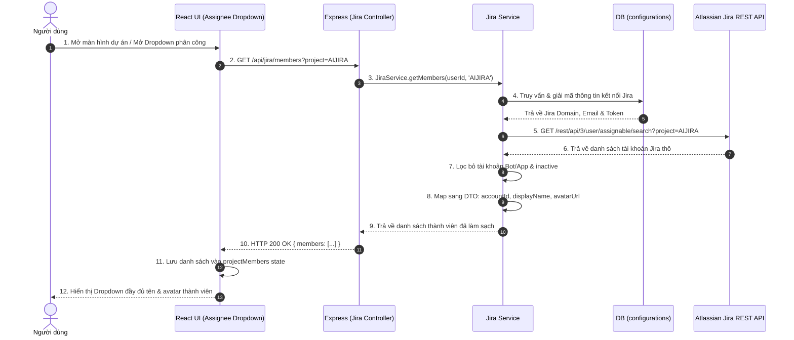

---

## LUỒNG 9: ĐỒNG BỘ TRẠNG THÁI NGƯỢC QUA WEBHOOK JIRA (BI-DIRECTIONAL JIRA SYNC)
- **Mục tiêu:** Lắng nghe sự kiện chuyển trạng thái công việc từ Jira Cloud khi Lập trình viên cập nhật trên Jira Board (vd: To Do $\rightarrow$ In Progress $\rightarrow$ Done), tự động cập nhật CSDL hệ thống để phản ánh tiến độ chính xác.
- **Thành viên phụ trách:** Thành viên 3
- **Endpoints:** `POST /api/jira/webhook-sync`, `POST /api/webhooks/jira-sync`, `GET /api/jira/synced-issues`
- **File mã nguồn liên quan:** `backend/src/controllers/jira.controller.js`, `backend/src/models/jiraIssue.model.js`, `backend/src/routes/jira.routes.js`

### Bảng Kịch Bản 12 Bước Kỹ Thuật (Luồng 9)
| Bước | Thành phần thực thi | Hành động & Xử lý kỹ thuật | Dữ liệu đầu vào | Dữ liệu đầu ra / Trạng thái |
| :---: | :--- | :--- | :--- | :--- |
| **1** | Developer trên Jira Cloud | Kéo một thẻ công việc (Issue) từ cột "In Progress" sang cột "Done" trên Jira Board. | Hành động kéo thả của Dev | Sự kiện issue transition trên Jira |
| **2** | Atlassian Webhook Engine | Jira phát hiện sự kiện thay đổi dữ liệu, kích hoạt Webhook đã đăng ký với payload `jira:issue_updated`. | Sự kiện cập nhật task | Webhook event payload từ Jira |
| **3** | Inbound HTTP Request | Jira Cloud gửi HTTP POST tới endpoint công khai của hệ thống: `POST /api/webhooks/jira-sync`. | Webhook JSON Body | Gửi tới server Express |
| **4** | Webhook Middleware | Express tiếp nhận request, kiểm tra Webhook Secret hoặc Header chữ ký nếu được cấu hình. | Request Headers & Body | Chuyển tiếp tới Controller |
| **5** | Event Parser | Jira Controller trích xuất thông tin trọng tâm: `issue.key`, `issue.fields.status.name`, `changelog.items`. | Raw Webhook payload | Thông tin `{ issueKey, newStatus, changelog }` |
| **6** | Event Filter | Kiểm tra xem sự kiện có thực sự làm thay đổi trạng thái (`status`) hay không; nếu chỉ sửa text thì bỏ qua. | Changelog items | Quyết định xử lý tiếp hay trả 200 sớm |
| **7** | PostgreSQL Query Issue | Truy vấn bảng `jira_issues` tìm bản ghi tương ứng: `SELECT * FROM jira_issues WHERE issue_key = $1`. | `issueKey` | Bản ghi Issue trong CSDL |
| **8** | PostgreSQL Update Status | Cập nhật trạng thái mới và thời gian đồng bộ: `UPDATE jira_issues SET status = $1, updated_at = NOW() WHERE issue_key = $2`. | `newStatus, issueKey` | Bản ghi được cập nhật trong CSDL |
| **9** | Status History Logging | Ghi nhật ký đồng bộ vào bảng log để phục vụ truy vết kiểm toán tiến độ phát triển. | `issueKey, oldStatus, newStatus` | Dòng nhật ký audit log mới |
| **10** | Immediate Acknowledgment | Gửi ngay phản hồi HTTP 200 OK `{ success: true, message: "Webhook processed" }` về cho Jira để tránh timeout. | Response status 200 | Jira ghi nhận Webhook thành công |
| **11** | Dashboard Invalidation | Đánh dấu cache của Dashboard thuộc project này đã cũ (`invalidate cache`), kích hoạt tính lại KPI. | `projectId` | Cache bị xóa, sẵn sàng tính mới |
| **12** | Client Live Refresh | Khi người dùng mở website, giao diện tự động đồng bộ trạng thái mới của Task (màu xanh lá "Done") mà không cần reload. | Dữ liệu CSDL mới nhất | Giao diện hiển thị tiến độ 100% |

### Sơ đồ Tuần tự (Sequence Diagram - Luồng 9)
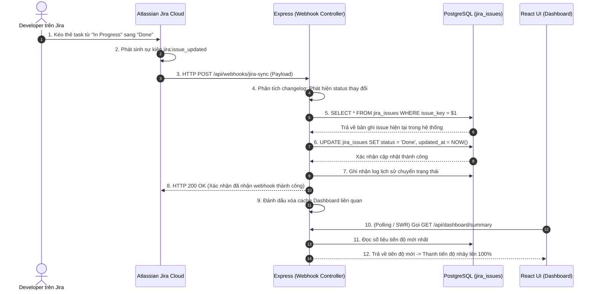

---

## LUỒNG 10: DASHBOARD THỐNG KÊ & BÁO CÁO TIẾN ĐỘ (PROJECT ANALYTICS & METRICS)
- **Mục tiêu:** Cung cấp bức tranh tổng thể về dự án thông qua các biểu đồ phân bổ trạng thái công việc, phân bổ Story Points, tỷ lệ hoàn thành dự án và xu hướng tạo issue.
- **Thành viên phụ trách:** Thành viên 4
- **Endpoints:** `GET /api/dashboard/summary`, `GET /api/dashboard/issue-breakdown`, `GET /api/dashboard/status-distribution`, `GET /api/dashboard/creation-trend`
- **File mã nguồn liên quan:** `backend/src/controllers/dashboard.controller.js`, `backend/src/services/dashboard.service.js`, `backend/src/migrations/005_dashboard_reporting_schema.sql`

### Bảng Kịch Bản 12 Bước Kỹ Thuật (Luồng 10)
| Bước | Thành phần thực thi | Hành động & Xử lý kỹ thuật | Dữ liệu đầu vào | Dữ liệu đầu ra / Trạng thái |
| :---: | :--- | :--- | :--- | :--- |
| **1** | Người dùng (Client) | Click chọn tab "Dashboard Thống Kê" trên thanh điều hướng của dự án. | Tab Click Event | Kích hoạt load trang Dashboard |
| **2** | React State Init | Bật skeleton loading placeholders cho toàn bộ các biểu đồ và card KPI. | Mount state | Hiển thị khung chờ tải dữ liệu |
| **3** | Parallel API Requests | Client phát đồng thời 4 HTTP GET request qua `Promise.all` tới các endpoint phân tích của Dashboard. | `projectId` & Bearer token | 4 HTTP GET Requests |
| **4** | Auth Verification | Middleware Express giải mã JWT và xác thực quyền truy cập dữ liệu của người dùng. | Authorization Header | `req.userId` xác thực |
| **5** | SQL Query: Summary KPI | Thực thi hàm tổng hợp đếm tổng số issues, số Epics, Stories, Tasks và tính tổng Story Points. | `projectId` | Kết quả KPI tổng quan |
| **6** | SQL Query: Status Distribution | Thực thi câu lệnh `GROUP BY status` để tính tỷ lệ các task đang ở trạng thái `To Do`, `In Progress`, `Done`. | `projectId` | Dữ liệu biểu đồ tròn (Pie/Donut) |
| **7** | SQL Query: Type Breakdown | Thực thi câu lệnh phân loại issues theo loại (`Epic`, `Story`, `Sub-task`) và số lượng tương ứng. | `projectId` | Dữ liệu biểu đồ cột (Bar Chart) |
| **8** | Completion Rate Calculation | Backend tính tỷ lệ hoàn thành: $\text{Completion Rate} = \frac{\text{Total Done Issues}}{\text{Total Issues}} \times 100\%$. | Số lượng task Done & Total | Chỉ số phần trăm hoàn thành |
| **9** | Response Assembly | Đóng gói toàn bộ số liệu thống kê vào DTO chuẩn hóa, định dạng nhãn tiếng Việt rõ ràng. | Raw SQL aggregated data | Clean Dashboard Response DTO |
| **10** | Express HTTP Response | Phản hồi HTTP 200 OK cho cả 4 request với thời gian phản hồi nhanh ($<100\text{ms}$). | Dashboard Data | HTTP Responses |
| **11** | Chart Component Binding | React nhận dữ liệu, nạp vào các thư viện biểu đồ (Chart.js / Recharts / SVG Donut). | Dữ liệu thống kê | Vẽ biểu đồ trực quan sinh động |
| **12** | Interactive Tooltip & View | Tắt skeleton loading, render đầy đủ biểu đồ với hiệu ứng hover hiển thị chi tiết số liệu khi di chuột. | Rendered Charts | Giao diện Dashboard hoàn chỉnh |

### Sơ đồ Tuần tự (Sequence Diagram - Luồng 10)
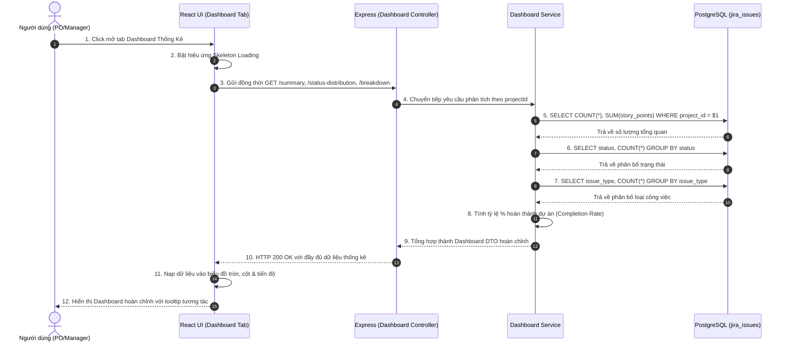

---

## LUỒNG 11: THÔNG BÁO ĐA KÊNH TỰ ĐỘNG (MULTI-CHANNEL NOTIFICATION SYSTEM)
- **Mục tiêu:** Tự động gửi thông báo định dạng đẹp mắt (Rich Card / Block Kit) tới Discord Webhook hoặc Slack Webhook khi có đợt tạo Epic mới thành công trên Jira, đảm bảo cơ chế chống trùng lặp (Idempotency).
- **Thành viên phụ trách:** Thành viên 4
- **Endpoints:** `POST /api/config/test-notification`, `GET /api/config/notifications/history`
- **File mã nguồn liên quan:** `backend/src/services/notification.service.js`, `n8n/workflows/flow-11-epic-notification.json`, `backend/src/tests/test_flow_11.js`

### Bảng Kịch Bản 12 Bước Kỹ Thuật (Luồng 11)
| Bước | Thành phần thực thi | Hành động & Xử lý kỹ thuật | Dữ liệu đầu vào | Dữ liệu đầu ra / Trạng thái |
| :---: | :--- | :--- | :--- | :--- |
| **1** | Event Trigger | Luồng 7 (hoặc nút Test Notification) kích hoạt sự kiện: Đã tạo Epic mới thành công trên Jira. | Thông tin Epic vừa tạo | Sự kiện `jira.epic.created` |
| **2** | Event ID Generation | Tạo mã định danh sự kiện duy nhất dạng UUIDv4: `eventId = "evt_" + crypto.randomUUID()`. | System time & random seed | Chuỗi `eventId` duy nhất |
| **3** | Idempotency Check (DB) | Kiểm tra bảng `notification_events` xem `eventId` đã tồn tại và xử lý thành công chưa. | `eventId` | Trạng thái trùng lặp hay mới |
| **4** | Notification Record Init | Ghi nhận bản ghi sự kiện vào CSDL với trạng thái ban đầu `status = 'pending'`. | Event metadata | Bản ghi lưu vết trong CSDL |
| **5** | Channel & Secret Lookup | Đọc cấu hình kênh thông báo (`discord`, `slack` hoặc `email`) và Webhook URL từ bảng cấu hình. | `userId` | Channel config & Webhook URL |
| **6** | Dispatch to n8n Webhook | Backend gửi HTTP POST tới n8n Workflow 11 với header bí mật `X-Webhook-Secret`. | Payload & Header Secret | Trigger n8n Workflow 11 |
| **7** | n8n Security Verification | n8n kiểm tra `X-Webhook-Secret`; nếu không khớp trả ngay 401 Unauthorized để chống giả mạo. | Request Headers | Kết quả xác thực webhook n8n |
| **8** | n8n Idempotency Guard | n8n kiểm tra biến `processedEvents` trong bộ nhớ workflow tĩnh để tránh bắn tin 2 lần nếu bị retry mạng. | `eventId` | Quyết định tiếp tục hoặc bỏ qua |
| **9** | Rich Payload Formatting | n8n format tin nhắn: Nếu Discord dùng Rich Embed (màu sắc, fields, avatar); nếu Slack dùng Block Kit có nút bấm. | Raw Epic Data | JSON format đặc thù của kênh đích |
| **10** | External Webhook Dispatch | n8n thực hiện HTTP POST đẩy tin nhắn trực tiếp sang Discord Webhook API hoặc Slack Incoming Webhook. | Formatted payload | Gửi tin nhắn qua Internet |
| **11** | External Delivery Confirmation | Discord/Slack phản hồi HTTP 204 No Content hoặc HTTP 200 OK xác nhận đã hiển thị tin nhắn trong channel. | HTTP Response từ Discord/Slack | Kết quả gửi tin thành công |
| **12** | Database Finalization & Audit | n8n phản hồi về Express, Express cập nhật bảng `notification_events` thành `status = 'success'`, lưu log lịch sử. | Execution result | Trạng thái `success` và lịch sử lưu vết |

### Sơ đồ Tuần tự (Sequence Diagram - Luồng 11)
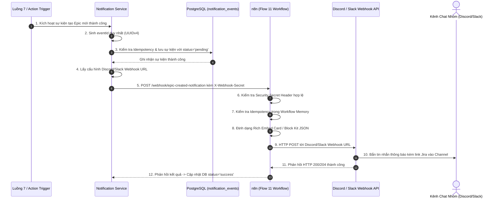

---

## LUỒNG 12: XUẤT BÁO CÁO TÀI LIỆU KỸ THUẬT ĐA ĐỊNH DẠNG (PDF & MARKDOWN EXPORT)
- **Mục tiêu:** Kết xuất toàn bộ cấu trúc phân cấp yêu cầu, bảng phân công nhiệm vụ và số liệu thống kê thành các tài liệu chuyên nghiệp (file Markdown tiêu chuẩn và file PDF hỗ trợ Unicode Tiếng Việt hoàn chỉnh với phông chữ DejaVu Sans).
- **Thành viên phụ trách:** Thành viên 4
- **Endpoints:** `GET /api/projects/:projectId/export?format=pdf|markdown`
- **File mã nguồn liên quan:** `backend/src/controllers/export.controller.js`, `backend/src/services/export.service.js`, `frontend/src/components/project/ExportModal.jsx`, `backend/src/tests/test_flow_12.js`

### Bảng Kịch Bản 12 Bước Kỹ Thuật (Luồng 12)
| Bước | Thành phần thực thi | Hành động & Xử lý kỹ thuật | Dữ liệu đầu vào | Dữ liệu đầu ra / Trạng thái |
| :---: | :--- | :--- | :--- | :--- |
| **1** | Người dùng (Client) | Nhấn nút "Xuất Tài Liệu" (Export), chọn định dạng mong muốn (**PDF Báo Cáo** hoặc **Markdown**) và nguồn dữ liệu. | Tùy chọn form Export | Sự kiện submit export |
| **2** | Client Download Handler | Kích hoạt HTTP GET hoặc POST tới `/api/projects/:projectId/export` với `responseType: 'blob'`. | `format, source, options` | Request tải file dạng nhị phân |
| **3** | Auth & Project Ownership | Express kiểm tra token JWT, xác minh quyền sở hữu dự án của người dùng đối với `projectId`. | Bearer token & `projectId` | Quyền truy cập hợp lệ |
| **4** | Hierarchy Data Retrieval | Truy vấn CSDL trích xuất toàn bộ cấu trúc 3 tầng: Epics $\rightarrow$ Stories $\rightarrow$ Sub-tasks kèm assignee và status. | `projectId, source` | Cây phân cấp hoàn chỉnh từ DB |
| **5** | Format Branching Condition | Controller kiểm tra tham số `format`: Nếu `markdown` chuyển sang Builder Markdown, nếu `pdf` chuyển sang PDFKit Engine. | Query `format` | Định tuyến bộ sinh tài liệu |
| **6** | Markdown Builder (Nếu chọn MD) | Sinh cấu trúc tiêu đề `#`, bảng Markdown, checkbox `- [x]`, bảng tổng kết Story Points và link Jira. | Hierarchy Data | Chuỗi văn bản Markdown UTF-8 |
| **7** | PDF Document Initialization | Khởi tạo thể hiện `new PDFDocument({ margin: 40, size: 'A4' })`, nhúng font chữ tiếng Việt `DejaVuSans.ttf`. | Options trang A4 & Font path | Đối tượng luồng PDFStream |
| **8** | PDF Cover & Metadata Render | Vẽ trang bìa báo cáo chuyên nghiệp: Tên dự án, Mã tiền tố, Tác giả, Ngày kết xuất và bảng chỉ số tóm tắt. | Metadata dự án | Trang bìa PDF hoàn chỉnh |
| **9** | PDF Hierarchy Tables Drawing | Duyệt qua từng Epic/Story/Task: Vẽ tiêu đề có màu nền phân cấp, vẽ bảng chi tiết các nhiệm vụ kỹ thuật. | Cây yêu cầu chi tiết | Các trang nội dung PDF |
| **10** | Auto Page Numbering & Footer | Tính toán tổng số trang, tự động ghi số trang `Trang X / Y` và dòng bản quyền ở chân trang của tất cả các trang. | Toàn bộ trang đã vẽ | Header & Footer chuẩn mực |
| **11** | HTTP Header Configuration | Thiết lập Header phản hồi: `Content-Type: application/pdf` (hoặc `text/markdown`), `Content-Disposition: attachment; filename="..."`. | Tên file xuất bản | HTTP Download Headers |
| **12** | Client Stream & Auto-Download | Trình duyệt nhận luồng nhị phân (Blob), tự động tạo thẻ `<a>` ảo và tải file về máy tính người dùng mà không cần reload trang. | File binary stream | File tải về thư mục Downloads của máy tính |

### Sơ đồ Tuần tự (Sequence Diagram - Luồng 12)
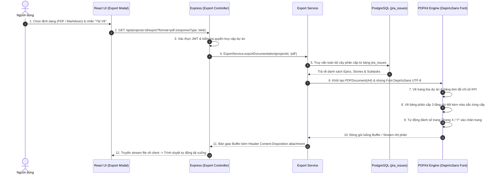

---

## HƯỚNG DẪN BẢO VỆ ĐỒ ÁN TRƯỚC HỘI ĐỒNG GIẢNG VIÊN

Khi trình bày trước giảng viên, nhóm có thể tự tin khẳng định:
1. **Kiến trúc phân rã chuẩn mực:** Toàn bộ hệ thống được chia thành **12 luồng nghiệp vụ độc lập**, tương ứng với từng giai đoạn trong chu trình phát triển phần mềm Agile.
2. **Đầy đủ 12 bước cho từng luồng:** Mỗi luồng đều trải qua chu trình khép kín 12 bước: từ **User Action** $\rightarrow$ **Client Validation** $\rightarrow$ **Security & Auth** $\rightarrow$ **Backend Controller** $\rightarrow$ **Data Vault / DB Query** $\rightarrow$ **Automation / External Services (n8n/Gemini/Jira)** $\rightarrow$ **Audit Logging / Status Sync** $\rightarrow$ **UI Re-render & User Feedback**.
3. **Mỗi thành viên làm chủ trọn vẹn 3 luồng:** 
   - Thành viên 1: Luồng 1, 2, 3 (Nền tảng, Quản trị, Mã hóa).
   - Thành viên 2: Luồng 4, 5, 6 (Xử lý AI, Giao diện phân cấp, Human-in-the-loop).
   - Thành viên 3: Luồng 7, 8, 9 (Tích hợp Jira, Lấy thành viên, Webhook đồng bộ ngược).
   - Thành viên 4: Luồng 10, 11, 12 (Dashboard báo cáo, Thông báo đa kênh, Xuất tài liệu PDF/Markdown).
