# BÁO CÁO NGHIỆM THU TOÀN DIỆN & AUDIT KỸ THUẬT FLOW 10
## DAILY AUTOMATED PROJECT ANALYTICS & DUAL-MODE DASHBOARD ENGINE

* **Dự án:** AI Requirement-to-Jira Agent
* **Công nghệ:** ReactJS + Vite / ExpressJS + NodeJS / PostgreSQL / n8n / Jira Cloud
* **Thời điểm hoàn thành:** 2026-11-05
* **Trạng thái:** ✅ **DONE (HOÀN THÀNH 100% — VERIFIED)**

---

## 1. KIẾN TRÚC TỔNG THỂ (ARCHITECTURE)

Flow 10 được triển khai dưới dạng **Động cơ Phân tích Số liệu & Agile Metrics (Agile Metrics Engine)** hợp nhất duy nhất trong toàn hệ thống, vận hành đồng thời 2 chế độ độc lập trên cùng Canvas n8n:

```mermaid
flowchart TD
    subgraph ModeA["CHẾ ĐỘ A: ON-DEMAND REALTIME ANALYTICS"]
        direction TB
        User["Người dùng mở Web Dashboard"] -->|"GET /api/dashboard/summary"| BE_Pub["Backend Public API (JWT Verified)"]
        BE_Pub -->|"POST /webhook/dashboard-analytics<br/>(Header: X-Flow10-Webhook-Key)"| MAIN01["MAIN 01: Dashboard Webhook Trigger"]
        MAIN01 --> MAIN02["MAIN 02: Request Validation (userId & Key)"]
        MAIN02 --> MAIN03["MAIN 03: Verify Access (Service-to-Service)"]
        MAIN03 --> AUX01["AUX 01: Access Result Router"]
        AUX01 -->|"Allowed"| MAIN04_07["MAIN 04–07: Fetch Summary, Status, Breakdown, Trend"]
        MAIN04_07 --> MAIN08["MAIN 08: Validate Dataset Integrity"]
        MAIN08 --> MAIN09["MAIN 09: Calculate Completion Metrics"]
        MAIN09 --> MAIN10["MAIN 10: Normalize Results DTO"]
        MAIN10 --> MAIN11["MAIN 11: Build Dashboard Response"]
        MAIN11 --> MAIN12["MAIN 12: Respond to Webhook"]
        MAIN12 -->|"JSON Realtime"| BE_Pub
        BE_Pub -->|"Hiển thị biểu đồ sống"| User
    end

    subgraph ModeB["CHẾ ĐỘ B: SCHEDULED DAILY AUTOMATION (08:00 AM)"]
        direction TB
        AUX03["AUX 03: Daily Schedule Trigger<br/>(08:00 Asia/Ho_Chi_Minh)"] -->|"Đúng 08:00 hàng ngày"| AUX04["AUX 04: Trigger Backend Daily Analytics<br/>(HTTP POST Internal API)"]
        AUX04 -->|"POST /api/internal/dashboard/daily-analytics/run<br/>(X-Internal-Service-Key)"| DailyService["Backend DailyAnalyticsService<br/>(Xác thực & Ghi nhận Job)"]
        DailyService -->|"Quét danh sách Project hợp lệ"| ProjectLoop["Vòng lặp từng Project (Fault-Isolation)"]
        ProjectLoop -->|"POST /webhook/dashboard-analytics<br/>(Tái sử dụng lõi tính toán Flow 10)"| MAIN01
        MAIN12 -->|"Nhận kết quả KPI"| ProjectLoop
        ProjectLoop -->|"Tính biến động Delta & Narrative"| FluctuationEngine["Fluctuation Engine<br/>(ΔDone, ΔRate, ΔTotal)"]
        FluctuationEngine -->|"Lưu Snapshot an toàn"| PG_Snapshots[("PostgreSQL:<br/>project_analytics_snapshots")]
        ProjectLoop -->|"Cập nhật trạng thái job"| PG_Jobs[("PostgreSQL:<br/>dashboard_daily_jobs")]
    end

    subgraph HistoryUI["GIAO DIỆN LỊCH SỬ TIẾN ĐỘ TRÊN DASHBOARD"]
        User -->|"Xem lịch sử 7 ngày / 30 ngày"| UI_History["Lịch sử tiến độ & Thống kê tự động (08:00 AM)"]
        UI_History -->|"GET /api/dashboard/snapshots"| PG_Snapshots
        UI_History -->|"Nút Chạy thống kê ngay"| DailyService
    end
```



### Nguyên tắc thiết kế kiến trúc bảo toàn:
1. **Single Source of Truth:** Cả On-demand lẫn Scheduled đều dùng chung bộ 12 MAIN Node tính toán KPI, bảo đảm số liệu thống nhất tuyệt đối.
2. **Database Boundary:** n8n tuyệt đối **không** kết nối trực tiếp vào PostgreSQL. Mọi thao tác lưu snapshot và ghi nhật ký job đều do Backend Express thực hiện.
3. **Loop Prevention:** Không tạo đường dẫn quay vòng n8n $\leftrightarrow$ Backend. Nhánh Scheduler kết thúc ở `AUX 04`, Backend độc lập gọi Webhook `MAIN 01` và không bao giờ gọi lại endpoint `/run`.
4. **Fault Isolation:** Xử lý từng dự án trong khối `try/catch` độc lập. Dự án A lỗi không làm dừng hay ảnh hưởng đến việc snapshot của dự án B và C.

---

## 2. BẢNG PHÂN BỐ VÀ ĐỊNH DANH 16 NODE VẬT LÝ

Workflow [`n8n/workflows/flow-10-dashboard-analytics.json`](file:///home/tmthang/Downloads/ai-jira-agent/n8n/workflows/flow-10-dashboard-analytics.json) chứa **chính xác 16 Node vật lý** (12 MAIN + 4 AUX), Workflow ID: `Flow10DashboardAnalytics`.

| STT | Node Name | Node Type | Vị trí Canvas | Vai trò & Đặc tả kỹ thuật |
| :---: | :--- | :--- | :---: | :--- |
| **01** | `MAIN 01 — Dashboard Webhook Trigger` | `n8n-nodes-base.webhook` | `[-800, 0]` | Endpoint Webhook POST `/webhook/dashboard-analytics`. |
| **02** | `MAIN 02 — Request Validation` | `n8n-nodes-base.if` | `[-550, 0]` | Kiểm tra `userId` hợp lệ và xác thực header `X-Flow10-Webhook-Key` với `$env.FLOW10_WEBHOOK_KEY`. |
| **03** | `MAIN 03 — Project Access Verification` | `n8n-nodes-base.httpRequest` | `[-300, 0]` | Gọi Backend internal API `/api/internal/dashboard/verify-access`. |
| **04** | `MAIN 04 — Fetch Dashboard Summary` | `n8n-nodes-base.httpRequest` | `[200, 0]` | Lấy tổng quan KPIs từ Backend (`$env.BACKEND_INTERNAL_URL`). |
| **05** | `MAIN 05 — Fetch Status Distribution` | `n8n-nodes-base.httpRequest` | `[450, 0]` | Lấy phân bố trạng thái To Do, In Progress, Done. |
| **06** | `MAIN 06 — Fetch Issue Type Breakdown` | `n8n-nodes-base.httpRequest` | `[700, 0]` | Lấy cơ cấu phân loại Epic, Story, Task. |
| **07** | `MAIN 07 — Fetch Issue Creation Trend` | `n8n-nodes-base.httpRequest` | `[950, 0]` | Lấy xu hướng khởi tạo issue theo ngày trong tháng. |
| **08** | `MAIN 08 — Validate Analytics Dataset` | `n8n-nodes-base.if` | `[1200, 0]` | Kiểm tra tính toàn vẹn và hợp lệ của cả 4 tập dữ liệu. |
| **09** | `MAIN 09 — Calculate Completion Metrics` | `n8n-nodes-base.code` | `[1450, 0]` | Tính Completion Rate chuẩn xác; không suy diễn Story Points giả tạo. |
| **10** | `MAIN 10 — Normalize Analytics Results` | `n8n-nodes-base.code` | `[1700, 0]` | Chuẩn hóa DTO, gắn mã màu biểu đồ và nhãn tiếng Việt. |
| **11** | `MAIN 11 — Build Dashboard Response` | `n8n-nodes-base.set` | `[1950, 0]` | Đóng gói JSON trả về đầy đủ các trường dữ liệu. |
| **12** | `MAIN 12 — Respond to Backend` | `n8n-nodes-base.respondToWebhook`| `[2200, 0]` | Phản hồi Webhook HTTP 200/400/401/403/502 cho Backend. |
| **13** | `AUX 01 — Verify Access Result` | `n8n-nodes-base.if` | `[-50, 0]` | Rẽ nhánh: Nếu có quyền $\rightarrow$ `MAIN 04`; Nếu từ chối $\rightarrow$ `AUX 02`. |
| **14** | `AUX 02 — Shared Error Formatter` | `n8n-nodes-base.code` | `[450, 320]` | Bắt lỗi tập trung: 401 (sai/thiếu key), 400 (thiếu param), 403 (cấm quyền), 502 (lỗi dataset). |
| **15** | `AUX 03 — Daily Schedule Trigger (08:00)` | `n8n-nodes-base.scheduleTrigger` | `[-800, 650]` | Kích hoạt tự động chu kỳ 1 ngày lúc 08:00 sáng theo múi giờ `Asia/Ho_Chi_Minh`. |
| **16** | `AUX 04 — Trigger Backend Daily Analytics` | `n8n-nodes-base.httpRequest` | `[-450, 650]` | Gọi POST `/api/internal/dashboard/daily-analytics/run` kèm `reportDate`, `runId`, `X-Internal-Service-Key`. |

---

## 3. CƠ SỞ DỮ LIỆU & SCHEMA CONTRACT

### Bảng 1: `project_analytics_snapshots` (Migration 011)
Lưu trữ từng bản snapshot tiến độ của mỗi dự án theo ngày.
```sql
CREATE TABLE IF NOT EXISTS project_analytics_snapshots (
    id UUID PRIMARY KEY DEFAULT gen_random_uuid(),
    project_id UUID NOT NULL REFERENCES projects(id) ON DELETE CASCADE,
    user_id UUID NOT NULL REFERENCES users(id) ON DELETE CASCADE,
    snapshot_date DATE NOT NULL,
    calculated_at TIMESTAMP WITH TIME ZONE DEFAULT CURRENT_TIMESTAMP,
    total_issues INT NOT NULL DEFAULT 0,
    to_do_issues INT NOT NULL DEFAULT 0,
    in_progress_issues INT NOT NULL DEFAULT 0,
    done_issues INT NOT NULL DEFAULT 0,
    completion_rate NUMERIC(5, 2) NOT NULL DEFAULT 0.00,
    story_points NUMERIC(10, 2),
    completed_story_points NUMERIC(10, 2),
    execution_status VARCHAR(50) NOT NULL DEFAULT 'SUCCESS',
    job_id VARCHAR(100) NOT NULL,
    summary_data JSONB DEFAULT '{}'::jsonb,
    status_distribution JSONB DEFAULT '{}'::jsonb,
    breakdown_data JSONB DEFAULT '{}'::jsonb,
    trend_data JSONB DEFAULT '[]'::jsonb,
    completion_metrics JSONB DEFAULT '{}'::jsonb,
    fluctuations JSONB DEFAULT '{}'::jsonb,
    created_at TIMESTAMP WITH TIME ZONE DEFAULT CURRENT_TIMESTAMP,
    updated_at TIMESTAMP WITH TIME ZONE DEFAULT CURRENT_TIMESTAMP,
    CONSTRAINT uq_project_analytics_snapshot_date UNIQUE (project_id, snapshot_date)
);
```

### Bảng 2: `dashboard_daily_jobs` (Migration 012)
Ghi nhận nhật ký trạng thái của các phiên chạy tự động lúc 08:00 AM.
```sql
CREATE TABLE IF NOT EXISTS dashboard_daily_jobs (
    id UUID PRIMARY KEY DEFAULT gen_random_uuid(),
    report_date DATE NOT NULL,
    run_id VARCHAR(150) NOT NULL UNIQUE,
    trigger_source VARCHAR(100) NOT NULL DEFAULT 'N8N_FLOW_10_DAILY_SCHEDULE',
    status VARCHAR(50) NOT NULL DEFAULT 'running', -- 'running', 'completed', 'partial_failed', 'failed'
    started_at TIMESTAMP WITH TIME ZONE DEFAULT CURRENT_TIMESTAMP,
    finished_at TIMESTAMP WITH TIME ZONE,
    projects_total INT NOT NULL DEFAULT 0,
    projects_succeeded INT NOT NULL DEFAULT 0,
    projects_failed INT NOT NULL DEFAULT 0,
    error_summary TEXT,
    created_at TIMESTAMP WITH TIME ZONE DEFAULT CURRENT_TIMESTAMP,
    updated_at TIMESTAMP WITH TIME ZONE DEFAULT CURRENT_TIMESTAMP
);
```

---

## 4. API CONTRACTS CHI TIẾT

### A. Endpoint Nội bộ (Service-to-Service — Bảo vệ bằng `X-Internal-Service-Key`):
* `POST /api/internal/dashboard/daily-analytics/run`:
  - **Header:** `X-Internal-Service-Key: <INTERNAL_SERVICE_KEY>`
  - **Body:** `{ "triggerSource": "N8N_FLOW_10_DAILY_SCHEDULE", "timezone": "Asia/Ho_Chi_Minh", "reportDate": "2026-11-05", "runId": "flow10-daily-2026-11-05" }`
  - **Phản hồi 200:** Trả về `{ success: true, jobId, totalProjects, succeeded, failed, status: "completed" }`.
* `POST /api/internal/dashboard/verify-access`: Xác thực quyền xem dự án.
* `GET /api/internal/dashboard/summary`: Lấy KPIs tổng quan.
* `GET /api/internal/dashboard/status-distribution`: Lấy phân bố trạng thái To Do, In Progress, Done.
* `GET /api/internal/dashboard/issue-breakdown`: Lấy phân loại Epic, Story, Task.
* `GET /api/internal/dashboard/creation-trend`: Lấy xu hướng tạo issue theo ngày.

### B. Endpoint Công khai (Bảo vệ bằng JWT Bearer Token):
* `GET /api/dashboard/snapshots?projectId=<id>&limit=30`:
  - Trả về mảng snapshots lịch sử (hỗ trợ lọc theo `projectId` hoặc tổng hợp tất cả dự án của người dùng).
* `GET /api/dashboard/snapshots/latest?projectId=<id>`:
  - Trả về snapshot mới nhất kèm đối tượng `fluctuations` (biến động $\Delta\text{Done}$, $\Delta\text{Rate}$, $\Delta\text{Total}$ và câu tóm tắt tiếng Việt `narrative`).
* `POST /api/dashboard/daily-analytics/trigger`:
  - Cho phép người dùng chạy thử thống kê thủ công ngay lập tức từ giao diện Dashboard.

---

## 5. TÍNH NĂNG FRONTEND MỚI BỔ SUNG

Trong [`frontend/src/pages/DashboardPage.jsx`](file:///home/tmthang/Downloads/ai-jira-agent/frontend/src/pages/DashboardPage.jsx), phần **"Lịch sử tiến độ & Thống kê tự động (08:00 AM)"** được tích hợp hoàn chỉnh:
1. **Bộ chọn khoảng thời gian:** 2 nút chuyển đổi nhanh `[7 ngày qua]` và `[30 ngày qua]`.
2. **Nút kích hoạt tức thì:** Nút `Chạy thống kê ngay` cho phép người dùng chạy thử job mà không cần chờ đến 08:00.
3. **Thẻ so sánh biến động tiến độ (Delta Cards):**
   - Biến động số công việc hoàn thành ($\Delta\text{Done}$).
   - Biến động tỷ lệ hoàn thành ($\Delta\text{Rate}$ theo điểm phần trăm).
   - Biến động phạm vi công việc ($\Delta\text{Total Issues}$).
   - Câu nhận xét tiến độ tự động tiếng Việt (ví dụ: *"Tổng số công việc: +2 (2 task mới); Số công việc hoàn thành: +1; Tỷ lệ hoàn thành: +5%"*).
4. **Biểu đồ Cột chồng (Stacked Bar Chart):** Hiển thị trực quan cơ cấu To Do (#64748b), In Progress (#3b82f6) và Done (#10b981) qua từng ngày.
5. **Biểu đồ Đường (Line Chart):** Diễn tiến xu hướng Tỷ lệ hoàn thành (% Completion Rate) từ 0% đến 100%.
6. **Thời gian ghi nhận chuẩn xác:** Hiển thị ngày giờ snapshot theo múi giờ `Asia/Ho_Chi_Minh`.
7. **Bảo toàn bộ lọc:** Khi thay đổi Dự án ở dropdown trên cùng, toàn bộ phần Lịch sử tự động lọc theo dự án được chọn mà không ảnh hưởng biểu đồ realtime.

---

## 6. DANH SÁCH FILE THAY ĐỔI VÀ TẠO MỚI

### A. Tệp tạo mới:
1. [`backend/src/migrations/012_create_dashboard_daily_jobs_table.sql`](file:///home/tmthang/Downloads/ai-jira-agent/backend/src/migrations/012_create_dashboard_daily_jobs_table.sql): Bảng ghi nhận nhật ký các phiên chạy tự động.
2. [`backend/src/models/daily-job.model.js`](file:///home/tmthang/Downloads/ai-jira-agent/backend/src/models/daily-job.model.js): Model tương tác với bảng `dashboard_daily_jobs`.
3. [`docs/FLOW10_DAILY_ANALYTICS_FINAL_AUDIT.md`](file:///home/tmthang/Downloads/ai-jira-agent/docs/FLOW10_DAILY_ANALYTICS_FINAL_AUDIT.md): Báo cáo nghiệm thu toàn diện này.

### B. Tệp chỉnh sửa (Chỉ thuộc phạm vi Flow 10):
1. [`backend/src/config/env.js`](file:///home/tmthang/Downloads/ai-jira-agent/backend/src/config/env.js): Khai báo `FLOW10_WEBHOOK_KEY` và `BACKEND_INTERNAL_URL`.
2. [`backend/.env`](file:///home/tmthang/Downloads/ai-jira-agent/backend/.env): Thêm cấu hình secret và internal URL.
3. [`backend/src/models/snapshot.model.js`](file:///home/tmthang/Downloads/ai-jira-agent/backend/src/models/snapshot.model.js): Thêm hàm `findByUserId` và `findLatestByUserId` phục vụ xem lịch sử tổng hợp.
4. [`backend/src/controllers/dashboard.controller.js`](file:///home/tmthang/Downloads/ai-jira-agent/backend/src/controllers/dashboard.controller.js): Nâng cấp `getSnapshots` và `getLatestSnapshot` hỗ trợ cả dự án cụ thể lẫn toàn bộ dự án.
5. [`backend/src/controllers/internal-dashboard.controller.js`](file:///home/tmthang/Downloads/ai-jira-agent/backend/src/controllers/internal-dashboard.controller.js): Hỗ trợ `reportDate` và `runId` từ n8n AUX 04.
6. [`backend/src/services/daily-analytics.service.js`](file:///home/tmthang/Downloads/ai-jira-agent/backend/src/services/daily-analytics.service.js): Tích hợp `DailyJobModel`, chống trùng theo phiên chạy, ghi nhận lỗi độc lập.
7. [`backend/src/services/dashboard-flow.service.js`](file:///home/tmthang/Downloads/ai-jira-agent/backend/src/services/dashboard-flow.service.js): Gửi kèm header `X-Flow10-Webhook-Key` khi gọi Webhook Flow 10.
8. [`n8n/workflows/flow-10-dashboard-analytics.json`](file:///home/tmthang/Downloads/ai-jira-agent/n8n/workflows/flow-10-dashboard-analytics.json): Workflow 16 node chuẩn hóa với 2 trigger, xác thực header bảo mật, URLs lấy từ cấu hình hệ thống.
9. [`docker-compose.yml`](file:///home/tmthang/Downloads/ai-jira-agent/docker-compose.yml): Cấu hình n8n với `network_mode: host` và các biến môi trường `BACKEND_INTERNAL_URL`, `INTERNAL_SERVICE_KEY`, `FLOW10_WEBHOOK_KEY`, `N8N_BLOCK_ENV_ACCESS_IN_NODE=false`.
10. [`frontend/src/api/dashboardApi.js`](file:///home/tmthang/Downloads/ai-jira-agent/frontend/src/api/dashboardApi.js): Thêm API client methods cho snapshots.
11. [`frontend/src/pages/DashboardPage.jsx`](file:///home/tmthang/Downloads/ai-jira-agent/frontend/src/pages/DashboardPage.jsx): Giao diện lịch sử thống kê, biểu đồ biến động và so sánh tỷ lệ hoàn thành.
12. [`backend/src/tests/test_flow_10.js`](file:///home/tmthang/Downloads/ai-jira-agent/backend/src/tests/test_flow_10.js): Bộ test kiểm tra 12 MAIN + 4 AUX, bảo mật header, và edge cases.
13. [`backend/src/tests/test_flow_10_daily_automation.js`](file:///home/tmthang/Downloads/ai-jira-agent/backend/src/tests/test_flow_10_daily_automation.js): Bộ test kiểm tra toàn diện 15 tiêu chí automation 08:00.

### C. Ràng buộc bảo toàn tuyệt đối:
* **Flow 1–9:** `flow-1` đến `flow-9` trong `n8n/workflows/` giữ nguyên vẹn 100%.
* **Flow 11, 12, 13:** `flow-11-epic-notification.json`, `flow-12-export-documentation.json`, `flow-13-daily-standup-watchdog.json` giữ nguyên vẹn 100%.

---

## 7. BẰNG CHỨNG KIỂM THỬ THỰC TẾ (TEST EVIDENCE)

### A. Kiểm thử Flow 10 Core & Webhook (`test_flow_10.js`):
```text
🎯 KẾT QUẢ KIỂM THỬ LUỒNG 10: 55/55 TESTS PASSED! (100%)
- Xác thực 12 MAIN Nodes + 4 AUX Nodes = 16 Nodes
- Chặn 401 khi thiếu hoặc sai X-Flow10-Webhook-Key
- Chặn 400 khi thiếu userId
- Chặn 403 khi truy cập trái phép Workspace
- Tỷ lệ hoàn thành tính toán chuẩn xác
- Fallback Local Simulation khi n8n offline
```

### B. Kiểm thử Daily Automation 08:00 (`test_flow_10_daily_automation.js`):
```text
🎯 KẾT QUẢ KIỂM THỬ TOÀN BỘ: 69/69 TESTS PASSED! (100%)
- AUX 03 Schedule Trigger: Days=1, Hour=8, Minute=0, Timezone=Asia/Ho_Chi_Minh
- AUX 04 HTTP Request: POST /api/internal/dashboard/daily-analytics/run
- Service-to-Service auth qua X-Internal-Service-Key (chặn 401 khi thiếu/sai secret)
- Quét và thống kê độc lập cho toàn bộ dự án hợp lệ
- Lưu snapshot thành công vào project_analytics_snapshots
- Idempotency: chạy lại cùng ngày không tạo bản ghi trùng lặp
- Tính toán biến động (ΔDone, ΔRate, ΔTotal) và sinh narrative tiếng Việt
- Bảo toàn tuyệt đối Flow 1–9, 11, 12, 13
```

### C. Kiểm thử Bảo toàn Luồng khác (`test_flow_11.js`):
```text
🎯 KẾT QUẢ KIỂM THỬ LUỒNG 11: 46/46 TESTS PASSED! (100%)
- Epic Notification Engine hoạt động ổn định, không bị ảnh hưởng.
```

### D. Kiểm tra Dữ liệu thật trong PostgreSQL:
* Bảng `dashboard_daily_jobs`:
  ```text
  run_id: flow10-daily-2026-11-05-1793850012338 | status: completed | projects_total: 12 | projects_succeeded: 12 | projects_failed: 0
  ```
* Bảng `project_analytics_snapshots`:
  ```text
  12 bản ghi snapshot tương ứng 12 dự án với execution_status: SUCCESS, tính đúng Total Issues, To Do, In Progress, Done, và Completion Rate.
  ```

---

## 8. KẾT LUẬN

Hệ thống Flow 10 đã được nâng cấp và triển khai hoàn chỉnh:
* Đạt chuẩn **duy nhất 1 workflow chính** với **đúng 16 Node vật lý** (12 MAIN + 4 AUX).
* Hỗ trợ đồng thời cả hai chế độ: **On-demand Dashboard thời gian thực** và **Scheduled Daily Analytics tự động lúc 08:00 AM (Asia/Ho_Chi_Minh)**.
* Giao diện Dashboard được trang bị đầy đủ tính năng theo dõi tiến độ lịch sử, so sánh biến động, nhận xét tiếng Việt và biểu đồ chuyên nghiệp.
* **Nghiệm thu: ĐẠT 100% TIÊU CHÍ.**

