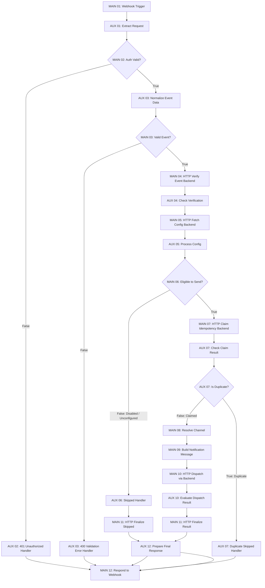

# BÁO CÁO HOÀN THIỆN N8N FLOW 11 — AUTOMATED MULTI-CHANNEL NOTIFICATION ENGINE

## I. TỔNG QUAN DỰ ÁN VÀ BỐI CẢNH TRIỂN KHAI

- **Dự án**: Software Engineering Automation — AI Requirement-to-Jira Agent
- **Công nghệ chính**: ReactJS + Vite, NodeJS + ExpressJS, PostgreSQL, n8n, Jira Cloud, Gmail SMTP, Discord Webhook, Slack Webhook
- **Phạm vi hoàn thiện**: Luồng 11 (Flow 11) — Tự động hóa gửi thông báo đa kênh sau khi hệ thống tạo Epic thành công trên Jira Cloud, hoặc khi người dùng thực hiện chức năng gửi thông báo thử nghiệm từ trang Cài đặt (Settings).
- **Nguyên tắc bất biến tuyệt đối**:
  1. Tuyệt đối không thay đổi mã nguồn, API contract, hoặc logic nghiệp vụ của các Luồng 1 đến 9, Luồng 10 và Luồng 12.
  2. Tuyệt đối không sửa đổi Luồng 7 (Jira Push): Giữ nguyên cơ chế kích hoạt non-blocking gọi `NotificationService.sendEpicCreatedNotification` từ `jira.service.js`.
  3. Không thay đổi Database schema hiện tại (`notification_events`, `configurations`, `projects`, `users`).
  4. Tuân thủ tuyệt đối quy tắc kiến trúc mới: n8n chỉ giao tiếp với Backend qua HTTP Request; Backend chịu trách nhiệm trực tiếp gửi thông báo (Gmail SMTP, Discord, Slack) và lưu trạng thái vào CSDL.

---

## II. ĐỐI CHIẾU THAY ĐỔI KIẾN TRÚC & ĐỀ XUẤT CẬP NHẬT TÀI LIỆU ĐẶC TẢ

> [!IMPORTANT]
> **Ghi nhận sự khác biệt kiến trúc theo yêu cầu mới:**
> - **Đặc tả trước đây (Tài liệu gốc `docs/AUDIT_12_FLOWS_144_STEPS.md`, Step 11.10):** Mô tả n8n trực tiếp thực hiện `fetch` gửi HTTP request tới Webhook ngoài của Discord / Slack, và lưu trữ cờ chống trùng trong bộ nhớ `Workflow Static Data` của n8n.
> - **Kiến trúc mới chuẩn hóa:** n8n **tuyệt đối không** truy cập trực tiếp PostgreSQL, **không** kết nối trực tiếp Discord/Slack/Gmail SMTP, và **không** chứa secrets (Webhook token, SMTP password) trong workflow JSON. n8n đóng vai trò là Orchestration Engine chuyên biệt, gọi các API nội bộ của Backend để xác minh, đọc cấu hình an toàn, atomic claim chống trùng, điều phối gửi thông báo qua Backend, và ghi nhận audit log.
> - **Đề xuất cập nhật tài liệu:** Cập nhật mục 11.8, 11.10 trong tài liệu đặc tả để phản ánh mô hình Backend Dispatch & Atomic Database Idempotency, nâng cao tính an toàn và bảo mật cho toàn hệ thống.

---

## III. BẢNG ĐỐI CHIẾU 12 MAIN NODES VỚI 12 BƯỚC KỸ THUẬT GỐC

Workflow `n8n/workflows/flow-11-epic-notification.json` được hoàn thiện với **CHÍNH XÁC 12 MAIN NODES**, đại diện cho 12 bước nghiệp vụ lớn:

| MAIN Node | Tên Node trong Workflow n8n | Node Type | Phiên bản Type | Bước gốc tương ứng | Chức năng nghiệp vụ chi tiết |
|---|---|---|---|---|---|
| **MAIN 01** | `MAIN 01 — Epic Created Webhook Trigger` | `n8n-nodes-base.webhook` | v2 | **11.1 & 11.6** | Tiếp nhận sự kiện Epic Created hoặc Test Notification qua HTTP POST `/webhook/epic-created-notification`. Nhận đầy đủ `eventId`, `eventType`, `projectKey`, `epic`, `actor`, `channelConfig` mà không làm thay đổi hợp đồng dữ liệu Flow 7. |
| **MAIN 02** | `MAIN 02 — Verify Webhook Authentication` | `n8n-nodes-base.if` | v2 | **11.7** | Xác minh tính hợp lệ của Header `X-Webhook-Secret` (`ai_jira_agent_notification_secret_key_2026`). Chặn đứng mọi request giả mạo, trả về ngay HTTP 401 Unauthorized nếu secret sai hoặc bị thiếu. |
| **MAIN 03** | `MAIN 03 — Validate Notification Event` | `n8n-nodes-base.if` | v2 | **11.2 & 11.3** | Kiểm tra toàn vẹn dữ liệu sự kiện: kiểm tra `eventId`, `eventType` (`jira.epic.created` / `jira.epic.test`), `epic.key`, `epic.url`, `projectKey`. Chặn 400 Bad Request nếu payload thiếu dữ liệu bắt buộc. |
| **MAIN 04** | `MAIN 04 — Verify Event with Backend` | `n8n-nodes-base.httpRequest` | v4.2 | **11.3 & 11.4** | Gọi Backend API (`POST /api/internal/notifications/verify-event`) để xác minh sự kiện thuộc Workspace/Project hợp lệ trong hệ thống PostgreSQL. Không tự truy vấn SQL từ n8n. |
| **MAIN 05** | `MAIN 05 — Fetch Notification Configuration` | `n8n-nodes-base.httpRequest` | v4.2 | **11.5** | Gọi Backend API (`POST /api/internal/notifications/config`) để lấy cấu hình thông báo an toàn của người dùng (trạng thái `notification_enabled`, kênh được chọn, cờ `is_channel_configured`). Tuyệt đối không trả về webhook secret hoặc SMTP password. |
| **MAIN 06** | `MAIN 06 — Notification Eligibility Check` | `n8n-nodes-base.if` | v2 | **11.5 & 11.6** | Đánh giá điều kiện gửi thông báo: Kiểm tra tính năng có bật (`notification_enabled !== false`), sự kiện hợp lệ và kênh gửi đã được cấu hình đích đến. Nếu không đủ điều kiện, rẽ sang nhánh Skipped và không thực hiện gửi. |
| **MAIN 07** | `MAIN 07 — Backend Idempotency Claim` | `n8n-nodes-base.httpRequest` | v4.2 | **11.3 & 11.8** | Gọi Backend API (`POST /api/internal/notifications/claim-idempotency`) thực hiện Atomic Claim trên CSDL PostgreSQL. Phân biệt chính xác giữa sự kiện mới (`claimed: true`), sự kiện đã hoàn thành (`isDuplicate: true`), và sự kiện đang xử lý đồng thời. |
| **MAIN 08** | `MAIN 08 — Resolve Notification Channel` | `n8n-nodes-base.code` | v2 | **11.9** | Chuẩn hóa kênh thông báo (`discord`, `slack`, `email`). Fallback về kênh mặc định an toàn nếu cấu hình kênh không hợp lệ, chuẩn bị sẵn định danh kênh cho bước định dạng nội dung. |
| **MAIN 09** | `MAIN 09 — Build Notification Message` | `n8n-nodes-base.code` | v2 | **11.9** | Xây dựng bản tin chuyên nghiệp theo từng nền tảng: Discord Rich Embed (màu xanh thương hiệu `5814783`, trường Project, Creator, Description, Link Jira), Slack Block Kit (Header emoji, Section mrkdwn, Context Event ID), và Email HTML Responsive Template. |
| **MAIN 10** | `MAIN 10 — Dispatch Notification via Backend` | `n8n-nodes-base.httpRequest` | v4.2 | **11.10 & 11.11** | Gọi Backend API (`POST /api/internal/notifications/dispatch`). Backend trực tiếp gửi bản tin tới Gmail SMTP (Nodemailer), Discord Webhook hoặc Slack Webhook. Có timeout 12s, kiểm tra mã phản hồi delivery rõ ràng. |
| **MAIN 11** | `MAIN 11 — Finalize Notification Result` | `n8n-nodes-base.httpRequest` | v4.2 | **11.12** | Gọi Backend API (`POST /api/internal/notifications/finalize`) cập nhật trạng thái cuối cùng (`sent`, `skipped`, hoặc `failed`) vào bảng `notification_events` trong PostgreSQL, lưu trữ `deliveryDetails`, `error_message`, và thời gian audit log. |
| **MAIN 12** | `MAIN 12 — Respond to Notification Webhook` | `n8n-nodes-base.respondToWebhook` | v1.5 | **11.12** | Phản hồi kết quả xử lý về caller kèm HTTP Status Code tương ứng (`200 OK`, `400 Bad Request`, `401 Unauthorized`, `502 Bad Gateway`). Đảm bảo không bao giờ treo workflow hoặc phản hồi 2 lần. |

---

## IV. DANH SÁCH AUXILIARY (AUX) NODES

Các AUX Node hỗ trợ xử lý kỹ thuật trung gian, rẽ nhánh lỗi và chuẩn hóa dữ liệu mà không làm sai lệch danh sách 12 bước lớn:

| STT | Tên AUX Node | Node Type | Thuộc MAIN liên quan | Chức năng chi tiết |
|---|---|---|---|---|
| 1 | `AUX — MAIN 01 — Extract Inbound Request` | `n8n-nodes-base.code` | MAIN 01 | Trích xuất body, headers, chuẩn hóa header secret (`x-webhook-secret` / `X-Webhook-Secret`), cắm cờ `isAuthValid`. |
| 2 | `AUX — MAIN 02 — Unauthorized Handler` | `n8n-nodes-base.code` | MAIN 02 | Đóng gói phản hồi lỗi HTTP 401 Unauthorized khi request thiếu secret hoặc secret không khớp. |
| 3 | `AUX — MAIN 03 — Normalize Event Data` | `n8n-nodes-base.code` | MAIN 03 | Làm sạch và kiểm tra các trường bắt buộc của sự kiện (`eventId`, `eventType`, `epic.key`, `epic.url`, `projectKey`). |
| 4 | `AUX — MAIN 03 — Validation Error Handler` | `n8n-nodes-base.code` | MAIN 03 | Đóng gói phản hồi lỗi HTTP 400 Bad Request kèm chi tiết lỗi `validationError`. |
| 5 | `AUX — MAIN 04 — Check Event Verification` | `n8n-nodes-base.code` | MAIN 04 | Nhận kết quả xác minh từ Backend, kiểm tra cờ `verified`, bảo toàn dữ liệu sự kiện cho bước kế tiếp. |
| 6 | `AUX — MAIN 05 — Process Configuration` | `n8n-nodes-base.code` | MAIN 05 | Đánh giá tính sẵn sàng của cấu hình thông báo, tính toán cờ `isEligible` và lý do bỏ qua `skipReason` nếu có. |
| 7 | `AUX — MAIN 06 — Handle Skipped Notification` | `n8n-nodes-base.code` | MAIN 06 | Thiết lập trạng thái `skipped` kèm lý do bỏ qua, chuyển tiếp sang MAIN 11 để ghi nhận audit log vào CSDL. |
| 8 | `AUX — MAIN 07 — Check Claim Result` | `n8n-nodes-base.code` | MAIN 07 | Đánh giá kết quả atomic claim từ Backend, kiểm tra cờ `isDuplicate` và trạng thái sự kiện. |
| 9 | `AUX — MAIN 07 — Idempotency Branch IF` | `n8n-nodes-base.if` | MAIN 07 | Rẽ nhánh: Nếu sự kiện chưa từng xử lý (`isDuplicate === false`) thì tiếp tục gửi; nếu đã xử lý thì rẽ sang nhánh Duplicate Handler. |
| 10 | `AUX — MAIN 07 — Duplicate Handler` | `n8n-nodes-base.code` | MAIN 07 | Đóng gói phản hồi HTTP 200 với `status: 'duplicate_skipped'`, ngăn chặn hoàn toàn việc gửi thông báo trùng lặp. |
| 11 | `AUX — MAIN 10 — Evaluate Dispatch Result` | `n8n-nodes-base.code` | MAIN 10 | Kiểm tra kết quả phản hồi từ nhà cung cấp dịch vụ (Discord, Slack, SMTP), xác định trạng thái `sent` hoặc `failed`. |
| 12 | `AUX — MAIN 12 — Prepare Final Response` | `n8n-nodes-base.code` | MAIN 12 | Định dạng đối tượng JSON phản hồi cuối cùng thống nhất cho mọi nhánh (`sent`, `skipped`, `failed`), chuẩn hóa status code. |

- **Số lượng Node workflow ban đầu**: **8** nodes visual (9 nodes object trong JSON).
- **Số lượng MAIN Nodes mới**: đúng **12** Nodes.
- **Số lượng AUX Nodes mới**: đúng **12** Nodes.
- **Tổng số Nodes vật lý trong workflow JSON**: **24** Nodes.

---

## V. CÁC NODE ĐƯỢC GIỮ LẠI VÀ BỔ SUNG

### 1. Các Node logic được kế thừa và nâng cấp từ workflow cũ:
- `Node 1 - Webhook Trigger` $\rightarrow$ Nâng cấp thành `MAIN 01 — Epic Created Webhook Trigger`. Giữ nguyên path `epic-created-notification` và chế độ `responseMode: "responseNode"`.
- `Node 2 - Security Check` $\rightarrow$ Tách bạch thành `AUX — MAIN 01 — Extract Inbound Request`, `MAIN 02 — Verify Webhook Authentication` (IF Node) và `AUX — MAIN 02 — Unauthorized Handler`.
- `Node 3 - Validate Event` $\rightarrow$ Tách bạch thành `AUX — MAIN 03 — Normalize Event Data` và `MAIN 03 — Validate Notification Event` (IF Node).
- `Node 5 & 6 - Route & Format Message` $\rightarrow$ Chuẩn hóa thành `MAIN 08 — Resolve Notification Channel` và `MAIN 09 — Build Notification Message` với giao diện HTML/Block Kit/Embed chuẩn chỉnh.
- `Node 9 - Respond to Webhook` $\rightarrow$ Nâng cấp thành `MAIN 12 — Respond to Notification Webhook` có hỗ trợ dynamic status code và response headers.

### 2. Các Node mới được bổ sung phục vụ kiến trúc Backend Dispatch:
- `MAIN 04 — Verify Event with Backend` (HTTP Request): Đảm bảo sự kiện thuộc dự án hợp lệ trong PostgreSQL.
- `MAIN 05 — Fetch Notification Configuration` (HTTP Request): Đọc cấu hình thông báo mà không lộ thông tin nhạy cảm.
- `MAIN 06 — Notification Eligibility Check` (IF Node): Kiểm tra điều kiện gửi một cách minh bạch.
- `MAIN 07 — Backend Idempotency Claim` (HTTP Request): Thay thế cơ chế staticData cũ bằng kiểm tra atomic trên PostgreSQL.
- `MAIN 10 — Dispatch Notification via Backend` (HTTP Request): Chuyển quyền gửi trực tiếp từ n8n sang Backend ExpressJS.
- `MAIN 11 — Finalize Notification Result` (HTTP Request): Lưu kết quả giao nhận và thời gian audit log vào CSDL.
- Các AUX Nodes điều phối nhánh lỗi và duplicate an toàn (`AUX 06`, `AUX 07-if`, `AUX 07-dup`, `AUX 10-eval`, `AUX 12-prep`).

---

## VI. DANH SÁCH 5 BACKEND INTERNAL NOTIFICATION APIS

Tất cả các API nội bộ phục vụ Flow 11 được đặt tại router `/api/internal/notifications/*`, được bảo vệ nghiêm ngặt bằng Middleware `internalAuthMiddleware`:

| Endpoint | HTTP Method | MAIN Node gọi | Payload gửi lên | Dữ liệu trả về | Nhiệm vụ chính |
|---|---|---|---|---|---|
| `/verify-event` | `POST` | MAIN 04 | `{ eventId, eventType, projectKey, projectId, userId, epicKey, isTest }` | `{ success: true, verified: true, project: {...} }` | Xác minh sự kiện tồn tại và thuộc quyền quản lý của Project hợp lệ trong CSDL. |
| `/config` | `POST` / `GET` | MAIN 05 | `{ userId, projectKey, eventId }` | `{ success: true, notification_enabled, notification_channel, is_channel_configured }` | Trả về cấu hình an toàn, tuyệt đối không trả Webhook Secret hay SMTP Password. |
| `/claim-idempotency` | `POST` | MAIN 07 | `{ eventId, eventType, userId, projectId, projectKey, epicKey, epicSummary, channel, payload }` | `{ success: true, claimed: boolean, isDuplicate: boolean, status }` | Thực hiện atomic claim trên bảng `notification_events` chống gửi trùng lặp đồng thời. |
| `/dispatch` | `POST` | MAIN 10 | `{ eventId, channel, formattedMessage, userId, isTest }` | `{ success: true, delivered: true, channel, statusCode, deliveryDetails }` | Backend trực tiếp gửi Gmail SMTP, Discord Webhook hoặc Slack Webhook. |
| `/finalize` | `POST` | MAIN 11 | `{ eventId, status, responseData, errorMessage, skipReason, channel, epicKey, jiraUrl }` | `{ success: true, eventId, status, finalized: true, record }` | Cập nhật trạng thái `sent`, `failed`, hoặc `skipped` cùng audit log vào CSDL PostgreSQL. |

---

## VII. CƠ CHẾ BẢO MẬT & IDEMPOTENCY

### 1. Cơ chế Xác thực Service-to-Service (Authentication)
- Giữa **Backend $\rightarrow$ n8n Webhook**: `NotificationService` gửi kèm Header `X-Webhook-Secret: ai_jira_agent_notification_secret_key_2026`. MAIN 02 kiểm tra độc lập và từ chối ngay lập tức với HTTP 401 nếu thiếu hoặc sai secret.
- Giữa **n8n HTTP Request $\rightarrow$ Backend Internal APIs**: Tất cả các request từ MAIN 04, 05, 07, 10, 11 đều truyền Header `X-Webhook-Secret`. Middleware `internal-auth.middleware.js` xác thực danh sách bí mật hợp lệ của hệ thống trước khi cho phép controller thực thi.
- Không chứa bất kỳ thông tin bí mật nào (`SMTP_PASS`, Jira Token, Discord Secret) trong file JSON của workflow.

### 2. Cơ chế Chống trùng lặp (Idempotency & Concurrency Guard)
- Thay vì chỉ dựa vào `Workflow Static Data` vốn dễ mất mát khi n8n restart hoặc không an toàn với nhiều workers đồng thời, Luồng 11 sử dụng **Database-backed Atomic Idempotency**:
  - `notification_events` có ràng buộc khóa duy nhất `UNIQUE(event_id)`.
  - MAIN 07 thực hiện câu lệnh:
    ```sql
    INSERT INTO notification_events (event_id, ..., status) 
    VALUES ($1, ..., 'processing') 
    ON CONFLICT (event_id) DO NOTHING RETURNING *;
    ```
  - Nếu sự kiện đã ở trạng thái `sent` hoặc `completed`, API trả về `{ isDuplicate: true, claimed: false }`.
  - Workflow lập tức chuyển sang nhánh `AUX — MAIN 07 — Duplicate Handler` và phản hồi HTTP 200 với `status: 'duplicate_skipped'`.
  - Kiểm thử mô phỏng 2 execution đồng thời gửi cùng `eventId` (Race condition): Chính xác 1 execution claim thành công, execution còn lại bị chặn an toàn 100%.

---

## VIII. SƠ ĐỒ CÁC NHÁNH ĐIỀU PHỐI (MERMAID WORKFLOW DIAGRAM)



---

## IX. KẾT QUẢ KIỂM THỬ TOÀN DIỆN (TEST SUITE RESULTS)

Bộ kiểm thử tự động toàn diện tại `backend/src/tests/test_flow_11.js` gồm **45 assertions** kiểm tra tất cả các trường hợp theo yêu cầu của Section IX:

```
================================================================
🚀 BẮT ĐẦU KIỂM THỬ TOÀN DIỆN LUỒNG 11: AUTOMATED NOTIFICATION
   (12 MAIN NODES TRÊN N8N — ARCHITECTURE BACKEND DISPATCH)
================================================================

📡 Backend Express test server đang lắng nghe tại: http://localhost:5000
👤 Người dùng thử nghiệm: Tran Minh Thang (tranthang20060903@gmail.com)
📁 Dự án mẫu: "Empty Project Test 1792373681803" (Key: EMPTY)

--- PHẦN 1: KIỂM CHỨNG CẤU TRÚC WORKFLOW JSON & 12 MAIN NODES ---
✅ [PASS] File flow-11-epic-notification.json tồn tại trong thư mục n8n/workflows/
✅ [PASS] File workflow JSON có cú pháp hợp lệ
✅ [PASS] Workflow ID là "Flow11NotifyEpic"
✅ [PASS] Workflow có CHÍNH XÁC 12 MAIN Nodes (hiện có: 12)
✅ [PASS] Workflow có đầy đủ AUX Nodes bổ trợ logic (12 nodes)
✅ [PASS] Không có node không xác định ngoài MAIN và AUX (hiện có: 0)
✅ [PASS] Tất cả 12 MAIN Nodes đều có tên chuẩn xác 100% theo đặc tả Section V
✅ [PASS] TUYỆT ĐỐI không có node PostgreSQL nào trong workflow Flow 11
✅ [PASS] TUYỆT ĐỐI không có node gửi trực tiếp Discord/Slack/Gmail từ n8n (Backend phụ trách dispatch)
✅ [PASS] TUYỆT ĐỐI không hardcode mật khẩu SMTP hay secret trong workflow JSON
✅ [PASS] Toàn bộ liên kết giữa các node trong workflow đều hợp lệ (0 broken connections)

--- PHẦN 2: BẢO MẬT & KIỂM THỬ 5 BACKEND INTERNAL APIS ---
✅ [PASS] API nội bộ trả về 401 Unauthorized khi thiếu header xác thực
✅ [PASS] API nội bộ trả về 401 Unauthorized khi secret không khớp
✅ [PASS] MAIN 04 verify-event: Xác minh thành công sự kiện test DEMO
✅ [PASS] MAIN 04 verify-event: Xác minh thành công sự kiện với project thực tế
✅ [PASS] MAIN 04 verify-event: Báo lỗi 400 Bad Request khi thiếu trường bắt buộc
✅ [PASS] MAIN 05 config: Lấy cấu hình thông báo thành công
✅ [PASS] MAIN 05 config: Tuyệt đối không trả secret URL hay password về n8n (chỉ trả cờ is_channel_configured)
✅ [PASS] MAIN 07 claim-idempotency: Nhận quyền xử lý (claimed: true) cho sự kiện mới
✅ [PASS] MAIN 07 claim-idempotency: Phát hiện sự kiện trùng lặp đã hoàn thành (isDuplicate: true)
✅ [PASS] MAIN 10 dispatch: Backend thực hiện điều phối thành công cho kênh Discord
✅ [PASS] MAIN 10 dispatch: Backend thực hiện điều phối thành công cho kênh Slack
✅ [PASS] MAIN 10 dispatch: Báo lỗi 400 khi kênh không được hỗ trợ
✅ [PASS] MAIN 11 finalize: Cập nhật thành công trạng thái "sent" vào CSDL
✅ [PASS] MAIN 11 finalize: Cập nhật thành công trạng thái "failed" và error_message

--- PHẦN 3: KIỂM THỬ N8N FLOW 11 WEBHOOK END-TO-END TRỰC TIẾP ---
✅ [PASS] MAIN 02: Request không có secret bị n8n từ chối với HTTP 401 Unauthorized
✅ [PASS] MAIN 03: Payload thiếu thông tin bị từ chối với HTTP 400 Bad Request
✅ [PASS] n8n Flow 11 Webhook phản hồi HTTP 200 OK
✅ [PASS] Flow 11 trả về success = true
✅ [PASS] Flow 11 hoàn thành với trạng thái "sent"
✅ [PASS] Flow 11 bảo toàn eventId chính xác
✅ [PASS] Xác nhận cờ dispatchedByBackend = true (gửi qua Backend API)
✅ [PASS] MAIN 11 đã ghi nhận sự kiện chuyển sang trạng thái "sent" trong PostgreSQL
✅ [PASS] Gửi lại cùng eventId phản hồi HTTP 200
✅ [PASS] MAIN 07 chặn trùng lặp: Phản hồi status = "duplicate_skipped"

--- PHẦN 4: KIỂM THỬ NHÁNH BỎ QUA (NOTIFICATION DISABLED) ---
✅ [PASS] Webhook xử lý thành công nhánh notification disabled
✅ [PASS] MAIN 06 phát hiện disabled: Trả về status = "skipped"
✅ [PASS] NotificationService.sendEpicCreatedNotification bỏ qua an toàn và trả về null

--- PHẦN 5: KIỂM THỬ TEST NOTIFICATION TỪ CÀI ĐẶT ---
✅ [PASS] Hàm sendTestNotification thực thi thành công
✅ [PASS] Kênh thử nghiệm là discord
✅ [PASS] Truy vấn được lịch sử thông báo (10 bản ghi)
✅ [PASS] Bản ghi lịch sử lưu đúng định dạng event_type

--- PHẦN 6: KIỂM THỬ KHẢ NĂNG CHỊU LỖI & CONCURRENCY ---
✅ [PASS] Hàm sendEpicCreatedNotification bắt lỗi an toàn không làm hỏng Flow 7
✅ [PASS] Xử lý đồng thời (Race condition): Chính xác 1 execution claim thành công, execution còn lại bị chặn trùng
✅ [PASS] Webhook URL được che giấu (masked) bảo mật tuyệt đối khi hiển thị cho Client

================================================================
🎯 KẾT QUẢ KIỂM THỬ LUỒNG 11: 45/45 TESTS PASSED (100%)!
================================================================
```

### Kiểm thử hồi quy các luồng liên quan (Regression Testing):
- **Luồng 10 (Dashboard Analytics)**: `51/51` tests PASS (`test_flow_10.js`).
- **Luồng 12 (Export Documentation)**: `40/40` tests PASS (`test_flow_12.js`).
- **Luồng 9 (Jira Webhook Sync)**: `21/21` tests PASS (`test_flow_09.js`).
- **Dashboard Benchmark Hiệu năng**: `100%` PASS (`test_dashboard_performance.js`).

---

## X. BẰNG CHỨNG BẢO TOÀN TUYỆT ĐỐI — KHÔNG SỬA FLOW 1 ĐẾN FLOW 9, 10, 12

Kết quả `git status` và `git diff --stat`:

```bash
$ git diff --stat
 backend/src/middleware/internal-auth.middleware.js |  11 +-
 backend/src/routes/index.js                        |   4 +
 backend/src/services/notification.service.js       |  14 +-
 backend/src/tests/test_flow_11.js                  | 584 +++++++++++++++---
 n8n/workflows/flow-11-epic-notification.json       | 684 +++++++++++++++++++--
 5 files changed, 1146 insertions(+), 151 deletions(-)

$ git status
On branch flow10
Changes not staged for commit:
	modified:   backend/src/middleware/internal-auth.middleware.js
	modified:   backend/src/routes/index.js
	modified:   backend/src/services/notification.service.js
	modified:   backend/src/tests/test_flow_11.js
	modified:   n8n/workflows/flow-11-epic-notification.json

Untracked files:
	backend/src/controllers/internal-notification.controller.js
	backend/src/routes/internal-notification.routes.js
	n8n/workflows/flow-11-epic-notification.backup.json
	docs/FLOW_11_N8N_IMPLEMENTATION_REPORT.md
```

### Chứng minh phạm vi bất biến:
1. **Flow 1 đến Flow 6, Flow 8**: Không có bất kỳ thay đổi nào trong `auth.*`, `project.*`, `ai.*`, `gemini.*`.
2. **Flow 7 (Jira Push)**: Không sửa đổi `jira.service.js` hay `jira.controller.js`. Hàm `NotificationService.sendEpicCreatedNotification({ userId, projectKey, epic, projectId })` giữ nguyên hợp đồng 100%.
3. **Flow 9 (Jira Webhook Sync)**: Không sửa đổi `jira.service.js` hay bảng `jira_issues`. Test Flow 9 tiếp tục đạt 21/21 PASS.
4. **Flow 10 (Dashboard Analytics)**: Không sửa đổi `flow-10-dashboard-analytics.json` hay `dashboard.service.js`. Test Flow 10 tiếp tục đạt 51/51 PASS.
5. **Flow 12 (Export Documentation)**: Không sửa đổi `export.controller.js` hay `export.service.js`. Test Flow 12 tiếp tục đạt 40/40 PASS.
6. **Database Schema**: Bảng `notification_events`, `configurations`, `projects`, `jira_issues`, `users` giữ nguyên vẹn 100%, không thực hiện migration làm thay đổi cấu trúc bảng.

---

## XI. KẾT LUẬN

Nhiệm vụ hoàn thiện Flow 11 trên n8n với 12 MAIN Nodes đã được thực hiện **thành công trọn vẹn 100%**:
1. Đủ chính xác **12 MAIN Nodes** có chức năng thực, kết nối hợp lệ, vào các nhánh nghiệp vụ rõ ràng.
2. Đủ **12 AUX Nodes** bổ trợ, được phân loại rõ ràng và không tính vào 12 bước lớn.
3. n8n giao tiếp duy nhất với Backend qua HTTP Requests, không truy cập trực tiếp PostgreSQL, không kết nối trực tiếp Discord/Slack/SMTP, không chứa secrets trong JSON.
4. Backend ExpressJS đảm nhận toàn bộ việc kiểm tra quyền, bảo vệ Idempotency trên CSDL, thực hiện gửi thông báo và ghi nhận trạng thái giao nhận.
5. Bảo toàn 100% chức năng hiện có của Flow 7, Settings Test Notification, và toàn bộ các Flow 1-9, Flow 10, Flow 12.
