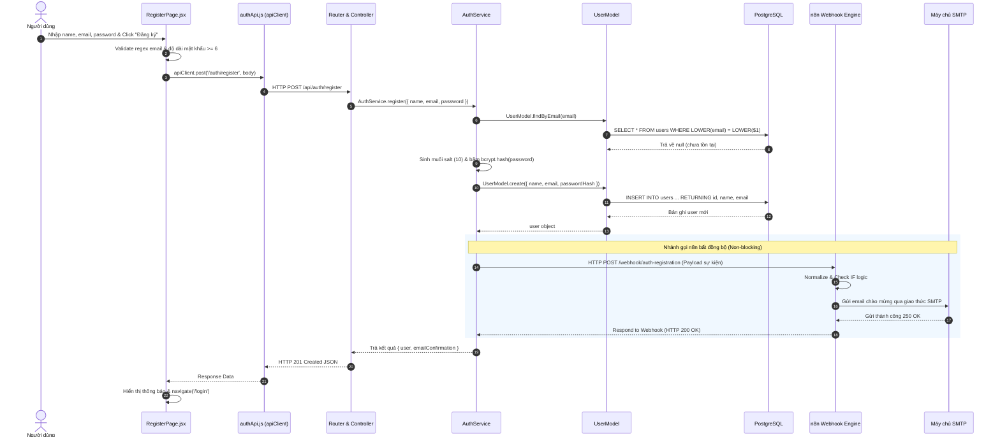
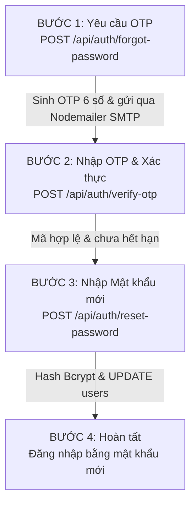
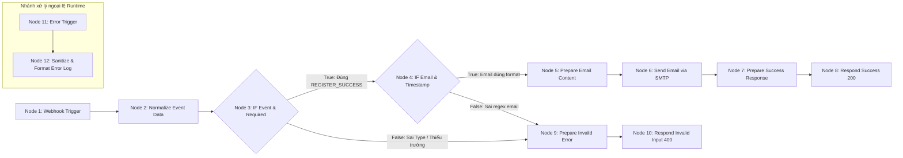
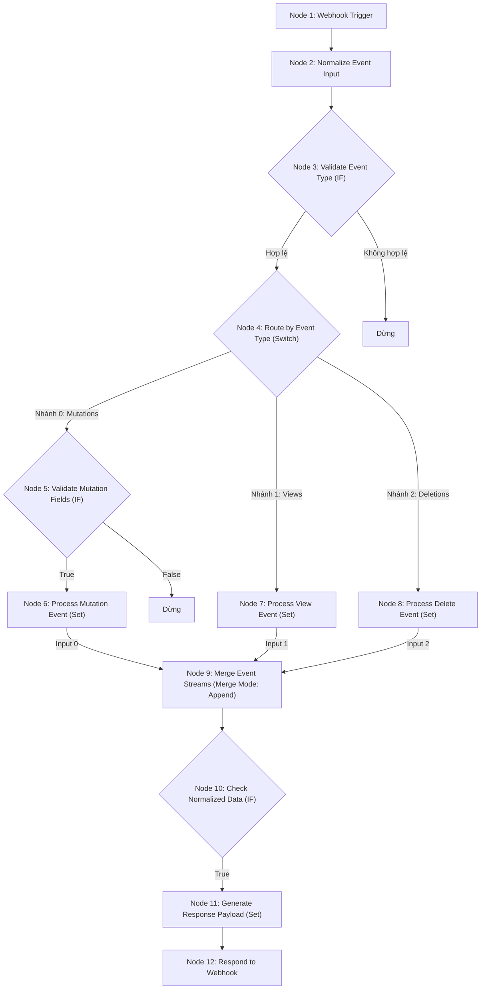
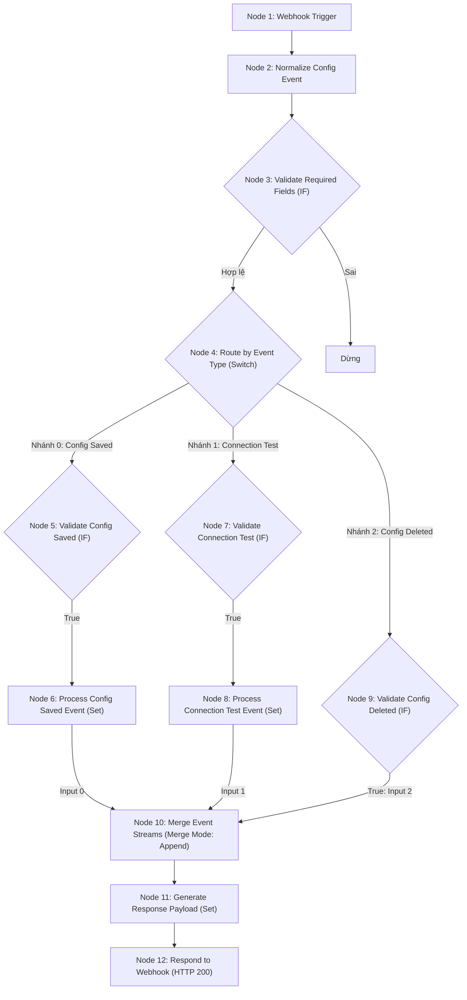

# TÀI LIỆU HƯỚNG DẪN & PHÂN TÍCH CHUYÊN SÂU MÃ NGUỒN: LUỒNG 1, LUỒNG 2 VÀ LUỒNG 3
## DỰ ÁN: AI JIRA AGENT (HỆ THỐNG PHÂN TÁCH YÊU CẦU & QUẢN LÝ JIRA TỰ ĐỘNG)

> **Dành cho:** Sinh viên phụ trách 3 luồng nền tảng (Luồng 1: Xác thực tài khoản; Luồng 2: Quản lý Workspace; Luồng 3: Cấu hình Jira & AI Key).  
> **Mục tiêu:** Nắm vững từng dòng code thực tế từ Frontend React, Backend Express, Database PostgreSQL tới Workflow n8n để tự tin trả lời vấn đáp và phản biện đồ án trước hội đồng giảng viên.

---

# PHẦN 1: BẢN CHẤT KIẾN TRÚC TOÀN HỆ THỐNG & NGUYÊN LÝ VẬN HÀNH

### 1.1. Bảng thuật ngữ và vai trò các tầng công nghệ trong dự án

Dự án áp dụng mô hình **Kiến trúc phân tầng (Layered Architecture / MVC cải tiến)** ở Backend kết hợp với **Kiến trúc hướng sự kiện (Event-driven Architecture)** giao tiếp với n8n:

| Thành phần | Đường dẫn thực tế | Bản chất kỹ thuật & Nhiệm vụ trong hệ thống |
| :--- | :--- | :--- |
| **ReactJS (Client)** | `frontend/src/` | Lớp giao diện người dùng (Presentation Layer). Quản trị State (trạng thái form, modal, dữ liệu hiển thị) và bắt sự kiện người dùng (Click, Submit, Input). |
| **API Client (Axios)**| `frontend/src/api/apiClient.js` | Lớp trung gian HTTP Client. Cấu hình `baseURL`, `timeout: 60000ms`, tự động bắt mọi request đi ra để chèn header `Authorization: Bearer <token>` (Request Interceptor). |
| **ExpressJS App** | `backend/src/app.js` & `backend/server.js` | Khung ứng dụng máy chủ (HTTP Web Server). Lắng nghe cổng 5000, quản lý vòng đời HTTP request, phân phối route và xử lý lỗi tập trung. |
| **Router** | `backend/src/routes/` | "Người điều phối giao thông" (URL Dispatcher). Nhận đường dẫn URL + HTTP Method (`GET`, `POST`, `PUT`, `DELETE`) để chỉ định đúng Controller xử lý. |
| **Middleware** | `backend/src/middleware/auth.middleware.js` | "Trạm kiểm soát an ninh". Chặn đứng request trước khi vào Controller để giải mã JWT Token, kiểm tra quyền sở hữu, hoặc bắt lỗi tập trung (`error.middleware.js`). |
| **Controller** | `backend/src/controllers/` | "Tiếp tân tiếp nhận yêu cầu". Trích xuất dữ liệu từ `req.body`, `req.params`, `req.query`, gọi Service tương ứng và đóng gói `res.status().json()`. **Tuyệt đối không viết câu lệnh SQL hay logic băm mật khẩu tại đây.** |
| **Service** | `backend/src/services/` | "Trái tim nghiệp vụ" (Business Logic Layer). Chứa toàn bộ thuật toán: mã hóa AES-256, so khớp mật khẩu bcrypt, sinh mã OTP ngẫu nhiên, phát sự kiện sang n8n. |
| **Model** | `backend/src/models/` | "Thủ kho dữ liệu" (Data Access Layer - DAL). Nơi duy nhất chứa các câu lệnh truy vấn SQL thuần (`db.query`) giao tiếp với PostgreSQL. |
| **PostgreSQL** | `backend/src/config/db.js` | Hệ quản trị CSDL quan hệ lưu trữ bền vững (ACID Persistence Store). Lưu các bảng `users`, `projects`, `configurations`, `password_resets`. |
| **n8n Workflow** | `n8n/workflows/` | "Bộ máy tự động hóa ngoài biên" (Automation Engine). Nhận tín hiệu Webhook từ Backend để thực thi các tác vụ rẽ nhánh, kiểm toán hoặc gửi email chào mừng. |
| **Webhook** | Triển khai trong các Service sự kiện | Cầu nối HTTP POST bất đồng bộ giữa Backend và n8n. Khi Backend lưu DB thành công, nó gửi payload JSON báo hiệu cho n8n chạy tiếp. |
| **SMTP Server** | `backend/src/services/email.service.js` | Giao thức chuyển thư tín (Simple Mail Transfer Protocol). Dự án dùng để gửi mã OTP 6 số (qua Nodemailer ở Backend) và email chào mừng (qua node Send Email ở n8n Flow 1). |
| **JWT** | `auth.service.js` & `auth.middleware.js` | Thẻ căn cước điện tử (Stateless Token) gồm Header, Payload (`userId`, `email`) và Signature mã hóa bằng `JWT_SECRET`. |
| **Jira Cloud REST API**| `backend/src/services/jira.service.js` | Giao diện API của Atlassian Jira Cloud (`https://domain.atlassian.net/rest/api/2/...`), phục vụ tạo/đồng bộ Issue và kiểm tra quyền. |
| **Google Gemini API** | `backend/src/services/ai.service.js` | Trí tuệ nhân tạo (AI Engine) bóc tách văn bản yêu cầu tự nhiên thành cấu trúc Epic $\rightarrow$ Story $\rightarrow$ Task. |

---

### 1.2. Sơ đồ luân chuyển dữ liệu thực tế (Mermaid Architecture Diagram)

```mermaid
flowchart TD
    subgraph Client["Lớp Giao diện (Frontend)"]
        User(("Người dùng")) -->|Nhập liệu & Click| ReactUI["React Component<br/>(RegisterPage / ProjectsPage / SettingsPage)"]
        ReactUI -->|Gọi hàm API| APIClient["apiClient.js (Axios Instance)<br/>Tự động gán Header: Authorization: Bearer JWT"]
    end

    subgraph ExpressBackend["Lớp Máy chủ & Nghiệp vụ (ExpressJS Backend)"]
        APIClient -->|Gửi HTTP Request qua Port 5000| App["app.js / server.js"]
        App -->|Định tuyến theo tiền tố /api/...| Router["Express Router<br/>(auth.routes / project.routes / config.routes)"]
        
        Router -->|Kiểm tra Token| AuthMid{"auth.middleware.js<br/>Token hợp lệ?"}
        AuthMid -->|Không / Hết hạn| Err401["Trả mã lỗi HTTP 401 Unauthorized"]
        AuthMid -->|Hợp lệ: Gán req.user| Controller["Controller tương ứng<br/>(Bóc tách req.body, req.params)"]
        
        Router -->|Public Routes: Login, Register, OTP| Controller
        
        Controller -->|Gọi nghiệp vụ| Service["Service Layer<br/>(auth.service / project.service / config.service)"]
        
        Service -->|Băm mật khẩu / Mã hóa AES-256| CryptoEngine["Bcrypt / crypto.service.js"]
        Service -->|Thao tác dữ liệu| Model["Model Layer (SQL Queries)<br/>(user.model / project.model / config.model)"]
    end

    subgraph DatabaseLayer["Lớp Cơ sở dữ liệu (PostgreSQL)"]
        Model -->|pg Pool Client execute SQL| Postgres[("PostgreSQL CSDL<br/>(Bảng: users, projects, configurations, password_resets)")]
        Postgres -->|RETURNING data| Model
    end

    subgraph AutomationLayer["Lớp Tự động hóa ngoài biên (n8n Workflow Engine)"]
        Service -.->|Sau khi DB lưu thành công: HTTP POST non-blocking| N8N_Webhook["Webhook Trigger Node<br/>(Flow 1, Flow 2, Flow 3)"]
        N8N_Webhook --> N8N_Normalize["Node Normalize (Set)"]
        N8N_Normalize --> N8N_Logic["Node Logic: IF / Switch"]
        N8N_Logic --> N8N_Action["Node Hành động:<br/>- Flow 1: Gửi email SMTP<br/>- Flow 2 & 3: Audit Summary Log"]
        N8N_Action --> N8N_Response["Node Respond to Webhook<br/>(Trả HTTP 200 cho Backend)"]
    end

    Model -->|Trả dữ liệu nguyên thủy| Service
    Service -->|Trả kết quả sạch| Controller
    Controller -->|res.status(200/201).json()| ReactUI
    ReactUI -->|Cập nhật State / Navigate| User
```

---

### 1.3. Khái niệm nền tảng dành cho buổi vấn đáp

- **HTTP Request là gì?** Là gói tin client gửi lên server gồm 4 phần:
  1. *Request Line:* Gồm HTTP Method (`GET`, `POST`, `PUT`, `DELETE`) và Path (ví dụ: `POST /api/auth/login`).
  2. *Headers:* Siêu dữ liệu như `Content-Type: application/json`, `Authorization: Bearer <token>`.
  3. *Body:* Dữ liệu thô gửi kèm (thường là chuỗi JSON).
- **HTTP Response là gì?** Là gói tin server phản hồi về client gồm:
  1. *Status Code:* Mã trạng thái 3 chữ số phản ánh kết quả xử lý.
  2. *Headers:* Thông tin server, kiểu dữ liệu trả về (`Content-Type: application/json`).
  3. *Body:* Nội dung kết quả (JSON payload).
- **Ý nghĩa các HTTP Status Code trong dự án:**
  - `200 OK`: Yêu cầu thành công, server trả về dữ liệu (ví dụ: Đăng nhập thành công, lấy danh sách Workspace thành công).
  - `201 Created`: Tạo mới tài nguyên thành công vào database (ví dụ: Đăng ký user mới thành công, tạo mới Workspace thành công).
  - `400 Bad Request`: Lỗi phía client do gửi dữ liệu thiếu hoặc sai định dạng (ví dụ: Email sai regex, mật khẩu dưới 6 ký tự, mã OTP không đủ 6 chữ số).
  - `401 Unauthorized`: Lỗi xác thực (ví dụ: Sai email/mật khẩu, không có JWT token, token giả mạo hoặc token đã hết hạn).
  - `404 Not Found`: Không tìm thấy tài nguyên hoặc không có quyền truy cập (ví dụ: Tìm kiếm Workspace ID không tồn tại hoặc Workspace thuộc sở hữu của user khác).
  - `409 Conflict`: Xung đột trạng thái dữ liệu (ví dụ: Đăng ký tài khoản với email đã tồn tại trong bảng `users`).
  - `500 Internal Server Error`: Lỗi máy chủ nội bộ (ví dụ: Mất kết nối database PostgreSQL, lỗi cú pháp runtime không lường trước).
- **Middleware chạy ở thời điểm nào?**  
  Middleware chạy **sau** khi Express nhận được request và phân giải body/cors, nhưng **trước** khi request chạm vào hàm xử lý của Controller. Nó có quyền xem xét request, từ chối ngay lập tức (bằng cách trả `res.status(401).json(...)`), hoặc bổ sung dữ liệu vào request (như gán `req.user = decodedUser`) rồi gọi `next()` để chuyển giao cho Controller.
- **Vì sao bắt buộc phải tách Controller và Service?**  
  Nhằm tuân thủ nguyên lý **Single Responsibility Principle (Đơn nhiệm)**:
  - *Controller* chỉ làm nhiệm vụ giao tiếp HTTP: bóc tách `req` và gửi trả `res`. Controller không quan tâm mật khẩu được băm như thế nào hay mã OTP được sinh ra bằng thuật toán gì.
  - *Service* chỉ quan tâm đến logic nghiệp vụ thuần túy: kiểm tra tính hợp lệ nghiệp vụ, mã hóa bảo mật, gọi database. Nhờ tách biệt, Service có thể được tái sử dụng ở nhiều nơi (ví dụ: có thể gọi từ Cron job, script CLI hoặc Controller khác) và viết Unit Test độc lập cực kỳ dễ dàng mà không cần giả lập môi trường HTTP.
- **Vì sao n8n KHÔNG ĐƯỢC kết nối trực tiếp PostgreSQL theo yêu cầu dự án?**  
  1. *Bảo mật nguyên tắc đặc quyền tối thiểu (Least Privilege):* Cơ sở dữ liệu chứa dữ liệu nhạy cảm của khách hàng (mật khẩu băm, token Jira, API key). n8n là công cụ ngoài biên, nếu cấu hình chuỗi kết nối DB trực tiếp trong n8n, bất kỳ ai có quyền truy cập canvas n8n đều có thể xem hoặc chỉnh sửa dữ liệu CSDL.
  2. *Toàn vẹn dữ liệu (Data Integrity) & Tránh Bypass Logic:* Mọi thao tác ghi vào PostgreSQL phải đi qua tầng Service của Backend để kiểm tra phân quyền (chống IDOR), mã hóa dữ liệu (AES-256) và ràng buộc toàn vẹn. Nếu n8n ghi trực tiếp, nó sẽ bỏ qua toàn bộ các lớp kiểm soát bảo mật này.
  3. *Tách biệt trạng thái lỗi (Fault Isolation):* Khi n8n sập hoặc bị nghẽn mạng, CSDL PostgreSQL của dự án hoàn toàn không bị ảnh hưởng.

---

# PHẦN 2: LUỒNG 1 — ĐĂNG KÝ, ĐĂNG NHẬP, XÁC THỰC VÀ QUÊN MẬT KHẨU

---

## 2.1. CHỨC NĂNG A: ĐĂNG KÝ TÀI KHOẢN (REGISTER)

### Bước 1: Người dùng thao tác trên giao diện `RegisterPage.jsx`
- **Khởi tạo State:**
  - `name`: Lưu họ và tên người dùng nhập (chuỗi).
  - `email`: Lưu địa chỉ email (chuỗi).
  - `password`: Lưu mật khẩu nhập vào (chuỗi).
  - `confirmPassword`: Lưu mật khẩu xác nhận (chuỗi).
  - `showPassword`: Trạng thái ẩn/hiện mật khẩu (boolean).
  - `error`: Lưu chuỗi thông báo lỗi khi validate thất bại hoặc API trả lỗi.
  - `isSubmitting`: Trạng thái đang gửi form để khóa nút bấm, hiển thị spinner chống spam click (boolean).
- **Hàm xử lý khi click Submit:** Hàm `handleSubmit(e)` tại `RegisterPage.jsx:L24-88`.
- **Kiểm tra dữ liệu tại Frontend (Client-side Validation):**
  - Cắt khoảng trắng: `name.trim()`, `email.trim()`.
  - Nếu `!trimmedName` $\rightarrow$ set `error = 'Vui lòng nhập họ và tên.'` và `return` (ngừng gửi request).
  - Nếu `!trimmedEmail` $\rightarrow$ set `error = 'Vui lòng nhập địa chỉ email.'` và `return`.
  - Regex kiểm tra định dạng email: `/^[^\s@]+@[^\s@]+\.[^\s@]+$/.test(trimmedEmail)`. Nếu sai $\rightarrow$ báo lỗi `Địa chỉ email không đúng định dạng.`.
  - Nếu `password.length < 6` $\rightarrow$ báo lỗi `Mật khẩu phải có độ dài tối thiểu 6 ký tự.`.
  - So khớp `password !== confirmPassword` $\rightarrow$ báo lỗi `Mật khẩu xác nhận không khớp.`.
- **Nếu tất cả đều đạt:** Đặt `setIsSubmitting(true)` và bắt đầu gọi API.

---

### Bước 2: Frontend phát HTTP Request qua `authApi.js`
- Tại `frontend/src/context/AuthContext.jsx:L53-55`, hàm `register` gọi:
  ```javascript
  authApi.register({ name: trimmedName, email: trimmedEmail, password })
  ```
- Hàm `register` trong `frontend/src/api/authApi.js:L4-11`:
  ```javascript
  register: async ({ name, email, password }) => {
    const response = await apiClient.post('/auth/register', { name, email, password });
    return response.data;
  }
  ```
- **Phương thức POST:** Có nghĩa là gửi một gói tin yêu cầu máy chủ tiếp nhận dữ liệu trong body để **khởi tạo mới một tài nguyên**.
- **Cấu trúc HTTP Request thực tế:**
  - **URL:** `http://localhost:5000/api/auth/register` (do `baseURL = '/api'` được cấu hình tại `apiClient.js:L4`).
  - **Headers:** `Content-Type: application/json`.
  - **Body JSON:**
    ```json
    {
      "name": "Nguyễn Văn Sinh Viên",
      "email": "student@example.com",
      "password": "ExamplePassword123"
    }
    ```

---

### Bước 3: Express tiếp nhận tại Router
- Tại `backend/src/app.js:L23`, máy chủ khai báo: `app.use('/api', apiRoutes)`.
- Tại `backend/src/routes/index.js:L21`, router tổng phân nhánh: `router.use('/auth', authRoutes)`.
- Tại `backend/src/routes/auth.routes.js:L7`:
  ```javascript
  router.post('/register', AuthController.register);
  ```
- **Middleware:** Tuyến đường `/register` là **Public Route**, **hoàn toàn không có middleware xác thực JWT** chạy trước vì người dùng mới chưa hề có tài khoản hay token. Chỉ có middleware parse body `express.json()` chạy toàn cục tại `app.js`.

---

### Bước 4: Xử lý tại Controller `auth.controller.js`
Đoạn code thực tế tại dòng 4 đến dòng 16:
```javascript
static async register(req, res, next) {
  try {
    const { name, email, password } = req.body;
    const result = await AuthService.register({ name, email, password });
    return res.status(201).json({
      message: result.message,
      user: result.user,
      emailConfirmation: result.emailConfirmation,
    });
  } catch (error) {
    next(error);
  }
}
```
- `req.body`: Đối tượng JavaScript chứa dữ liệu JSON đã được `express.json()` bóc tách từ HTTP Request.
- `AuthService.register()`: Controller giao toàn bộ trách nhiệm logic cho Service xử lý.
- `res.status(201)`: Trả về chuẩn HTTP 201 Created khi đăng ký thành công.
- `next(error)`: Nếu Service ném ra lỗi (ví dụ 400 hoặc 409), `try/catch` sẽ bắt lấy và đẩy sang `errorHandler` tại `error.middleware.js` để phản hồi mã lỗi chuẩn cho client.

---

### Bước 5: Logic nghiệp vụ tại Service `auth.service.js`
Hàm `register` tại `backend/src/services/auth.service.js:L62-107` thực thi tuần tự 9 thao tác kỹ thuật:

1. **Kiểm tra dữ liệu đầu vào (Server-side Validation):**
   - Gọi `validateRegistrationInput({ name, email, password })`.
   - Nếu client cố tình vượt rào gửi rỗng hoặc mật khẩu dưới 6 ký tự $\rightarrow$ ném lỗi `error.statusCode = 400`.
2. **Kiểm tra tài khoản đã tồn tại trong database:**
   ```javascript
   const existingUser = await UserModel.findByEmail(email);
   if (existingUser) {
     const error = new Error('Email này đã được đăng ký trong hệ thống.');
     error.statusCode = 409; // HTTP 409 Conflict
     throw error;
   }
   ```
3. **Mã hóa mật khẩu bằng thuật toán Bcrypt:**
   - **Salt là gì?** Salt (muối) là một chuỗi ký tự ngẫu nhiên được sinh ra và ghép nối vào mật khẩu trước khi băm.
   - **Bcrypt Hash làm gì?**
     ```javascript
     const salt = await bcrypt.genSalt(10);
     const passwordHash = await bcrypt.hash(password, salt);
     ```
     Bcrypt thực hiện thuật toán băm chậm (Key Derivation Function) lặp đi lặp lại $2^{10}$ vòng (1024 vòng). Chuỗi băm kết quả có dạng:
     `$2a$10$wK3Fj9p...` (trong đó `$2a$` là định danh phiên bản Bcrypt, `$10$` là cost factor - độ phức tạp).
   - **Vì sao không dùng mã hóa hai chiều?** Mã hóa hai chiều (như AES) có thể bị giải mã ngược lại nếu lộ khóa (secret key). Bcrypt là **hàm băm một chiều (One-Way Hashing)**: một khi đã băm thì về mặt toán học không thể dịch ngược trở lại thành mật khẩu gốc. Khi đăng nhập, ta chỉ băm mật khẩu vừa nhập và so sánh kết quả băm với giá trị lưu trong CSDL.
4. **Gọi Model tạo bản ghi:**
   ```javascript
   const newUser = await UserModel.create({ name, email, passwordHash });
   ```
5. **Kích hoạt gửi email xác nhận qua n8n:**
   ```javascript
   try {
     emailConfirmation = await AuthNotificationService.sendRegistrationConfirmation(newUser);
   } catch (notifyErr) {
     emailConfirmation = { sent: false, reason: notifyErr.message };
   }
   ```
   *Lưu ý kiến trúc:* Việc gọi n8n được bọc riêng trong `try/catch`. Nếu n8n chưa bật hoặc bị lỗi mạng, nó **không làm sập** quy trình đăng ký, user vẫn được tạo thành công trong PostgreSQL.

---

### Bước 6: Thao tác Database tại Model `user.model.js`
Hàm `create` tại dòng 26-34:
```javascript
static async create({ name, email, passwordHash }) {
  const query = `
    INSERT INTO users (name, email, password_hash)
    VALUES ($1, $2, $3)
    RETURNING id, name, email, created_at, updated_at;
  `;
  const { rows } = await db.query(query, [name.trim(), email.trim().toLowerCase(), passwordHash]);
  return rows[0];
}
```
- **Ý nghĩa các tham số `$1, $2, $3` (Parameterized Query):** Đây là kỹ thuật truyền tham số an toàn của thư viện `pg`. Giá trị biến không bao giờ được nối chuỗi trực tiếp vào câu lệnh SQL, mà được PostgreSQL biên dịch trước (Prepared Statement), giúp **triệt tiêu hoàn toàn lỗ hổng bảo mật SQL Injection**.
- **Mệnh đề `RETURNING`:** Cho phép PostgreSQL trả về ngay lập tức bản ghi vừa chèn mà không cần chạy thêm một lệnh `SELECT` phụ.
- **Bảo mật:** Trong mệnh đề `RETURNING`, ta chỉ lấy `id, name, email, created_at, updated_at`, **tuyệt đối không trả cột `password_hash`**.
- Bảng `users` trong CSDL được tạo bởi migration `001_create_users_table.sql` có cấu trúc:
  - `id`: UUID (tự sinh ngẫu nhiên qua `gen_random_uuid()`).
  - `name`: VARCHAR(150) NOT NULL.
  - `email`: VARCHAR(255) NOT NULL UNIQUE (được đánh index `idx_users_email` để tăng tốc độ tìm kiếm).
  - `password_hash`: VARCHAR(255) NOT NULL.
  - `created_at`, `updated_at`: TIMESTAMP WITH TIME ZONE.

---

### Bước 7: Kích hoạt Webhook n8n tại `auth-notification.service.js`
- Hàm `sendRegistrationConfirmation(user)` đọc biến môi trường:
  `webhookUrl = env.N8N_AUTH_WEBHOOK_URL` (ví dụ `http://localhost:5678/webhook/auth-registration`).
- Định dạng thời gian theo chuẩn múi giờ Việt Nam (Asia/Ho_Chi_Minh, UTC+7) bằng hàm `formatVietnamDateTime(user.created_at)`:
  - Trích xuất chính xác ngày đăng ký (ví dụ: `29/10/2026`) và giờ đăng ký (ví dụ: `19:30:00`).
- **Payload gửi sang n8n Webhook:**
  ```json
  {
    "eventType": "REGISTER_SUCCESS",
    "userId": "9b1deb4d-3b7d-4bad-9bdd-2b0d7b3dcb6d",
    "email": "student@example.com",
    "displayName": "Nguyễn Văn Sinh Viên",
    "registeredAt": "2026-10-29T12:30:00.000Z",
    "registrationDetails": {
      "email": "student@example.com",
      "displayName": "Nguyễn Văn Sinh Viên",
      "registeredDate": "29/10/2026",
      "registeredTime": "19:30:00",
      "timeZone": "Asia/Ho_Chi_Minh (UTC+7)",
      "formattedDateTime": "19:30:00 ngày 29/10/2026 (Giờ Việt Nam - UTC+7)"
    },
    "emailTemplate": {
      "subject": "Xác nhận đăng ký tài khoản AI Jira Agent thành công",
      "to": "student@example.com",
      "from": "\"AI Jira Agent\" <no-reply@ai-jira-agent.local>",
      "html": "<!DOCTYPE html>...",
      "text": "Xin chào Nguyễn Văn Sinh Viên..."
    }
  }
  ```
- **Bảo mật tuyệt đối:** Payload chỉ mang thông tin sự kiện và mẫu email HTML, **tuyệt đối không chứa password hay hash**.
- **Cơ chế Fallback URL:** Hàm `postToN8n` tự động chuyển đổi giữa `/webhook/` và `/webhook-test/` nếu n8n trả về mã 404.

---

### Bước 8: Frontend nhận kết quả và điều hướng
- Backend phản hồi HTTP Status `201 Created` với JSON:
  ```json
  {
    "message": "Registration successful",
    "user": {
      "id": "9b1deb4d-3b7d-4bad-9bdd-2b0d7b3dcb6d",
      "name": "Nguyễn Văn Sinh Viên",
      "email": "student@example.com",
      "created_at": "2026-10-29T12:30:00.000Z"
    },
    "emailConfirmation": {
      "sent": true,
      "configured": true
    }
  }
  ```
- Tại `RegisterPage.jsx:L70-81`:
  - Kiểm tra `response?.emailConfirmation?.sent === true`.
  - Nếu email đã gửi thành công $\rightarrow$ thông báo: *"Đăng ký tài khoản thành công. Vui lòng kiểm tra email để xem thông tin xác nhận."*.
  - Nếu email chưa gửi $\rightarrow$ thông báo: *"Đăng ký tài khoản thành công! Vui lòng đăng nhập với thông tin vừa tạo."*.
  - Gọi `navigate('/login', { state: { message: successMessage } })` chuyển người dùng sang trang Đăng nhập.
- Nếu Backend ném lỗi `409 Conflict` (Email trùng), khối `catch` tại dòng 82-84 bóc tách `err?.response?.data?.message` và gán vào `setError('Email này đã được đăng ký trong hệ thống.')`, hiển thị alert màu đỏ trên form.

---

### Sơ đồ tuần tự (Sequence Diagram) Luồng Đăng ký tài khoản



---

## 2.2. CHỨC NĂNG B: ĐĂNG NHẬP (LOGIN)

### 1. Quy trình thực thi theo từng bước code
1. **Người dùng thao tác tại `LoginPage.jsx`:** Nhập `email` và `password`. Nhấn nút "Đăng nhập".
2. **Client Validation:** Kiểm tra rỗng và regex email. Nếu hợp lệ, gọi `login({ email, password })` từ `useAuth()`.
3. **Frontend gửi Request:** Gọi `authApi.login({ email, password })` gửi `POST /api/auth/login`.
4. **Router & Controller:** `auth.routes.js:L8` chuyển request tới `AuthController.login` (`auth.controller.js:L18-29`).
5. **Service kiểm tra tài khoản (`auth.service.js:L109-136`):**
   ```javascript
   const user = await UserModel.findByEmail(email);
   if (!user) {
     const error = new Error('Email hoặc mật khẩu không chính xác.');
     error.statusCode = 401;
     throw error;
   }
   ```
6. **So khớp mật khẩu bằng Bcrypt:**
   ```javascript
   const isMatch = await bcrypt.compare(password, user.password_hash);
   if (!isMatch) {
     const error = new Error('Email hoặc mật khẩu không chính xác.');
     error.statusCode = 401;
     throw error;
   }
   ```
   *Lưu ý bảo mật:* Dù sai email hay sai mật khẩu, Backend đều trả về **cùng một thông báo lỗi 401 duy nhất** để ngăn chặn kẻ tấn công dò quét xem email nào đã có trong hệ thống (chống User Enumeration Attack).
7. **Tạo JWT Token bằng hàm `generateToken(user)` (`auth.service.js:L44-60`):**
   - **Thành phần cấu tạo của JWT (3 phần phân cách bởi dấu chấm `.`)**:
     1. *Header:* Chứa thuật toán ký `{"alg": "HS256", "typ": "JWT"}` (Base64Url encoded).
     2. *Payload:* Chứa Claims dữ liệu:
        ```javascript
        {
          "userId": "9b1deb4d-3b7d-4bad-9bdd-2b0d7b3dcb6d",
          "email": "student@example.com",
          "iat": 1761740000,
          "exp": 1761826400
        }
        ```
     3. *Signature:* Chữ ký số tạo bởi HMAC-SHA256(`header + payload`, `JWT_SECRET`). Chữ ký này đảm bảo không ai có thể can thiệp sửa đổi `userId` trong token.
   - `JWT_SECRET`: Khóa bí mật chỉ máy chủ backend biết. Nếu thiếu biến môi trường này, service sẽ ném lỗi: `'JWT_SECRET is not configured in environment variables.'`.
   - `expiresIn: '1d'`: Token chỉ có hiệu lực trong vòng 24 giờ kể từ thời điểm phát hành. Sau 24h, token tự động bị vô hiệu hóa.
8. **Backend phản hồi:** Trả HTTP 200 OK gồm:
   ```json
   {
     "user": {
       "id": "9b1deb4d-3b7d-4bad-9bdd-2b0d7b3dcb6d",
       "name": "Nguyễn Văn Sinh Viên",
       "email": "student@example.com"
     },
     "token": "eyJhbGciOiJIUzI1NiIsInR5cCI6IkpXVCJ9..."
   }
   ```
9. **Frontend lưu trữ và quản lý State:**
   - Tại `AuthContext.jsx:L42-51`, hàm `login` nhận token và gọi `tokenStorage.saveToken(data.token)` (lưu vào `localStorage` của trình duyệt).
   - Cập nhật State React: `setUser(data.user)` và `setToken(data.token)`.
   - Điều hướng người dùng về trang đích (mặc định là `/dashboard`).
10. **Tự động gắn Token vào Request tiếp theo:**
    Tại `apiClient.js:L15-26`, Request Interceptor can thiệp:
    ```javascript
    apiClient.interceptors.request.use((config) => {
      const token = tokenStorage.getToken();
      if (token) {
        config.headers.Authorization = `Bearer ${token}`;
      }
      return config;
    });
    ```
11. **Xử lý khi Token hết hạn:** Khi gửi request mang token đã hết hạn, Backend trả HTTP 401 kèm message: `'Phiên đăng nhập đã hết hạn. Vui lòng đăng nhập lại.'`. Khi người dùng tải lại trang, `AuthContext` gọi `authApi.getCurrentUser()`, phát hiện lỗi 401 sẽ tự động chạy `tokenStorage.removeToken()`, set user về `null` và đá văng về màn hình `/login`.

---

## 2.3. CHỨC NĂNG C: XÁC THỰC JWT VÀ API LẤY THÔNG TIN TÀI KHOẢN (`GET /api/auth/me`)

Đoạn code "trọng tài" an ninh nằm tại `backend/src/middleware/auth.middleware.js`:

1. **Trích xuất Authorization Header:**
   - Client gửi header có dạng: `Authorization: Bearer <chuỗi_token>`.
   - Middleware kiểm tra: `if (!authHeader || !authHeader.startsWith('Bearer '))` $\rightarrow$ ném lỗi HTTP 401: `'Không tìm thấy Bearer token xác thực.'`.
2. **Giải mã và xác thực chữ ký số bằng `jwt.verify`:**
   ```javascript
   decoded = jwt.verify(token, process.env.JWT_SECRET);
   ```
   - Nếu token bị chỉnh sửa dù chỉ 1 ký tự $\rightarrow$ ném lỗi `JsonWebTokenError` $\rightarrow$ trả HTTP 401: `'Token không hợp lệ.'`.
   - Nếu thời gian hiện tại vượt quá claim `exp` $\rightarrow$ ném lỗi `TokenExpiredError` $\rightarrow$ trả HTTP 401: `'Phiên đăng nhập đã hết hạn. Vui lòng đăng nhập lại.'`.
3. **Đối soát trong Cơ sở dữ liệu:**
   ```javascript
   const user = await UserModel.findById(decoded.userId);
   if (!user) {
     return res.status(401).json({ error: 'Unauthorized', message: 'Người dùng không tồn tại hoặc đã bị xóa.' });
   }
   ```
   *Vì sao phải đối soát DB?* Nếu một nhân viên bị sa thải và admin đã xóa tài khoản khỏi DB, dù JWT của họ còn hạn 24h thì việc kiểm tra `UserModel.findById` vẫn lập tức chặn đứng họ lại.
4. **Gắn thông tin vào Request Context:**
   ```javascript
   req.user = { id: user.id, name: user.name, email: user.email };
   next();
   ```
   **Nguyên tắc vàng:** Backend **tuyệt đối không tin tưởng bất kỳ `userId` nào do Frontend tự gửi trong body**. Mọi Controller phía sau đều lấy định danh qua `req.user.id` do Middleware đã bảo chứng an toàn.
5. **Endpoint `GET /api/auth/me`:**
   Tại `auth.controller.js:L31-39`, chỉ đơn giản trả về `res.status(200).json({ user: req.user })`. Khi người dùng F5 tải lại trang, `AuthContext` gọi endpoint này để phục hồi phiên làm việc.

---

## 2.4. CHỨC NĂNG D: QUÊN MẬT KHẨU VÀ OTP (FORGOT PASSWORD)

Chức năng được chia làm **4 bước khép kín** tại `ForgotPasswordPage.jsx` và Backend:



### Bước 1: Yêu cầu gửi OTP (`POST /api/auth/forgot-password`)
- **Giao diện:** Người dùng nhập email tại Step 1 của `ForgotPasswordPage.jsx`.
- **Controller & Service:** `auth.controller.js:L41` gọi `AuthService.requestPasswordReset(email)` (`auth.service.js:L141-235`).
- **Kiểm tra tài khoản:** Nếu email không có trong DB, Backend vẫn trả về message thành công chung để chống rò rỉ tài khoản.
- **Sinh mã OTP:** Dùng module bảo mật Node.js:
  ```javascript
  const otpCode = crypto.randomInt(100000, 1000000).toString(); // Sinh chuỗi ngẫu nhiên từ 100000 đến 999999
  const expiresAt = new Date(Date.now() + 15 * 60 * 1000); // Hạn 15 phút
  ```
- **Lưu database tại `password-reset.model.js:L7-26`:**
  1. Chạy câu lệnh vô hiệu hóa các OTP cũ của email này chưa dùng:
     ```sql
     UPDATE password_resets SET used = TRUE WHERE LOWER(email) = LOWER($1) AND used = FALSE;
     ```
  2. Chèn bản ghi OTP mới:
     ```sql
     INSERT INTO password_resets (email, otp_code, expires_at, used) VALUES ($1, $2, $3, FALSE);
     ```
- **Phương thức gửi email:** **Gửi TRỰC TIẾP qua SMTP từ Backend bằng Nodemailer** (`email.service.js`), **KHÔNG qua n8n**.  
  *Lý do:* Tác vụ cấp mã OTP đòi hỏi độ trễ cực thấp và bảo mật trực tiếp từ CSDL, không đưa qua dịch vụ webhook trung gian.
- **Giao diện:** Frontend chuyển sang Step 2 và kích hoạt bộ đếm ngược 60 giây (`resendCountdown = 60`).

### Bước 2: Xác thực mã OTP (`POST /api/auth/verify-otp`)
- **Giao diện:** Người dùng nhập mã 6 số từ email.
- **Service xử lý (`auth.service.js:L240-278`):**
  Gọi `PasswordResetModel.findValidOtp({ email, otpCode })`.
- **SQL kiểm tra trong CSDL:**
  ```sql
  SELECT id, email, otp_code, expires_at, used, created_at
  FROM password_resets
  WHERE LOWER(email) = LOWER($1)
    AND otp_code = $2
    AND used = FALSE
    AND expires_at > CURRENT_TIMESTAMP
  ORDER BY created_at DESC
  LIMIT 1;
  ```
- **Kết quả:** Nếu không khớp hoặc quá 15 phút $\rightarrow$ trả lỗi HTTP 400: `'Mã xác nhận OTP không chính xác hoặc đã hết hạn.'`. Nếu đúng $\rightarrow$ trả HTTP 200, Frontend mở khóa chuyển sang Step 3.

### Bước 3: Đặt lại mật khẩu mới (`POST /api/auth/reset-password`)
- **Giao diện:** Người dùng nhập `newPassword` và `confirmPassword`.
- **Service xử lý (`auth.service.js:L283-339`):**
  1. Xác thực lại mã OTP một lần nữa để tránh gian lận API.
  2. Băm mật khẩu mới: `passwordHash = await bcrypt.hash(newPassword, salt)`.
  3. Cập nhật bảng `users`:
     ```sql
     UPDATE users SET password_hash = $1, updated_at = CURRENT_TIMESTAMP WHERE LOWER(email) = LOWER($2);
     ```
  4. Đánh dấu mã OTP đã được sử dụng thành công:
     ```sql
     UPDATE password_resets SET used = TRUE WHERE id = $1;
     ```
- **Bước 4 (Hoàn tất):** Backend trả về HTTP 200 OK. Frontend hiển thị màn hình chúc mừng thành công với icon tích xanh và nút bấm "Quay lại Đăng nhập".

---

## 2.5. PHÂN TÍCH CHI TIẾT 12 NODE CỦA WORKFLOW N8N FLOW 1 (`flow-1-auth-registration.json`)

Chúng ta đọc trực tiếp file `n8n/workflows/flow-1-auth-registration.json`. Toàn bộ workflow gồm **12 nodes**.



### Chi tiết kỹ thuật từng Node:

#### 1. `Node 1 - Webhook Trigger`
- **Loại node:** `n8n-nodes-base.webhook` (Version 2).
- **Vị trí:** Cổng vào đầu tiên của workflow (ID: `f1-node-1-webhook`).
- **Cấu hình quan trọng:**
  - `httpMethod`: `POST`
  - `path`: `auth-registration`
  - `responseMode`: `responseNode` (Nghĩa là webhook không tự động trả response ngay mà sẽ giữ kết nối chờ các node `Respond to Webhook` phía sau quyết định nội dung trả về).
- **Dữ liệu đầu ra:** Trả về đối tượng JSON chứa `body`, `headers`, `query` do Backend gửi sang.
- **Node tiếp theo:** `Node 2 - Normalize Event Data`.

#### 2. `Node 2 - Normalize Event Data`
- **Loại node:** `n8n-nodes-base.set` (Edit Fields - Version 3.4).
- **Vị trí:** Node thứ 2, nhận dữ liệu từ Node 1.
- **Biểu thức n8n cấu hình:**
  - `eventType`: `={{ $json.body?.eventType || $json.eventType || '' }}`
  - `userId`: `={{ $json.body?.userId || $json.userId || '' }}`
  - `email`: `={{ ($json.body?.email || $json.email || '').trim().toLowerCase() }}`
  - `displayName`: `={{ $json.body?.displayName || $json.displayName || '' }}`
  - `registeredAt`: `={{ $json.body?.registeredAt || $json.registeredAt || '' }}`
  - `registrationDetails`: `={{ $json.body?.registrationDetails || $json.registrationDetails || {} }}`
  - `emailTemplate`: `={{ $json.body?.emailTemplate || $json.emailTemplate || {} }}`
- **Nhiệm vụ:** Chuẩn hóa dữ liệu đầu vào. Dù n8n bọc payload trong `$json.body` hay để ở root `$json`, node này đều bóc tách sạch sẽ và đưa về cấu trúc phẳng thống nhất.
- **Node tiếp theo:** `Node 3 - Check Event Type & Required Fields`.

#### 3. `Node 3 - Check Event Type & Required Fields`
- **Loại node:** `n8n-nodes-base.if` (Version 2).
- **Vị trí:** Node kiểm tra logic tầng 1.
- **Điều kiện kiểm tra (Tổ hợp AND):**
  1. `$json.eventType` EQUALS `REGISTER_SUCCESS`
  2. `$json.userId` NOT_EQUALS `""` (không được để trống)
  3. `$json.email` NOT_EQUALS `""` (không được để trống)
- **Rẽ nhánh:**
  - **Nhánh True (Output 0):** Thỏa mãn điều kiện $\rightarrow$ Đi tiếp sang `Node 4`.
  - **Nhánh False (Output 1):** Sự kiện sai hoặc thiếu ID/Email $\rightarrow$ Rẽ sang `Node 9` để báo lỗi 400.

#### 4. `Node 4 - Check Email & Timestamp Format`
- **Loại node:** `n8n-nodes-base.if` (Version 2).
- **Vị trí:** Node kiểm tra logic tầng 2.
- **Điều kiện kiểm tra (Tổ hợp AND):**
  1. `$json.email` REGEX MATCH `^[^\\s@]+@[^\\s@]+\\.[^\\s@]+$` (Đảm bảo đúng quy chuẩn địa chỉ email).
  2. `$json.registeredAt` NOT_EQUALS `""` (Bắt buộc phải có thời điểm đăng ký từ CSDL).
- **Rẽ nhánh:**
  - **Nhánh True (Output 0):** Hợp lệ $\rightarrow$ Chuyển tiếp tới `Node 5`.
  - **Nhánh False (Output 1):** Email sai định dạng $\rightarrow$ Rẽ sang `Node 9` báo lỗi.

#### 5. `Node 5 - Prepare Email Content`
- **Loại node:** `n8n-nodes-base.set` (Edit Fields).
- **Nhiệm vụ:** Tổng hợp các trường phục vụ cho việc gửi email.
- **Biểu thức n8n cấu hình:**
  - `emailTo`: `={{ $json.email }}`
  - `fromEmail`: `={{ $json.emailTemplate?.from || '"AI Jira Agent" <lephubao19@gmail.com>' }}`
  - `emailSubject`: `={{ $json.emailTemplate?.subject || 'Xác nhận đăng ký tài khoản AI Jira Agent thành công' }}`
  - `displayName`: `={{ $json.displayName || 'Quý khách' }}`
  - `emailHtml`: `={{ $json.emailTemplate?.html || ('<p>Xin chào ' + ($json.displayName || 'Quý khách') + ', bạn đã đăng ký tài khoản thành công.</p>') }}`
  - `emailText`: `={{ $json.emailTemplate?.text || ('Xin chào ' + ($json.displayName || 'Quý khách') + ', bạn đã đăng ký tài khoản thành công.') }}`
- **Node tiếp theo:** `Node 6 - Send Email via SMTP`.

#### 6. `Node 6 - Send Email via SMTP`
- **Loại node:** `n8n-nodes-base.emailSend` (Version 2.1).
- **Nhiệm vụ:** Thực hiện kết nối máy chủ thư điện tử qua giao thức mạng SMTP và gửi thư thực tế.
- **Cấu hình tham số:**
  - `toEmail`: `={{ $json.emailTo }}`
  - `fromEmail`: `={{ $json.fromEmail }}`
  - `subject`: `={{ $json.emailSubject }}`
  - `emailFormat`: `both` (gửi cả HTML và Text thô cho các máy đọc thư cổ điển).
  - `html`: `={{ $json.emailHtml }}`
  - `text`: `={{ $json.emailText }}`
  - `credentials`: Liên kết với tài khoản xác thực `SMTP account` (đã lưu bí mật trong n8n).
- **Node tiếp theo:** `Node 7 - Prepare Success Response`.

#### 7. `Node 7 - Prepare Success Response`
- **Loại node:** `n8n-nodes-base.set` (Edit Fields).
- **Nhiệm vụ:** Đóng gói JSON báo hiệu thành công.
- **Đặc điểm kỹ thuật đặc biệt (Cross-Node Reference):**
  Node này đọc lại dữ liệu từ `Node 2` để đảm bảo thông tin không bị biến dạng qua các node trung gian:
  - `userId`: `={{ $('Node 2 - Normalize Event Data').item.json.userId }}`
  - `email`: `={{ $('Node 2 - Normalize Event Data').item.json.email }}`
  - `success`: `true`
  - `statusCode`: `200`
  - `emailSent`: `true`
  - `message`: `"Xác nhận đăng ký tài khoản AI Jira Agent thành công"`
  - `processedAt`: `={{ new Date().toISOString() }}`
- **Node tiếp theo:** `Node 8 - Respond Success 200`.

#### 8. `Node 8 - Respond Success 200`
- **Loại node:** `n8n-nodes-base.respondToWebhook` (Version 1.5).
- **Cấu hình:** `respondWith: json`, `responseBody: ={{ $json }}`, `options.responseCode: 200`.
- **Nhiệm vụ:** Bắn trả gói tin HTTP 200 OK chứa kết quả của Node 7 về cho Backend Express. Kết thúc nhánh thành công.

#### 9. `Node 9 - Prepare Invalid Input Error`
- **Loại node:** `n8n-nodes-base.set` (Edit Fields).
- **Nhiệm vụ:** Chuẩn bị nội dung lỗi khi dữ liệu bị từ chối ở Node 3 hoặc Node 4.
- **Payload sinh ra:**
  - `success`: `false`
  - `statusCode`: `400`
  - `error`: `"Dữ liệu đăng ký không hợp lệ: eventType phải là REGISTER_SUCCESS, email đúng định dạng và có đầy đủ userId, registeredAt."`
  - `emailSent`: `false`
  - `timestamp`: `={{ new Date().toISOString() }}`
- **Node tiếp theo:** `Node 10 - Respond Invalid Input 400`.

#### 10. `Node 10 - Respond Invalid Input 400`
- **Loại node:** `n8n-nodes-base.respondToWebhook`.
- **Cấu hình:** `options.responseCode: 400`.
- **Nhiệm vụ:** Trả về mã lỗi HTTP 400 cho Backend. Kết thúc nhánh dữ liệu không hợp lệ.

#### 11. `Node 11 - Error Trigger`
- **Loại node:** `n8n-nodes-base.errorTrigger` (Version 1).
- **Vị trí:** Đứng độc lập ở tọa độ `[-600, 340]`, **không nối dây từ Node 1**.
- **Cơ chế hoạt động:** Đây là cơ chế bắt lỗi toàn cục của n8n (Global Workflow Exception Handler). Khi bất kỳ node nào trong luồng chính bị lỗi nghiêm trọng (ví dụ: Node 6 gọi SMTP bị timeout mạng, hoặc sai mật khẩu email 535), n8n sẽ tự động kích hoạt `Node 11`.
- **Node tiếp theo:** `Node 12 - Sanitize & Format Error Log`.

#### 12. `Node 12 - Sanitize & Format Error Log`
- **Loại node:** `n8n-nodes-base.set` (Edit Fields).
- **Nhiệm vụ:** Lọc sạch log lỗi để đảm bảo tính an toàn thông tin:
  - `success`: `false`
  - `statusCode`: `500`
  - `error`: `={{ $json.execution?.error?.message || 'Lỗi xử lý gửi email xác nhận trong n8n' }}`
  - `sanitized`: `true`
  - `safeNote`: `"Tuyệt đối không lưu mật khẩu, password hash, JWT token hoặc API secret trong log lỗi."`

---

# PHẦN 3: LUỒNG 2 — QUẢN LÝ WORKSPACE/DỰ ÁN

---

## 3.1. PHÂN TÍCH 5 THAO TÁC CRUD WORKSPACE TỪ GIAO DIỆN ĐẾN DATABASE

### Thao tác A: Xem danh sách Workspace (`GET /api/projects`)
1. **Giao diện & Kích hoạt:** Người dùng truy cập trang `ProjectsPage.jsx`. `useEffect` tại dòng 46-69 tự động gọi `projectApi.getProjects()`.
2. **HTTP Request:** Axios gửi `GET /api/projects`. Interceptor tự động đính kèm header `Authorization: Bearer <jwt_token>`.
3. **Middleware & Controller:**
   - `project.routes.js:L10` gọi `router.use(authMiddleware)` xác thực token và gán `req.user.id`.
   - Chuyển tiếp tới `ProjectController.getAll` (`project.controller.js:L5-25`).
4. **Model & SQL Query tại `project.model.js:L16-25`:**
   ```sql
   SELECT id, user_id, name, description, project_key, created_at, updated_at
   FROM projects
   WHERE user_id = $1
   ORDER BY created_at DESC;
   ```
   - `WHERE user_id = $1`: **Yếu tố bảo mật sống còn**. Chỉ trả về các dự án do chính user này tạo ra.
   - `ORDER BY created_at DESC`: Đưa các dự án vừa tạo mới nhất lên đầu danh sách.
5. **Gọi sự kiện n8n (Non-blocking):**
   Controller phát sự kiện `WORKSPACE_VIEWED` sang n8n:
   ```javascript
   WorkspaceEventService.emitEvent({
     eventType: 'WORKSPACE_VIEWED',
     userId,
     workspaceName: 'All Workspaces',
     metadata: { totalProjects: projects.length },
   }).catch(() => {});
   ```
6. **Frontend hiển thị:** Trả về HTTP 200 với `{ projects: [...] }`. `ProjectsPage` duyệt mảng render danh sách các card dự án. Nếu mảng rỗng (`projects.length === 0`), giao diện hiển thị component trạng thái trống (Empty State) với nút "Tạo dự án đầu tiên của bạn".

---

### Thao tác B: Xem chi tiết một Workspace (`GET /api/projects/:id`)
1. **Lấy ID & Route Parameter:** Người dùng click vào một card dự án $\rightarrow$ Navigate tới URL `/projects/:id` (ví dụ `/projects/a5e8c1b2-1111-2222-3333-444455556666`).
2. **Kiểm tra định dạng UUID tại `project.service.js:L50-54`:**
   ```javascript
   if (!this.isValidUUID(id)) {
     const error = new Error('Dự án không tồn tại hoặc bạn không có quyền truy cập.');
     error.statusCode = 404;
     throw error;
   }
   ```
   Dự án sử dụng regex `^[0-9a-f]{8}-[0-9a-f]{4}-[0-9a-f]{4}-[0-9a-f]{4}-[0-9a-f]{12}$` để ngăn chặn các chuỗi inject độc hại trước khi chạm vào CSDL.
3. **SQL Query tại `project.model.js:L27-36`:**
   ```sql
   SELECT id, user_id, name, description, project_key, created_at, updated_at
   FROM projects
   WHERE id = $1 AND user_id = $2
   LIMIT 1;
   ```
   - **Xử lý vi phạm quyền (IDOR Prevention):** Nếu ID tồn tại trong DB nhưng thuộc về `user_id` của người khác, câu lệnh SQL trả về `rows[0] = null`. Service lập tức ném lỗi HTTP 404. Kẻ tấn công không thể biết ID đó có tồn tại trên hệ thống hay không.

---

### Thao tác C: Tạo mới Workspace (`POST /api/projects`)
1. **Giao diện:** Người dùng nhấn nút "Tạo dự án mới", modal `ProjectModal.jsx` hiển thị. Nhập `name`, `description`.
2. **Frontend gửi API:** `projectApi.createProject({ name, description })`.
3. **Service kiểm tra nghiệp vụ `project.service.js:L10-43`:**
   - Tên dự án bắt buộc, cắt khoảng trắng, độ dài tối đa 150 ký tự.
   - Mô tả tối đa 2000 ký tự.
4. **Tự động sinh Project Key tại `project.model.js:L4-14`:**
   Hàm `generateDefaultKey(name)` lấy chữ cái đầu của các từ và viết hoa (ví dụ: `"AI Jira Agent"` $\rightarrow$ Key `"AJA"`). Nếu không đủ chữ cái thì lấy mặc định `"KAN"`.
5. **SQL Query chèn bản ghi:**
   ```sql
   INSERT INTO projects (user_id, name, description, project_key)
   VALUES ($1, $2, $3, $4)
   RETURNING id, user_id, name, description, project_key, created_at, updated_at;
   ```
6. **Phát sự kiện sang n8n qua `workspace-event.service.js`:**
   Gửi sự kiện `WORKSPACE_CREATED` sang `N8N_WORKSPACE_WEBHOOK_URL`.
7. **Frontend nhận kết quả:** Backend trả mã HTTP 201 Created. `ProjectsPage` hiển thị toast thông báo: *"Tạo dự án mới thành công!"*, đóng modal và tải lại danh sách.

---

### Thao tác D: Cập nhật Workspace (`PUT /api/projects/:id`)
1. **Giao diện:** Người dùng click nút "Chỉnh sửa" trên card dự án. Form modal được điền sẵn thông tin cũ.
2. **Khác biệt giữa PUT và POST:** POST dùng để *tạo mới*, còn PUT dùng để *thay thế/cập nhật* một tài nguyên đã xác định rõ ID trên đường dẫn URL (`/api/projects/:id`).
3. **SQL Query cập nhật linh hoạt với COALESCE tại `project.model.js:L61-79`:**
   ```sql
   UPDATE projects
   SET name = COALESCE($1, name),
       description = COALESCE($2, description),
       project_key = COALESCE($3, project_key),
       updated_at = CURRENT_TIMESTAMP
   WHERE id = $4 AND user_id = $5
   RETURNING id, user_id, name, description, project_key, created_at, updated_at;
   ```
   - **Ý nghĩa của hàm `COALESCE`:** Nếu tham số `$1` là `NULL` (người dùng không sửa tên), `COALESCE($1, name)` sẽ giữ nguyên giá trị cột `name` hiện tại trong DB.
   - `WHERE id = $4 AND user_id = $5`: Đảm bảo chỉ người sở hữu mới được cập nhật.
4. **Phát sự kiện n8n:** Gửi sự kiện `WORKSPACE_UPDATED`.
5. **Frontend phản hồi:** Backend trả HTTP 200 OK kèm thông tin đã cập nhật. Giao diện thay đổi tên/mô tả trên card ngay lập tức.

---

### Thao tác E: Xóa Workspace (`DELETE /api/projects/:id`)
1. **Giao diện:** Người dùng nhấn nút xóa (icon thùng rác). Hộp thoại `window.confirm()` hiện lên: *"Bạn có chắc chắn muốn xóa dự án này?"*.
2. **SQL Query xóa an toàn tại `project.model.js:L81-89`:**
   ```sql
   DELETE FROM projects
   WHERE id = $1 AND user_id = $2
   RETURNING id;
   ```
   Nếu `rows.length === 0` (ID không khớp hoặc không phải chủ sở hữu) $\rightarrow$ Backend ném lỗi HTTP 404.
3. **Cơ chế `ON DELETE CASCADE` trong CSDL:**
   Trong bảng `projects`, khóa ngoại liên kết tới `users(id)` có ràng buộc `ON DELETE CASCADE`. Nghĩa là nếu tài khoản người dùng bị xóa, tất cả dự án thuộc về người dùng đó sẽ tự động bị dọn dẹp sạch sẽ trong PostgreSQL mà không để lại dữ liệu rác.
4. **Phát sự kiện n8n:** Gửi `WORKSPACE_DELETED` sang n8n.
5. **Frontend cập nhật:** Backend trả HTTP 200 `{ message: 'Xóa dự án thành công.' }`. `ProjectsPage` lọc bỏ dự án có ID tương ứng ra khỏi State và cập nhật giao diện.

---

## 3.2. PHÂN TÍCH CHI TIẾT 12 NODE CỦA WORKFLOW N8N FLOW 2 (`flow-2-workspace-management.json`)

Chúng ta đọc trực tiếp file `n8n/workflows/flow-2-workspace-management.json`. Workflow gồm **đúng 12 nodes**:



### Bảng chi tiết từng Node trong Flow 2:

| STT | Tên Node chính xác | Loại Node | Dữ liệu đầu vào | Logic xử lý & Biểu thức n8n | Dữ liệu đầu ra | Node tiếp theo |
| :---: | :--- | :--- | :--- | :--- | :--- | :--- |
| **1** | `Node 1 - Webhook Trigger` | `webhook` | HTTP POST body từ Backend | Lắng nghe đường dẫn `workspace-management`, `responseMode: responseNode` | Dữ liệu thô từ Backend | Node 2 |
| **2** | `Node 2 - Normalize Event Input` | `set` | Dữ liệu từ Node 1 | Bóc tách: `eventType`, `userId`, `workspaceId`, `workspaceName`, `description`, `timestamp`, `requestId = 'req-ws-' + $now.toMillis()` | JSON chuẩn hóa đầy đủ trường | Node 3 |
| **3** | `Node 3 - Validate Event Type` | `if` | Dữ liệu từ Node 2 | Regex kiểm tra `eventType` phải là 1 trong 4 loại: `^(WORKSPACE_CREATED\|WORKSPACE_UPDATED\|WORKSPACE_DELETED\|WORKSPACE_VIEWED)$` VÀ `userId != ''` | Nhánh True nếu đúng | Nhánh True $\rightarrow$ Node 4 |
| **4** | `Node 4 - Route by Event Type` | `switch` | Dữ liệu từ nhánh True Node 3 | **Phân thành 3 nhánh Output:**<br/>- Output 0 (`Mutations`): regex `^(WORKSPACE_CREATED\|WORKSPACE_UPDATED)$`<br/>- Output 1 (`Views`): equals `WORKSPACE_VIEWED`<br/>- Output 2 (`Deletions`): equals `WORKSPACE_DELETED` | Chuyển dữ liệu vào đúng nhánh | Nhánh 0 $\rightarrow$ Node 5<br/>Nhánh 1 $\rightarrow$ Node 7<br/>Nhánh 2 $\rightarrow$ Node 8 |
| **5** | `Node 5 - Validate Mutation Fields` | `if` | Dữ liệu nhánh Mutations | Kiểm tra `workspaceName != ''` VÀ `userId != ''` (Tạo/sửa bắt buộc phải có tên dự án) | Nhánh True nếu hợp lệ | Nhánh True $\rightarrow$ Node 6 |
| **6** | `Node 6 - Process Mutation Event` | `set` | Dữ liệu nhánh True Node 5 | Gán `category = 'WORKSPACE_MUTATION'`, `status = 'PROCESSED'`, sinh chuỗi kiểm toán tiếng Việt: `auditSummary = 'Workspace ' + ($json.eventType === 'WORKSPACE_CREATED' ? 'được tạo mới thành công: ' : 'được cập nhật thành công: ') + $json.workspaceName` | Object kiểm toán mutation | Node 9 (kết nối vào Input 0) |
| **7** | `Node 7 - Process View Event` | `set` | Dữ liệu nhánh Views (từ Node 4) | Gán `category = 'WORKSPACE_QUERY'`, `status = 'PROCESSED'`, sinh `auditSummary = 'Người dùng truy vấn xem ' + ($json.workspaceId ? ('Workspace ID: ' + $json.workspaceId) : 'Danh sách Workspaces')` | Object kiểm toán view | Node 9 (kết nối vào Input 1) |
| **8** | `Node 8 - Process Delete Event` | `set` | Dữ liệu nhánh Deletions (từ Node 4) | Gán `category = 'WORKSPACE_DELETION'`, `status = 'PROCESSED'`, sinh `auditSummary = 'Workspace đã được xóa an toàn khỏi hệ thống: ' + ($json.workspaceName ? $json.workspaceName : ('ID ' + $json.workspaceId))` | Object kiểm toán delete | Node 9 (kết nối vào Input 2) |
| **9** | `Node 9 - Merge Event Streams` | `merge` | Dữ liệu từ 3 nhánh (Node 6, 7, 8) | **Chế độ cấu hình:** `mode: 'append'`, `numberInputs: 3`. Nghĩa là bất kể nhánh nào hoàn thành, dữ liệu đều được đưa vào luồng chung để đi tiếp mà không làm mất trường dữ liệu | Dòng dữ liệu hợp nhất | Node 10 |
| **10**| `Node 10 - Check Normalized Data` | `if` | Dữ liệu từ Node 9 | Kiểm tra bảo chứng lần cuối: `$json.status == 'PROCESSED'` VÀ `$json.userId != ''` | Nhánh True nếu đạt | Nhánh True $\rightarrow$ Node 11 |
| **11**| `Node 11 - Generate Response Payload` | `set` | Dữ liệu từ nhánh True Node 10 | Đóng gói JSON hoàn chỉnh: `success: true`, `workflowStatus: 'COMPLETED'`, `message: 'Xử lý sự kiện ' + $json.eventType + ' thành công trong Flow 2 Workspace Management.'`, `processedAt: $now.toISO()` | JSON response hoàn chỉnh | Node 12 |
| **12**| `Node 12 - Respond to Webhook` | `respondToWebhook` | Dữ liệu từ Node 11 | Trả kết quả HTTP 200 kèm JSON về cho Backend Express | Phản hồi HTTP 200 cho Backend | Kết thúc workflow |

> **Bản chất thực tế cần khẳng định với giảng viên:**  
> Trong workflow Flow 2, n8n **không chứa node PostgreSQL và không lưu dữ liệu vĩnh viễn vào ổ đĩa**. Dữ liệu `auditSummary` được sinh ra trong bộ nhớ execution của n8n phục vụ việc kiểm toán phiên làm việc và trả phản hồi cho Backend. Mọi thao tác lưu dữ liệu dự án bền vững đều do **Backend Express đảm nhiệm 100% tại CSDL PostgreSQL**.

---

# PHẦN 4: LUỒNG 3 — CẤU HÌNH JIRA VÀ AI API KEY

---

## 4.1. PHÂN TÍCH CÁC CHỨC NĂNG CẤU HÌNH BẢO MẬT

### Chức năng A: Xem cấu hình (`GET /api/config`)
1. **Frontend tải cấu hình:** Khi truy cập `SettingsPage.jsx`, hàm `loadConfig()` gọi `configApi.getConfig()`.
2. **Backend truy vấn database:** `ConfigModel.findByUserId(userId)` (`config.model.js:L4-15`) chạy câu lệnh SQL:
   ```sql
   SELECT id, user_id, jira_domain, jira_email, jira_api_token_encrypted, gemini_api_key_encrypted,
          notification_enabled, notification_channel, discord_webhook_url, slack_webhook_url, notification_email,
          created_at, updated_at
   FROM configurations
   WHERE user_id = $1 LIMIT 1;
   ```
3. **Cơ chế Masking bảo vệ tại `config.service.js:L42-135`:**
   - Backend giải mã thử chuỗi mã hóa bằng `CryptoService.decrypt()` để kiểm tra tính toàn vẹn.
   - Sau đó gọi `CryptoService.mask(secret, 4)`: **Chỉ giữ lại 4 ký tự cuối**, toàn bộ phần còn lại thay bằng `********` (ví dụ: `********Ab12`).
   - Nếu đã cấu hình $\rightarrow$ trả về `jira_api_token_configured: true` và `jira_api_token_masked: '********Ab12'`.
   - **Lý do an ninh:** Token thật và API Key gốc **không bao giờ nằm trên React State** của Frontend sau khi đã lưu, ngăn chặn nguy cơ bị đánh cắp thông qua tấn công XSS hoặc extension trình duyệt độc hại.

---

### Chức năng B: Lưu và Cập nhật cấu hình bảo mật (`PUT /api/config`)
1. **Dữ liệu người dùng nhập:** Người dùng nhập `jira_domain`, `jira_email`, `jira_api_token`, `gemini_api_key` tại `SettingsPage.jsx` và nhấn "Lưu cấu hình".
2. **Frontend gửi Request:** Gọi `configApi.updateConfig(payload)`. Chỉ gửi những trường có nhập liệu mới.
3. **Backend kiểm tra tính hợp lệ:**
   - Kiểm tra domain bằng `validateDomain(domain)`: Cho phép cả `https://company.atlassian.net` hoặc `company.atlassian.net`. Tự động chuẩn hóa về URL có giao thức `https://`.
   - Kiểm tra định dạng email bằng Regex.
4. **Mã hóa khóa bí mật bằng thuật toán AES-256-GCM tại `crypto.service.js`:**
   - **AES-256-GCM là gì?** Là chuẩn mã hóa đối xứng khối nâng cao (Advanced Encryption Standard) với độ dài khóa 256 bits hoạt động ở chế độ Galois/Counter Mode. Đây là thuật toán mã hóa được các ngân hàng và tổ chức quân sự sử dụng vì nó vừa mã hóa bảo mật, vừa cung cấp tính năng **xác thực tính toàn vẹn (Authenticated Encryption)**.
   - **Vector khởi tạo (IV) 12 bytes:** Mỗi lần mã hóa, hàm `crypto.randomBytes(12)` sinh ra một chuỗi byte ngẫu nhiên mới hoàn toàn. Do đó, **kể cả khi bạn mã hóa cùng 1 API Key 10 lần, kết quả chuỗi bản mã sinh ra ở 10 lần đều khác nhau 100%**, khiến kẻ tấn công không thể đoán được quy luật.
   - **Authentication Tag 16 bytes:** Là mã băm mật mã học được sinh ra từ ciphertext. Khi giải mã, nếu dữ liệu bị thay đổi dù chỉ 1 bit, hàm giải mã sẽ lập tức phát hiện và từ chối.
   - **Cấu trúc lưu trong PostgreSQL:** Chuỗi văn bản gồm 3 phần ghép bởi dấu hai chấm:
     `ivHex:authTagHex:encryptedHex`
5. **Ghi vào PostgreSQL bằng câu lệnh Upsert tại `config.model.js:L28-69`:**
   ```sql
   INSERT INTO configurations (
     user_id, jira_domain, jira_email, jira_api_token_encrypted, gemini_api_key_encrypted, updated_at
   )
   VALUES ($1, $2, $3, $4, $5, CURRENT_TIMESTAMP)
   ON CONFLICT (user_id) DO UPDATE SET
     jira_domain = EXCLUDED.jira_domain,
     jira_email = EXCLUDED.jira_email,
     jira_api_token_encrypted = EXCLUDED.jira_api_token_encrypted,
     gemini_api_key_encrypted = EXCLUDED.gemini_api_key_encrypted,
     updated_at = CURRENT_TIMESTAMP
   RETURNING *;
   ```
   *Ý nghĩa:* Nếu người dùng chưa có cấu hình thì `INSERT`; nếu đã có (`ON CONFLICT on user_id`) thì tự động chuyển thành `UPDATE`.
6. **Gọi n8n Flow 3 qua `config-event.service.js`:**
   Phát sự kiện `CONFIG_SAVED` sang `N8N_CONFIG_WEBHOOK_URL`. Payload chỉ chứa metadata: `hasJiraDomain: true`, `isJiraConfigured: true`, `provider: 'JIRA'`. **Tuyệt đối không gửi token hoặc key sang n8n.**
7. **Frontend phản hồi:** Backend trả HTTP 200 OK kèm dữ liệu đã masking. Frontend hiển thị thông báo thành công màu xanh và tự động reset các ô input nhập token về rỗng.

---

### Chức năng C: Phân biệt 3 cấp độ kiểm tra kết nối Jira / Gemini

| Cấp độ | Tên gọi | Bản chất kỹ thuật & Vị trí thực thi | Giá trị chứng minh |
| :---: | :--- | :--- | :--- |
| **Cấp 1** | **Lưu cấu hình thành công** | Thực thi tại `PUT /api/config`. Dữ liệu được mã hóa AES-256 và lưu an toàn vào PostgreSQL. | Chứng minh CSDL đã lưu trữ được khóa. |
| **Cấp 2** | **Kiểm tra đủ trường & Phát sự kiện n8n** | Thực thi tại `POST /api/config/test-connection` (`config.controller.js:L80-125`). Backend kiểm tra trong DB xem có đủ bộ ba: Domain + Email + Token hay không, sau đó phát sự kiện `CONNECTION_TEST_REQUESTED` sang n8n Flow 3. | **Chưa chứng minh kết nối mạng thành công**. Chỉ chứng minh người dùng đã điền đủ thông tin vào hệ thống. |
| **Cấp 3** | **Kiểm tra kết nối mạng thực tế với Jira Cloud** | Thực thi tại `JiraService.getJiraProjects(userId)` (`jira.service.js:L362-404`) (API `GET /api/jira/projects`). Backend giải mã token, tạo header: `Authorization: Basic base64(email:token)` và gửi HTTP GET trực tiếp tới Atlassian Jira Cloud: `https://domain.atlassian.net/rest/api/2/project`. | **Chứng minh 100% kết nối thật**. Nếu Jira trả về HTTP 200 và danh sách Project, token đó mới thực sự có hiệu lực trên Jira Cloud. Nếu Jira trả về HTTP 401 thì token sai hoặc tài khoản bị khóa. |

---

### Chức năng D: Xóa cấu hình (`DELETE /api/config?type=jira` hoặc `?type=gemini`)
- **Frontend:** Người dùng nhấn icon thùng rác tại khu vực Jira hoặc Gemini. Gọi `configApi.deleteConfig('jira')`.
- **Query Parameter:** Chuỗi `?type=jira` trên URL giúp Backend phân biệt người dùng muốn xóa riêng cấu hình Jira hay xóa riêng Gemini hay xóa toàn bộ.
- **Backend xử lý tại `config.model.js:L71-92`:**
  - Nếu `type === 'jira'`: Chạy SQL đặt các cột Jira về NULL:
    ```sql
    UPDATE configurations
    SET jira_domain = NULL, jira_email = NULL, jira_api_token_encrypted = NULL, updated_at = CURRENT_TIMESTAMP
    WHERE user_id = $1;
    ```
  - Nếu `type === 'gemini'`: Đặt `gemini_api_key_encrypted = NULL`.
- **Phát sự kiện n8n:** Gửi sự kiện `CONFIG_DELETED` sang n8n Flow 3.
- **Frontend cập nhật:** Xóa các giá trị hiển thị, chuyển trạng thái badge về *"Chưa cấu hình"*.

---

## 4.2. PHÂN TÍCH CHI TIẾT 12 NODE CỦA WORKFLOW N8N FLOW 3 (`flow-3-jira-ai-config.json`)

Chúng ta đọc trực tiếp file `n8n/workflows/flow-3-jira-ai-config.json`. Workflow gồm **đúng 12 nodes**:



### Chi tiết kỹ thuật từng Node trong Flow 3:

| STT | Tên Node chính xác | Loại Node | Dữ liệu đầu vào | Logic xử lý & Biểu thức n8n | Dữ liệu đầu ra | Node tiếp theo |
| :---: | :--- | :--- | :--- | :--- | :--- | :--- |
| **1** | `Node 1 - Webhook Trigger` | `webhook` | HTTP POST body từ Backend | Lắng nghe path `jira-ai-config`, `responseMode: responseNode` | JSON webhook thô | Node 2 |
| **2** | `Node 2 - Normalize Config Event` | `set` | Dữ liệu từ Node 1 | Bóc tách: `eventType`, `userId`, `configId`, `provider` (viết hoa), `status`, `timestamp`, `requestId` | JSON chuẩn hóa metadata | Node 3 |
| **3** | `Node 3 - Validate Required Fields`| `if` | Dữ liệu từ Node 2 | Regex kiểm tra `eventType` phải là 1 trong 3 loại: `^(CONFIG_SAVED\|CONNECTION_TEST_REQUESTED\|CONFIG_DELETED)$` VÀ có `userId`, `requestId` | Nhánh True nếu đúng | Nhánh True $\rightarrow$ Node 4 |
| **4** | `Node 4 - Route by Event Type` | `switch` | Dữ liệu từ nhánh True Node 3 | **Phân thành 3 nhánh Output:**<br/>- Output 0 (`Config Saved`): `eventType == 'CONFIG_SAVED'`<br/>- Output 1 (`Connection Test`): `eventType == 'CONNECTION_TEST_REQUESTED'`<br/>- Output 2 (`Config Deleted`): `eventType == 'CONFIG_DELETED'` | Rẽ nhánh dữ liệu | Nhánh 0 $\rightarrow$ Node 5<br/>Nhánh 1 $\rightarrow$ Node 7<br/>Nhánh 2 $\rightarrow$ Node 9 |
| **5** | `Node 5 - Validate Config Saved` | `if` | Dữ liệu nhánh Config Saved | Kiểm tra `provider != ''` VÀ status phải là `^(SAVED\|UPDATED\|SUCCESS)$` | Nhánh True nếu hợp lệ | Nhánh True $\rightarrow$ Node 6 |
| **6** | `Node 6 - Process Config Saved Event`| `set` | Dữ liệu nhánh True Node 5 | Gán `category = 'INTEGRATION_VAULT_SAVE'`, `status = 'PROCESSED'`, sinh log kiểm toán: `auditSummary = 'Khóa bảo mật nhà cung cấp ' + $json.provider + ' đã được mã hóa AES-256-GCM và lưu an toàn vào PostgreSQL (Config ID: ' + $json.configId + ')'` | Object kiểm toán save | Node 10 (kết nối vào Input 0) |
| **7** | `Node 7 - Validate Connection Test` | `if` | Dữ liệu nhánh Connection Test | Regex kiểm tra `provider == '^(JIRA\|GEMINI)$'` VÀ `userId != ''` | Nhánh True nếu hợp lệ | Nhánh True $\rightarrow$ Node 8 |
| **8** | `Node 8 - Process Connection Test Event`| `set` | Dữ liệu nhánh True Node 7 | Gán `category = 'INTEGRATION_TEST_EVENT'`, `status = 'PROCESSED'`, ghi nhận: `auditSummary = 'Tiếp nhận sự kiện kiểm tra kết nối dịch vụ ' + $json.provider + ' từ người dùng ' + $json.userId + '. (Kết quả kết nối thực tế do Backend thực thi an toàn)'` | Object kiểm toán test event | Node 10 (kết nối vào Input 1) |
| **9** | `Node 9 - Validate Config Deleted` | `if` | Dữ liệu nhánh Config Deleted | Kiểm tra `userId != ''` VÀ `eventType == 'CONFIG_DELETED'` | Nhánh True nếu hợp lệ | **Nối trực tiếp vào Node 10 (Input 2)** |
| **10**| `Node 10 - Merge Event Streams` | `merge` | Dữ liệu từ 3 nhánh (Node 6, 8, 9) | **Chế độ cấu hình:** `mode: 'append'`, `numberInputs: 3`. Gom các luồng sự kiện về một đầu ra chung | Luồng dữ liệu thống nhất | Node 11 |
| **11**| `Node 11 - Generate Response Payload`| `set` | Dữ liệu từ Node 10 | Đóng gói JSON hoàn chỉnh: `success: true`, `workflowStatus: 'COMPLETED'`, `message: 'Xử lý sự kiện ' + $json.eventType + ' thành công trong Flow 3 Jira & AI Config Vault.'`, `processedAt: $now.toISO()` | JSON response hoàn chỉnh | Node 12 |
| **12**| `Node 12 - Respond to Webhook` | `respondToWebhook` | Dữ liệu từ Node 11 | Trả kết quả HTTP 200 kèm JSON về cho Backend Express | Phản hồi HTTP 200 cho Backend | Kết thúc workflow |

### Workflow phụ: Flow 3 Error Handler (`flow-3-error-handler.json`)
Trong thư mục `n8n/workflows/` có riêng file `flow-3-error-handler.json` gồm **2 nodes**:
1. `Error Trigger`: Tự động bắt mọi ngoại lệ nếu workflow Flow 3 gặp sự cố.
2. `Format Error Response` (`set`): Chuẩn hóa JSON phản hồi lỗi:
   ```json
   {
     "success": false,
     "statusCode": 400,
     "message": "={{ $json.execution?.error?.message || 'Yêu cầu không hợp lệ hoặc dữ liệu cấu hình thiếu trường bắt buộc.' }}",
     "timestamp": "={{ $now.toISO() }}"
   }
   ```

---

# PHẦN 5: MINH HỌA DỮ LIỆU JSON TRƯỚC VÀ SAU CÁC NODE N8N

### 1. Minh họa Node Edit Fields (Ví dụ Node 2 - Flow 2 Normalize Event Input)
- **Dữ liệu thô đầu vào (Input):**
  ```json
  {
    "body": {
      "eventType": "WORKSPACE_CREATED",
      "userId": "9b1deb4d-3b7d-4bad-9bdd-2b0d7b3dcb6d",
      "projectId": "ws-12345",
      "name": "Dự án Shopee",
      "description": "Mô tả dự án",
      "timestamp": "2026-10-29T12:00:00.000Z"
    }
  }
  ```
- **Dữ liệu đã chuẩn hóa đầu ra (Output):**
  ```json
  {
    "eventType": "WORKSPACE_CREATED",
    "userId": "9b1deb4d-3b7d-4bad-9bdd-2b0d7b3dcb6d",
    "workspaceId": "ws-12345",
    "workspaceName": "Dự án Shopee",
    "description": "Mô tả dự án",
    "timestamp": "2026-10-29T12:00:00.000Z",
    "requestId": "req-ws-1761740000"
  }
  ```

---

### 2. Minh họa Node IF (Ví dụ Node 3 - Flow 1 Check Event Type)
- **Trường hợp ĐÚNG (Đi nhánh True - Output 0):**
  - *Input:* `{ "eventType": "REGISTER_SUCCESS", "userId": "u-1", "email": "student@example.com" }`
  - *Kết quả:* Thỏa mãn cả 3 điều kiện AND $\rightarrow$ Dữ liệu đi tiếp sang Node 4 để kiểm tra format email.
- **Trường hợp SAI (Đi nhánh False - Output 1):**
  - *Input:* `{ "eventType": "LOGIN_SUCCESS", "userId": "u-1", "email": "student@example.com" }`
  - *Kết quả:* `eventType` không bằng `REGISTER_SUCCESS` $\rightarrow$ Dữ liệu bị đẩy ngay sang Node 9 để trả về HTTP 400.

---

### 3. Minh họa Node Switch (Ví dụ Node 4 - Flow 2 Route by Event Type)
- Dữ liệu vào: `{ "eventType": "WORKSPACE_CREATED", "workspaceName": "Dự án A" }`
  $\rightarrow$ Khớp với Regex nhánh 0 (`^(WORKSPACE_CREATED|WORKSPACE_UPDATED)$`) $\rightarrow$ Rẽ vào **Output 0 (`Mutations`)** $\rightarrow$ Đi tới Node 5.
- Dữ liệu vào: `{ "eventType": "WORKSPACE_VIEWED", "workspaceId": "ws-1" }`
  $\rightarrow$ Khớp nhánh 1 (`WORKSPACE_VIEWED`) $\rightarrow$ Rẽ vào **Output 1 (`Views`)** $\rightarrow$ Đi tới Node 7.
- Dữ liệu vào: `{ "eventType": "WORKSPACE_DELETED", "workspaceId": "ws-1" }`
  $\rightarrow$ Khớp nhánh 2 (`WORKSPACE_DELETED`) $\rightarrow$ Rẽ vào **Output 2 (`Deletions`)** $\rightarrow$ Đi tới Node 8.

---

### 4. Minh họa Node Merge trong Flow 2 và Flow 3
- **Chế độ cấu hình thực tế:** `mode: 'append'`, `numberInputs: 3`.
- **Nguyên lý hoạt động:** Chế độ `append` **KHÔNG** bắt buộc phải chờ cả 3 nhánh cùng gửi dữ liệu mới chạy. Trong thực tế mỗi request chỉ đi theo 1 trong 3 nhánh của Switch (hoặc Tạo/Sửa, hoặc Xem, hoặc Xóa). Khi nhánh đó chạy xong và gửi dữ liệu vào một trong các Input (Input 0, 1 hoặc 2), Node Merge lập tức cho dữ liệu đi qua để chuyển sang Node tiếp theo mà không bị nghẽn (non-blocking).

---

# PHẦN 6: THEO DÕI VẾT DỮ LIỆU ĐẦU-CUỐI (DATA TRACE)

### Kịch bản End-to-End: Lưu Cấu hình Jira & Gemini Key (Luồng 3)

```
[1. FORM SETTINGS] Người dùng nhập:
   jira_domain: "https://myteam.atlassian.net"
   jira_email: "lead@myteam.com"
   jira_api_token: "ATATT3xFfGF0..."
   gemini_api_key: "AIzaSyD-..."

        ▼ (Đóng gói HTTP Request)
[2. AXIOS API CLIENT]
   Header: Authorization: Bearer eyJhbGciOi... (JWT của user)
   Body: { jira_domain, jira_email, jira_api_token, gemini_api_key }

        ▼ (Kiểm tra token tại auth.middleware.js)
[3. CONTROLLER]
   Trích xuất an toàn: userId = req.user.id ("9b1deb4d-3b7d...")
   req.body được chuyển tới ConfigService.saveConfig()

        ▼ (Mã hóa bảo mật tại crypto.service.js)
[4. SERVICE]
   jira_api_token  ──► AES-256-GCM ──► "iv1:tag1:ciphertext1"
   gemini_api_key  ──► AES-256-GCM ──► "iv2:tag2:ciphertext2"
   Tách bỏ plaintext secret hoàn toàn khỏi bộ nhớ.

        ▼ (Lưu bền vững vào PostgreSQL)
[5. DATABASE - Bảng 'configurations']
   INSERT INTO configurations ... ON CONFLICT (user_id) DO UPDATE
   Lưu trữ an toàn 2 bản mã. Cột updated_at nhận CURRENT_TIMESTAMP.

        ▼ (Phát sự kiện sang n8n: config-event.service.js)
[6. WEBHOOK PAYLOAD] (TUYỆT ĐỐI KHÔNG CÓ SECRET)
   {
     "eventType": "CONFIG_SAVED",
     "userId": "9b1deb4d-3b7d...",
     "provider": "JIRA",
     "status": "SAVED",
     "metadata": { "hasJiraDomain": true, "isJiraConfigured": true }
   }

        ▼ (Xử lý trong n8n Flow 3)
[7. n8n WORKFLOW]
   Webhook Trigger ──► Normalize ──► Check IF ──► Switch (Nhánh Config Saved)
   ──► Node 6: Sinh auditSummary "Khóa bảo mật nhà cung cấp JIRA đã được mã hóa AES-256-GCM..."
   ──► Merge ──► Generate Response ──► Respond to Webhook (HTTP 200)

        ▼ (Trả lời người dùng)
[8. FRONTEND NHẬN RESPONSE]
   Backend áp dụng CryptoService.mask() trả về:
   {
     "success": true,
     "data": {
       "jira_domain": "https://myteam.atlassian.net",
       "jira_api_token_masked": "********ken...",
       "gemini_api_key_masked": "********key..."
     }
   }
   React State reset ô nhập về rỗng. Người dùng nhìn thấy cấu hình đã an toàn.
```

---

# PHẦN 7: MA TRẬN XỬ LÝ LỖI (ERROR HANDLING MATRIX)

| Tình huống lỗi | Thành phần phát hiện | File & Hàm bắt lỗi | Mã HTTP | Nội dung JSON trả về | Ảnh hưởng Database | Ảnh hưởng Frontend | Ảnh hưởng n8n |
| :--- | :--- | :--- | :---: | :--- | :--- | :--- | :--- |
| **Email đăng ký đã tồn tại** | Backend Service | `auth.service.js:L66` | `409` | `{"error": "Error", "message": "Email này đã được đăng ký trong hệ thống."}` | Không thay đổi, lệnh INSERT bị hủy | Form hiển thị Alert đỏ, giữ nguyên dữ liệu đã nhập | Không kích hoạt n8n |
| **Mật khẩu dưới 6 ký tự** | Frontend & Backend | `RegisterPage.jsx` & `auth.service.js` | `400` | `{"error": "Error", "message": "Mật khẩu phải có độ dài tối thiểu 6 ký tự."}` | Không tác động | Bị chặn ngay tại Client hoặc hiện thông báo lỗi | Không gọi |
| **Đăng nhập sai mật khẩu** | Backend Service | `auth.service.js:L121` | `401` | `{"error": "Error", "message": "Email hoặc mật khẩu không chính xác."}` | Không thay đổi | Alert đỏ cảnh báo sai thông tin | Không liên quan |
| **JWT hết hạn (Token Expired)**| Auth Middleware | `auth.middleware.js:L27` | `401` | `{"error": "Unauthorized", "message": "Phiên đăng nhập đã hết hạn. Vui lòng đăng nhập lại."}` | Không tác động | Xóa token trong localStorage, điều hướng về `/login` | Không gọi |
| **Thiếu Bearer Token** | Auth Middleware | `auth.middleware.js:L8` | `401` | `{"error": "Unauthorized", "message": "Không tìm thấy Bearer token xác thực."}` | Không tác động | Chặn truy cập trang bảo vệ qua ProtectedRoute | Không gọi |
| **Sửa/Xóa Workspace của người khác** | Backend Model & Service | `project.service.js:L91` | `404` | `{"error": "Error", "message": "Dự án không tồn tại hoặc bạn không có quyền truy cập."}` | CSDL giữ nguyên vẹn 100% | Báo lỗi không tìm thấy dự án | Không phát event |
| **Máy chủ n8n bị tắt (Offline)** | Event Service | `postToN8n` trong các Event Service | `200` hoặc `201` | Vẫn trả thành công cho CRUD/Register, kèm warning log tại console | **Dữ liệu vẫn lưu thành công vào PostgreSQL** | Người dùng vẫn thao tác bình thường không bị treo | n8n không ghi nhận phiên chạy |
| **Máy chủ SMTP lỗi (Gửi OTP)** | Email Service | `email.service.js:L84` | `502` | `{"error": "Error", "message": "Lỗi xác thực Gmail SMTP (535)..."}` | OTP đã lưu nhưng người dùng không nhận được mail | Báo lỗi không gửi được email, đề nghị thử lại | Không liên quan |
| **Workflow n8n bị lỗi runtime** | Error Trigger | `Node 11 Flow 1` hoặc `Flow 3 Error Handler` | `500` hoặc `400` | Log lỗi được lọc sạch bí mật, trả về `{ success: false, sanitized: true }` | Database không ảnh hưởng | Tùy thuộc vào việc n8n có kết nối response hay không | Lưu phiên chạy màu đỏ trong Executions |

---

# PHẦN 8: BỘ 30 CÂU HỎI & TRẢ LỜI VẤN ĐÁP KỸ THUẬT (KÈM FILE ĐỐI CHIẾU)

#### Câu 1: Em hãy trình bày luồng dữ liệu khi người dùng đăng ký tài khoản mới?
- **Trả lời mẫu:** Khi người dùng submit form tại `RegisterPage.jsx`, dữ liệu được validate format rồi gửi `POST /api/auth/register`. Express Router chuyển tới `AuthController.register` $\rightarrow$ gọi `AuthService.register`. Service kiểm tra email trùng trong bảng `users`, băm mật khẩu bằng `bcryptjs` với 10 vòng salt, rồi gọi `UserModel.create` chèn vào PostgreSQL. Sau khi DB lưu thành công, Backend gọi bất đồng bộ sang n8n Webhook `auth-registration` để n8n gửi email chào mừng qua SMTP và trả phản hồi 201 Created cho người dùng.
- **Giải thích sâu:** Điểm mấu chốt là tính chất non-blocking: nếu n8n hoặc SMTP bị nghẽn, user vẫn được tạo an toàn trong DB.
- **File đối chiếu:** `backend/src/services/auth.service.js:L62-107`.

#### Câu 2: Tại sao dự án lại dùng Bcrypt để băm mật khẩu mà không dùng MD5 hay SHA-256?
- **Trả lời mẫu:** MD5 và SHA-256 là các hàm băm nhanh, máy tính hiện đại có thể thử hàng tỷ phép tính mỗi giây dẫn đến dễ bị tấn công Brute-force hoặc Rainbow Table. Bcrypt là thuật toán băm chậm, có tích hợp cơ chế sinh muối ngẫu nhiên (Salt) và cho phép điều chỉnh độ phức tạp (Cost Factor = 10 vòng), giúp kháng cự hiệu quả trước các cuộc tấn công giải mã mật khẩu.
- **Giải thích sâu:** Bcrypt không thể giải mã ngược lại. Khi đăng nhập, ta dùng `bcrypt.compare` để đối chiếu chuỗi băm.
- **File đối chiếu:** `backend/src/services/auth.service.js:L72-73`.

#### Câu 3: JWT Token trong dự án gồm những gì và lưu ở đâu?
- **Trả lời mẫu:** JWT gồm 3 phần: Header, Payload (chứa `userId`, `email`, thời gian hết hạn 1 ngày `exp`) và Signature được ký bởi `JWT_SECRET`. Token được trả về cho Frontend khi đăng nhập thành công và lưu trong `localStorage` của trình duyệt.
- **Giải thích sâu:** Token mang tính Stateless, Backend không cần lưu session trong bộ nhớ mà chỉ cần giải mã token bằng secret key.
- **File đối chiếu:** `backend/src/services/auth.service.js:L44-60` và `frontend/src/context/AuthContext.jsx:L45`.

#### Câu 4: Middleware `authMiddleware` hoạt động như thế nào?
- **Trả lời mẫu:** Middleware chặn ở đầu các route riêng tư, trích xuất chuỗi token từ header `Authorization: Bearer <token>`, dùng `jwt.verify` kiểm tra chữ ký và hạn dùng. Nếu hợp lệ, nó truy vấn `UserModel.findById` để xác nhận tài khoản còn tồn tại trong DB, rồi gắn `{ id, name, email }` vào `req.user` trước khi gọi `next()`.
- **Giải thích sâu:** Nếu token hết hạn, middleware trả về lỗi 401 `TokenExpiredError`.
- **File đối chiếu:** `backend/src/middleware/auth.middleware.js:L4-65`.

#### Câu 5: Làm sao để ngăn chặn người dùng A xem hoặc xóa Workspace của người dùng B (Lỗ hổng IDOR)?
- **Trả lời mẫu:** Backend không bao giờ tin cậy `userId` do client gửi. Mọi truy vấn `SELECT`, `UPDATE`, `DELETE` trong `ProjectModel` đều bắt buộc chứa điều kiện kép: `WHERE id = $workspaceId AND user_id = $userId` (với `userId` lấy trực tiếp từ `req.user.id` của token đã xác thực). Nếu người dùng A sửa ID của người dùng B, SQL sẽ trả về 0 bản ghi và Backend ném lỗi 404 Not Found.
- **Giải thích sâu:** IDOR (Insecure Direct Object Reference) là lỗ hổng nguy hiểm khi server chỉ kiểm tra ID bản ghi mà quên kiểm tra quyền sở hữu.
- **File đối chiếu:** `backend/src/models/project.model.js:L27-36` và `L81-89`.

#### Câu 6: Hàm `COALESCE` trong câu lệnh cập nhật Workspace có tác dụng gì?
- **Trả lời mẫu:** `COALESCE($1, name)` trả về giá trị đầu tiên khác `NULL`. Nếu người dùng chỉ sửa mô tả mà không sửa tên (tham số `$1` là `NULL`), `COALESCE` sẽ giữ nguyên giá trị `name` cũ trong database, giúp câu lệnh UPDATE linh hoạt cho phép cập nhật từng phần (Partial Update).
- **Giải thích sâu:** Giúp tối ưu không cần viết nhiều câu lệnh SQL cho từng trường hợp sửa đổi.
- **File đối chiếu:** `backend/src/models/project.model.js:L61-70`.

#### Câu 7: Jira API Token và Gemini API Key được bảo vệ như thế nào trong CSDL?
- **Trả lời mẫu:** Được mã hóa đối xứng bằng thuật toán **AES-256-GCM**. Mỗi lần mã hóa đều sinh ngẫu nhiên một Vector khởi tạo (IV) 12 bytes và một Authentication Tag 16 bytes. Bản ghi lưu trong bảng `configurations` có định dạng: `ivHex:authTagHex:encryptedHex`.
- **Giải thích sâu:** Chế độ GCM cung cấp cả tính bảo mật lẫn tính toàn vẹn (Authenticated Encryption). Kể cả khi kẻ trộm có được database, họ cũng không thể giải mã nếu không có khóa bí mật `ENCRYPTION_KEY`.
- **File đối chiếu:** `backend/src/services/crypto.service.js:L15-28`.

#### Câu 8: Data Masking là gì và áp dụng ở đâu trong Luồng 3?
- **Trả lời mẫu:** Khi người dùng xem cấu hình tại trang Settings, Backend không bao giờ trả về API Key nguyên văn mà gọi `CryptoService.mask(secret, 4)` để che dấu chuỗi thành dạng `********Ab12` (chỉ giữ 4 ký tự cuối).
- **Giải thích sâu:** Giúp người dùng nhận biết khóa đã được cài đặt mà không làm lộ khóa trên trình duyệt, phòng chống mã độc chụp màn hình hoặc XSS đánh cắp.
- **File đối chiếu:** `backend/src/services/crypto.service.js:L62-72`.

#### Câu 9: Endpoint `POST /api/config/test-connection` có chứng minh kết nối mạng tới Jira thành công không?
- **Trả lời mẫu:** **Dạ không.** Endpoint này chỉ kiểm tra trong CSDL người dùng đã điền đủ bộ ba: Jira Domain + Email + Token hay chưa, rồi phát sự kiện sang n8n Flow 3. Muốn kiểm tra kết nối mạng thật, hệ thống gọi API `GET /api/jira/projects` (`JiraService.getJiraProjects`), tại đó Backend giải mã token và gửi HTTP GET Basic Auth thật tới Atlassian Jira Cloud.
- **Giải thích sâu:** Cần phân biệt rõ trạng thái *Configuration Ready* (đã đủ cấu hình trong DB) và *Network Connectivity* (đã bắt tay thành công với Jira Cloud).
- **File đối chiếu:** `backend/src/controllers/config.controller.js:L80-125` và `backend/src/services/jira.service.js:L362-404`.

#### Câu 10: Tại sao n8n không kết nối trực tiếp vào PostgreSQL?
- **Trả lời mẫu:** Để đảm bảo nguyên tắc an ninh tối thiểu (Least Privilege). Việc để mọi thao tác CSDL đi qua Express giúp tập trung logic xác thực JWT, phân quyền chống IDOR và mã hóa AES-256 tại một nơi duy nhất. n8n chỉ đóng vai trò tự động hóa ngoài biên tiếp nhận sự kiện.
- **Giải thích sâu:** Nếu để n8n kết nối DB trực tiếp, khi n8n gặp sự cố hoặc lộ tài khoản canvas, CSDL lõi sẽ bị đe dọa.
- **File đối chiếu:** Kiến trúc toàn bộ các file trong `backend/src/services/`.

#### Câu 11: Nếu máy chủ n8n bị sập, người dùng có tạo được Workspace hay đăng nhập không?
- **Trả lời mẫu:** Dạ **hoàn toàn tạo và đăng nhập bình thường**. Mọi thao tác CRUD Workspace và Đăng nhập đều do Express và PostgreSQL xử lý trước. Lệnh phát Webhook sang n8n được bọc trong `try/catch` non-blocking, nếu n8n tắt, backend chỉ ghi log cảnh báo và vẫn trả kết quả 201/200 thành công cho người dùng.
- **Giải thích sâu:** Đây là nguyên lý thiết kế hệ thống chịu lỗi (Fault-tolerant & Graceful Degradation).
- **File đối chiếu:** `backend/src/controllers/project.controller.js:L60-74`.

#### Câu 12: Cơ chế tự động Fallback Webhook URL trong Backend hoạt động ra sao?
- **Trả lời mẫu:** Hàm `postToN8n` trong các Service sự kiện bắt lỗi HTTP 404. Nếu URL đang là `/webhook/` (chế độ Active) mà bị 404, nó tự động đổi sang `/webhook-test/` (chế độ Test) và thử lại một lần nữa trước khi kết luận lỗi.
- **Giải thích sâu:** Giúp lập trình viên kiểm thử n8n dễ dàng mà không phải liên tục sửa file `.env`.
- **File đối chiếu:** `backend/src/services/workspace-event.service.js:L7-24`.

#### Câu 13: Node `Switch` trong n8n Flow 2 phân thành mấy nhánh?
- **Trả lời mẫu:** Phân thành đúng 3 nhánh Output:
  - Nhánh 0 (`Mutations`): Bắt sự kiện `WORKSPACE_CREATED` và `WORKSPACE_UPDATED`.
  - Nhánh 1 (`Views`): Bắt sự kiện `WORKSPACE_VIEWED`.
  - Nhánh 2 (`Deletions`): Bắt sự kiện `WORKSPACE_DELETED`.
- **Giải thích sâu:** Node Switch phân nhánh dựa trên biểu thức Regex kiểm tra trường `$json.eventType`.
- **File đối chiếu:** `n8n/workflows/flow-2-workspace-management.json:L125-206`.

#### Câu 14: Node `Merge` trong n8n Flow 2 và Flow 3 hoạt động ở chế độ nào?
- **Trả lời mẫu:** Hoạt động ở chế độ `mode: 'append'` với `numberInputs: 3`. Nó nhận dữ liệu từ 3 nhánh xử lý sự kiện riêng biệt và hợp nhất về một luồng chung mà không bắt buộc phải chờ cả 3 nhánh cùng có dữ liệu.
- **Giải thích sâu:** Vì mỗi request chỉ đi vào 1 nhánh của Switch, nên chế độ `append` giúp dữ liệu của nhánh đó đi thẳng qua Merge để tới node phản hồi.
- **File đối chiếu:** `n8n/workflows/flow-2-workspace-management.json:L485-498`.

#### Câu 15: Node `Respond to Webhook` có ý nghĩa gì trong workflow n8n?
- **Trả lời mẫu:** Cho phép workflow phản hồi trực tiếp một mã HTTP status (như 200 hoặc 400) kèm payload JSON do workflow tùy biến về cho máy chủ Express đang đợi, thay vì để Express bị timeout hoặc n8n chỉ trả về phản hồi mặc định dạng chuỗi.
- **Giải thích sâu:** Giúp Backend biết chính xác workflow đã xử lý thành công hay thất bại.
- **File đối chiếu:** `n8n/workflows/flow-1-auth-registration.json:L339-354`.

#### Câu 16: Biểu thức `$('Node 2 - Normalize Event Data').item.json.userId` trong n8n có ý nghĩa gì?
- **Trả lời mẫu:** Đây là cú pháp tham chiếu chéo (Cross-Node Reference). Nó cho phép một node ở phía sau (như Node 7) đọc lại chính xác giá trị `userId` từ kết quả đã chuẩn hóa của Node 2 mà không sợ bị các node trung gian (như Node gửi mail) làm mất trường dữ liệu.
- **Giải thích sâu:** Giúp dữ liệu phản hồi luôn đầy đủ và toàn vẹn.
- **File đối chiếu:** `n8n/workflows/flow-1-auth-registration.json:L310`.

#### Câu 17: Mã OTP trong chức năng Quên mật khẩu được sinh ra như thế nào?
- **Trả lời mẫu:** Được sinh ra bằng hàm `crypto.randomInt(100000, 1000000).toString()` trong module mã hóa chuẩn của Node.js, tạo ra số nguyên ngẫu nhiên bảo mật gồm đúng 6 chữ số (từ 100000 đến 999999).
- **Giải thích sâu:** `crypto.randomInt` an toàn hơn `Math.random()` rất nhiều vì nó sử dụng nguồn sinh entropy của hệ điều hành, chống lại việc dự đoán trước chuỗi số ngẫu nhiên.
- **File đối chiếu:** `backend/src/services/auth.service.js:L162`.

#### Câu 18: Tại sao bảng `password_resets` lại cần cột `used` và `expires_at`?
- **Trả lời mẫu:** Cột `expires_at` giới hạn hiệu lực OTP trong 15 phút để chống tấn công brute-force kéo dài. Cột `used` đánh dấu `TRUE` ngay sau khi đổi mật khẩu thành công để đảm bảo **mã OTP chỉ được dùng duy nhất 1 lần (Single-use Token)**, ngăn chặn tấn công Replay Attack.
- **Giải thích sâu:** Khi tạo OTP mới, hệ thống cũng tự động đánh dấu `used = TRUE` cho các OTP cũ chưa kịp dùng của email đó.
- **File đối chiếu:** `backend/src/models/password-reset.model.js:L7-26`.

#### Câu 19: Email gửi OTP quên mật khẩu được gửi qua n8n hay gửi từ Backend?
- **Trả lời mẫu:** Được gửi **trực tiếp từ Backend thông qua `EmailService.sendEmail` bằng Nodemailer**, không qua n8n.
- **Giải thích sâu:** Vì OTP là tác vụ bảo mật khẩn cấp, gửi trực tiếp từ Backend giúp giảm độ trễ tối đa và không đẩy mã OTP qua hệ thống thứ ba.
- **File đối chiếu:** `backend/src/services/auth.service.js:L217-222`.

#### Câu 20: Câu lệnh SQL nào đảm bảo một user chỉ có duy nhất 1 bản ghi cấu hình trong bảng `configurations`?
- **Trả lời mẫu:** Câu lệnh `INSERT INTO configurations ... ON CONFLICT (user_id) DO UPDATE SET...`. Trong migration, cột `user_id` được đặt ràng buộc `UNIQUE REFERENCES users(id) ON DELETE CASCADE`.
- **Giải thích sâu:** Đảm bảo quan hệ 1-1 giữa người dùng và cấu hình tích hợp (Mỗi user chỉ có 1 kho lưu trữ khóa Jira/Gemini).
- **File đối chiếu:** `backend/src/migrations/003_create_configurations_table.sql:L3` và `backend/src/models/config.model.js:L43`.

#### Câu 21: Node `Error Trigger` trong n8n Flow 1 hoạt động như thế nào?
- **Trả lời mẫu:** Node `Error Trigger` đứng độc lập, không nối dây từ webhook chính. Khi bất kỳ node nào trong luồng (ví dụ Node gửi mail SMTP) bị sập hoặc timeout, n8n tự động chuyển luồng điều khiển tới `Error Trigger` $\rightarrow$ đi tới Node 12 để làm sạch log lỗi và ghi nhận lỗi an toàn.
- **Giải thích sâu:** Hoạt động giống như khối `catch` toàn cục của workflow.
- **File đối chiếu:** `n8n/workflows/flow-1-auth-registration.json:L423-431`.

#### Câu 22: Trong file `flow-3-jira-ai-config.json`, Node 9 (Validate Config Deleted) nối vào đâu?
- **Trả lời mẫu:** Node 9 sau khi kiểm tra sự kiện xóa cấu hình hợp lệ, đầu ra của nó được **nối trực tiếp vào Input 2 của Node 10 (Merge Event Streams)**, không cần đi qua node trung gian xử lý vì thao tác xóa không cần tạo dữ liệu vault mới.
- **Giải thích sâu:** Đây là thiết kế tối ưu luồng, hợp nhất trực tiếp sự kiện xóa vào stream phản hồi.
- **File đối chiếu:** `n8n/workflows/flow-3-jira-ai-config.json:L704-712`.

#### Câu 23: Frontend lưu và sử dụng JWT token như thế nào giữa các trang?
- **Trả lời mẫu:** Token được lưu trong `localStorage` qua tiện ích `tokenStorage.js`. Khi khởi động ứng dụng, `AuthContext` lấy token ra gọi `GET /api/auth/me` để kiểm tra phiên đăng nhập. Khi gửi bất kỳ request nào, Axios Interceptor trong `apiClient.js` tự động đọc token từ storage chèn vào header `Authorization: Bearer <token>`.
- **Giải thích sâu:** Giúp duy trì trạng thái đăng nhập kể cả khi người dùng F5 hoặc mở tab mới.
- **File đối chiếu:** `frontend/src/api/apiClient.js:L15-26`.

#### Câu 24: Tại sao khi lưu cấu hình tại `PUT /api/config`, nếu người dùng không nhập token mới thì backend không được ghi đè?
- **Trả lời mẫu:** Vì trên giao diện token đã được masking thành `********`. Nếu người dùng chỉ sửa domain mà không nhập token mới, Backend nhận biết và giữ nguyên chuỗi `jira_api_token_encrypted` cũ trong CSDL, tránh việc ghi đè chuỗi sao `********` vào bản mã.
- **Giải thích sâu:** Đây là kỹ thuật bảo vệ tính toàn vẹn của Credential Vault.
- **File đối chiếu:** `backend/src/services/config.service.js:L157-164`.

#### Câu 25: Nếu database PostgreSQL bị mất kết nối đột ngột thì Backend xử lý thế nào?
- **Trả lời mẫu:** Lệnh `db.query` sẽ ném ngoại lệ kết nối (`ECONNREFUSED` hoặc pool connection timeout). Controller bắt lỗi trong khối `try/catch` và đẩy sang `error.middleware.js`. Middleware ghi log `[Error Handler]` ra console và trả về HTTP 500 với JSON `{ error: "Error", message: "Lỗi máy chủ nội bộ. Vui lòng thử lại sau." }`.
- **Giải thích sâu:** Tránh làm lộ chi tiết chuỗi kết nối hay cấu trúc bảng ra ngoài màn hình client.
- **File đối chiếu:** `backend/src/middleware/error.middleware.js:L1-14`.

#### Câu 26: Tại sao mật khẩu người dùng lại được chuyển thành chữ thường khi băm không?
- **Trả lời mẫu:** Dạ **không**. Mật khẩu bắt buộc phải giữ nguyên chữ hoa, chữ thường và ký tự đặc biệt để đảm bảo độ phức tạp. Chỉ có **email** mới được chuyển thành chữ thường (`LOWER(email)`) để đảm bảo tính duy nhất không phân biệt hoa thường khi đăng ký và đăng nhập.
- **Giải thích sâu:** Email mang tính định danh không phân biệt hoa thường theo chuẩn RFC, còn mật khẩu phân biệt chữ hoa/thường nghiêm ngặt.
- **File đối chiếu:** `backend/src/models/user.model.js:L8` và `L32`.

#### Câu 27: Ràng buộc `ON DELETE CASCADE` trên bảng `projects` có ý nghĩa gì?
- **Trả lời mẫu:** Trong migration `002_create_projects_table.sql`, khóa ngoại `user_id` tham chiếu `users(id)` với thuộc tính `ON DELETE CASCADE`. Khi một người dùng bị xóa khỏi bảng `users`, toàn bộ các dự án thuộc quyền sở hữu của người dùng đó trong bảng `projects` sẽ tự động bị xóa theo, đảm bảo không có bản ghi mồ côi (Orphan Records).
- **Giải thích sâu:** Giúp đảm bảo tính toàn vẹn tham chiếu trong mô hình cơ sở dữ liệu quan hệ.
- **File đối chiếu:** `backend/src/migrations/002_create_projects_table.sql:L3`.

#### Câu 28: Dữ liệu thời gian đăng ký trong email chào mừng của Flow 1 lấy từ đâu?
- **Trả lời mẫu:** Lấy trực tiếp từ cột `created_at` trong CSDL PostgreSQL khi user được tạo thành công, sau đó đưa qua hàm `formatVietnamDateTime` sử dụng `Intl.DateTimeFormat` chuẩn múi giờ `Asia/Ho_Chi_Minh (UTC+7)` để định dạng thành ngày giờ Việt Nam thân thiện trước khi truyền vào webhook n8n.
- **Giải thích sâu:** Đảm bảo thời gian trong email chính xác tuyệt đối theo thời điểm ghi nhận trong database của máy chủ.
- **File đối chiếu:** `backend/src/services/auth-notification.service.js:L8-39`.

#### Câu 29: Nếu n8n trả về mã lỗi 400 hoặc 500 thì Backend có ném lỗi ra ngoài cho người dùng không?
- **Trả lời mẫu:** Dạ **không**. Trong cả 3 Service sự kiện (`auth-notification`, `workspace-event`, `config-event`), lệnh gọi `postToN8n` được bọc trong khối `try/catch`. Lỗi của n8n chỉ được ghi nhận dưới dạng `console.warn` trên terminal máy chủ và trả về cờ `{ dispatched: false }`, giao dịch CSDL chính của người dùng vẫn được bảo toàn trọn vẹn.
- **Giải thích sâu:** Đây là nguyên lý phân tách sự kiện bất đồng bộ: lỗi của hệ thống phụ không được làm hỏng nghiệp vụ của hệ thống chính.
- **File đối chiếu:** `backend/src/services/workspace-event.service.js:L77-86`.

#### Câu 30: Sự khác biệt cơ bản nhất giữa Luồng 1, Luồng 2 và Luồng 3 là gì?
- **Trả lời mẫu:**
  - **Luồng 1 (Identity):** Xác thực danh tính và quản lý vòng đời tài khoản (Sinh JWT Token).
  - **Luồng 2 (Workspace):** Quản trị không gian làm việc nội bộ (CRUD dữ liệu có phân quyền theo JWT).
  - **Luồng 3 (Integration Vault):** Quản trị kho khóa bảo mật tích hợp bên thứ ba (Mã hóa AES-256 Jira Token và AI Key).
  Cả 3 luồng cùng tạo thành nền tảng vững chắc để người dùng bắt đầu sử dụng các tính năng phân tách yêu cầu AI ở các luồng tiếp theo.
- **Giải thích sâu:** Thiếu Luồng 1 sẽ không có người dùng; thiếu Luồng 2 sẽ không có nơi chứa các yêu cầu phần mềm; thiếu Luồng 3 sẽ không có chìa khóa kết nối với Jira và Gemini.

---

# PHẦN 9: TỔNG KẾT & CẨM NANG ÔN TẬP NHANH TRONG 5 PHÚT

Khi bước vào phòng thi vấn đáp, hãy giữ bình tĩnh và ghi nhớ **4 trụ cột kỹ thuật cốt lõi** này:

1. **Về Kiến trúc & Phân quyền:**
   - Frontend React $\rightarrow$ Backend Express $\rightarrow$ Database PostgreSQL.
   - n8n **không kết nối PostgreSQL**. n8n chỉ nhận webhook sau khi DB đã lưu thành công.
   - Mọi API bảo vệ đều qua `authMiddleware` giải mã JWT lấy `req.user.id`.
   - Chống IDOR bằng cách luôn thêm `WHERE user_id = $userId` trong mọi thao tác Workspace.
2. **Về Bảo mật Mật khẩu & Khóa API:**
   - Mật khẩu: Băm một chiều bằng **Bcrypt (cost factor 10)** kèm muối ngẫu nhiên.
   - Khóa Jira & Gemini: Mã hóa đối xứng **AES-256-GCM** kèm IV 12 bytes và AuthTag 16 bytes.
   - Khi hiển thị lên giao diện: Luôn áp dụng **Data Masking** chỉ giữ 4 ký tự cuối dạng `********`.
3. **Về Tự động hóa n8n:**
   - Flow 1 (Auth): Đúng **12 nodes** (có node Send Email via SMTP và Error Trigger).
   - Flow 2 (Workspace): Đúng **12 nodes** (Switch 3 nhánh: Mutations, Views, Deletions; Merge 3 inputs).
   - Flow 3 (Config): Đúng **12 nodes** (Switch 3 nhánh: Saved, Test, Deleted; Merge 3 inputs) + 1 workflow phụ Error Handler gồm 2 nodes.
4. **Về Xử lý ngoại lệ (Fault Tolerance):**
   - Nếu n8n offline: Backend vẫn thực thi CRUD và đăng nhập bình thường (Non-blocking).
   - Nếu n8n báo 404: Tự động đổi qua lại giữa `/webhook/` và `/webhook-test/`.
   - Quên mật khẩu: Gửi mã OTP 6 số (hạn 15 phút, dùng 1 lần) trực tiếp qua SMTP Nodemailer tại Backend.
