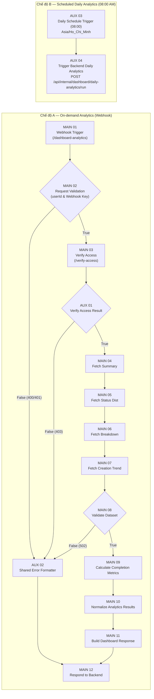

# BÁO CÁO KỸ THUẬT CHI TIẾT — FLOW 10: DASHBOARD ANALYTICS & DAILY AUTOMATION

**Dự án:** AI Requirement-to-Jira Agent  
**Workflow ID:** `Flow10DashboardAnalytics`  
**Tên Workflow:** `AI Jira Agent - Flow 10 Dashboard Analytics & Agile Metrics Engine`  
**File Workflow:** `n8n/workflows/flow-10-dashboard-analytics.json`  
**Ngày lập báo cáo:** 2026-11-12  
**Trạng thái kiểm thử thực tế:**
- ✅ `test_flow_10.js`: **55/55 Tests Passed (100%)**
- ✅ `test_flow_10_daily_automation.js`: **69/69 Tests Passed (100%)**
- ✅ `test_dashboard_performance.js`: **100% Passed** (4 APIs song song phản hồi ~14.89 ms trên 439 issues; ~5.22 ms khi lọc 1 workspace)
- ✅ ESLint `DashboardPage.jsx`: **0 errors, 0 warnings**

---

## I. TỔNG QUAN FLOW 10

**Flow 10 (Dashboard Analytics & Agile Metrics Engine)** đảm nhiệm toàn bộ nghiệp vụ thống kê dữ liệu dự án, tính toán chỉ số hoàn thành và tự động lưu ảnh chụp tiến độ hằng ngày (Daily Project Analytics). Workflow được thiết kế hợp nhất gồm **2 chế độ hoạt động** trong **1 workflow n8n duy nhất (16 Nodes = 12 MAIN + 4 AUX)**, tuân thủ múi giờ `Asia/Ho_Chi_Minh`.

### 1.1. Hai chế độ vận hành song song
1. **Chế độ A — On-demand Analytics (Thống kê thời gian thực):**
   - Kích hoạt khi người dùng mở trang `/dashboard` hoặc chọn lọc theo Project/Workspace.
   - Frontend gọi 4 API `/api/dashboard/*` song song $\rightarrow$ Backend `DashboardFlowService` dùng cơ chế **in-flight promise collapsing + cache 2.5s** để gộp thành **1 lần gọi duy nhất** sang n8n Webhook `/webhook/dashboard-analytics`.
   - Nếu n8n không phản hồi, Backend tự động bật **Local Simulation Fallback** gọi trực tiếp `DashboardService` (PostgreSQL) để Dashboard không bao giờ bị gián đoạn.
2. **Chế độ B — Scheduled Daily Analytics (Tự động 08:00 AM hằng ngày):**
   - Kích hoạt bởi `AUX 03 — Daily Schedule Trigger (08:00)` trong cùng workflow Flow 10, nối sang `AUX 04 — Trigger Backend Daily Analytics` gọi `POST /api/internal/dashboard/daily-analytics/run`.
   - Backend duyệt từng project trong DB, chạy thống kê qua Flow 10, tính toán **biến động (fluctuations)** so với ngày trước đó, và lưu vào bảng `project_analytics_snapshots` kèm nhật ký phiên chạy ở `dashboard_daily_jobs`.
   - Ngoài n8n Schedule Trigger, Backend còn chạy `DailyAnalyticsSchedulerService` nội bộ trong `backend/server.js` làm lớp dự phòng lúc `08:00` (`forceRefresh: false` để tránh ghi đè nếu n8n đã chạy trước).

### 1.2. Nguyên tắc kiến trúc & Bảo mật
- **0 Node PostgreSQL trong n8n:** Toàn bộ truy vấn CSDL đều do Backend Express thực hiện.
- **Xác thực 2 lớp:**
  - `Backend -> n8n Webhook`: dùng header `X-Flow10-Webhook-Key` (`$env.FLOW10_WEBHOOK_KEY`).
  - `n8n HTTP Request -> Backend Internal APIs`: dùng header `X-Internal-Service-Key` (`$env.INTERNAL_SERVICE_KEY`) qua `internalAuthMiddleware`.
- **Story Points trung thực:** `MAIN 09` và `DailyAnalyticsService` chỉ ghi nhận `storyPoints` / `completedStoryPoints` khi có dữ liệu số hợp lệ từ Backend, trả `null` nếu chưa có (tuyệt đối không tự suy diễn).

---

## II. KIẾN TRÚC & SƠ ĐỒ LUỒNG DỮ LIỆU

---

## III. CHI TIẾT 16 NODE TRONG N8N WORKFLOW (`flow-10-dashboard-analytics.json`)

File [`flow-10-dashboard-analytics.json`](file:///home/tmthang/Downloads/ai-jira-agent/n8n/workflows/flow-10-dashboard-analytics.json) gồm **12 MAIN Nodes + 4 AUX Nodes = 16 Nodes vật lý** (`timezone: "Asia/Ho_Chi_Minh"`).

### 3.1. Danh sách 12 MAIN Nodes

| STT | Tên Node | Type & Version | Vai trò & Logic chi tiết | Kết nối |
|---|---|---|---|---|
| **01** | `MAIN 01 — Dashboard Webhook Trigger` | `n8n-nodes-base.webhook` (v2) | Nhận HTTP `POST` tại path `dashboard-analytics` với `responseMode: "responseNode"`. Payload gồm `{ userId, projectId, requestId, timestamp, backendUrl }`. | `MAIN 02` |
| **02** | `MAIN 02 — Request Validation` | `n8n-nodes-base.if` (v2.2) | Kiểm tra 2 điều kiện `AND`: 1. Có `userId` khác rỗng. 2. Header `x-flow10-webhook-key` khớp `$env.FLOW10_WEBHOOK_KEY`. | True $\rightarrow$ `MAIN 03` False $\rightarrow$ `AUX 02` |
| **03** | `MAIN 03 — Project Access Verification` | `n8n-nodes-base.httpRequest` (v4.2) | Gọi `POST {$env.BACKEND_INTERNAL_URL}/api/internal/dashboard/verify-access` (timeout 5s, `neverError: true`, header `X-Internal-Service-Key`) để xác minh `userId` và quyền sở hữu `projectId` (nếu có). | `AUX 01` |
| **04** | `MAIN 04 — Fetch Dashboard Summary` | `n8n-nodes-base.httpRequest` (v4.2) | Gọi `GET /api/internal/dashboard/summary?userId=...&projectId=...` lấy tổng dự án, Epics, Stories, Tasks, issues trong tháng và tổng Story Points. | `MAIN 05` |
| **05** | `MAIN 05 — Fetch Status Distribution` | `n8n-nodes-base.httpRequest` (v4.2) | Gọi `GET /api/internal/dashboard/status-distribution` lấy số lượng `toDo`, `inProgress`, `done`, `total`. | `MAIN 06` |
| **06** | `MAIN 06 — Fetch Issue Type Breakdown` | `n8n-nodes-base.httpRequest` (v4.2) | Gọi `GET /api/internal/dashboard/issue-breakdown` lấy mảng `breakdown` theo tháng và toàn thời gian cho Epic/Story/Task. | `MAIN 07` |
| **07** | `MAIN 07 — Fetch Issue Creation Trend` | `n8n-nodes-base.httpRequest` (v4.2) | Gọi `GET /api/internal/dashboard/creation-trend` lấy chuỗi ngày liên tục trong tháng (`trend`). | `MAIN 08` |
| **08** | `MAIN 08 — Validate Analytics Dataset` | `n8n-nodes-base.if` (v2.2) | Kiểm tra toàn vẹn dữ liệu từ 4 node trên: `summary.totalIssues >= 0`, `status.total >= 0`, `Array.isArray(breakdown.breakdown)`, `Array.isArray(trend.trend)`. | True $\rightarrow$ `MAIN 09` False $\rightarrow$ `AUX 02` |
| **09** | `MAIN 09 — Calculate Completion Metrics` | `n8n-nodes-base.code` (v2) | Tính `completionRate = parseFloat(((doneIssues / totalIssues) * 100).toFixed(1))` (an toàn khi `totalIssues === 0` $\rightarrow$ `0%`), kiểm tra `totalStoryPoints` / `completedStoryPoints` hợp lệ (không suy diễn), gắn `isZeroState`, `calculatedAt`. | `MAIN 10` |
| **10** | `MAIN 10 — Normalize Analytics Results` | `n8n-nodes-base.code` (v2) | Chuẩn hóa 4 DTO đầu ra (`normalizedSummary`, `normalizedStatus`, `normalizedBreakdown`, `normalizedTrend`) kèm nhãn tiếng Việt và mã màu (`#64748b` To Do, `#3b82f6` In Progress, `#10b981` Done). | `MAIN 11` |
| **11** | `MAIN 11 — Build Dashboard Response` | `n8n-nodes-base.set` (v3.4) | Đóng gói response thống nhất `{ success: true, requestId, summary, breakdown, statusDistribution, creationTrend, completionMetrics, data: { ..., executionEngine: "n8n-Flow10-DashboardAnalytics", generatedAt }, timestamp }`. | `MAIN 12` |
| **12** | `MAIN 12 — Respond to Backend` | `n8n-nodes-base.respondToWebhook` (v1.5) | Trả JSON body `={{ $json }}` với `responseCode: "={{ $json.statusCode || 200 }}"`. | Kết thúc Chế độ A |

### 3.2. Chi tiết 4 AUX Nodes

| STT | Tên AUX Node | Type & Version | Nhiệm vụ chi tiết |
|---|---|---|---|
| **01** | `AUX 01 — Verify Access Result` | `n8n-nodes-base.if` (v2.2) | Kiểm tra `Boolean($json.allowed || $json.data?.allowed)`. True đi tiếp `MAIN 04`; False rẽ sang `AUX 02` để báo `403`. |
| **02** | `AUX 02 — Shared Error Formatter` | `n8n-nodes-base.code` (v2) | Định dạng lỗi tập trung cho 4 tình huống: - **401** (`INVALID_DASHBOARD_REQUEST_OR_AUTH`): thiếu hoặc sai `X-Flow10-Webhook-Key`. - **400** (`INVALID_DASHBOARD_REQUEST`): thiếu `userId`. - **403** (`PROJECT_ACCESS_DENIED`): dự án không tồn tại hoặc không thuộc quyền user. - **502** (`INVALID_ANALYTICS_DATASET`): dataset từ 4 API `MAIN 04–07` thiếu hoặc sai định dạng. |
| **03** | `AUX 03 — Daily Schedule Trigger (08:00)` | `n8n-nodes-base.scheduleTrigger` (v1.2) | Trigger định kỳ mỗi ngày (`daysInterval: 1`, `triggerAtHour: 8`, `triggerAtMinute: 0`) theo timezone `Asia/Ho_Chi_Minh`. Không phụ thuộc người dùng mở web. |
| **04** | `AUX 04 — Trigger Backend Daily Analytics` | `n8n-nodes-base.httpRequest` (v4.2) | Gửi `POST {$env.BACKEND_INTERNAL_URL}/api/internal/dashboard/daily-analytics/run` (timeout 30s, header `X-Internal-Service-Key`) kèm `triggerSource: 'N8N_FLOW_10_DAILY_SCHEDULE'`, `reportDate` (`yyyy-LL-dd` GMT+7), `runId: 'flow10-daily-YYYY-MM-DD'`. |

---

## IV. BACKEND APIS & SERVICES PHỤC VỤ FLOW 10

### 4.1. Public Dashboard APIs (`/api/dashboard/*` — bảo vệ bằng JWT `authMiddleware`)
Định nghĩa tại [`dashboard.routes.js`](file:///home/tmthang/Downloads/ai-jira-agent/backend/src/routes/dashboard.routes.js) và [`dashboard.controller.js`](file:///home/tmthang/Downloads/ai-jira-agent/backend/src/controllers/dashboard.controller.js):

| Endpoint | Method | Chức năng |
|---|---|---|
| `/api/dashboard/summary` | `GET` | Tổng hợp KPIs (`totalProjects`, `totalEpics`, `totalStories`, `totalTasks`, `totalIssues`, `completionRate`, `issuesThisMonth`) qua `DashboardFlowService`. |
| `/api/dashboard/issue-breakdown` | `GET` | Phân loại Epic / Story / Task tháng hiện tại và toàn thời gian. |
| `/api/dashboard/status-distribution` | `GET` | Phân bố To Do, In Progress, Done và tỷ lệ hoàn thành. |
| `/api/dashboard/creation-trend` | `GET` | Xu hướng tạo issue từng ngày trong tháng hiện tại. |
| `/api/dashboard/analytics` | `GET` | Trả trọn bộ 4 tập dữ liệu trong 1 lượt gọi. |
| `/api/dashboard/snapshots` | `GET` | Lấy lịch sử snapshot (`limit` tối đa 100, lọc theo `projectId`, `startDate`, `endDate`). Kiểm tra quyền sở hữu project khi truyền `projectId`. |
| `/api/dashboard/snapshots/latest` | `GET` | Lấy snapshot mới nhất kèm dữ liệu biến động (`fluctuations`) so với ngày trước. |
| `/api/dashboard/daily-analytics/trigger` | `POST` | Cho phép user chạy thử ngay thống kê snapshot cho 1 dự án hoặc toàn bộ dự án của user (`forceRefresh: true`). |

### 4.2. Internal APIs (`/api/internal/dashboard/*` — bảo vệ bằng `internalAuthMiddleware`)
Định nghĩa tại [`internal-dashboard.routes.js`](file:///home/tmthang/Downloads/ai-jira-agent/backend/src/routes/internal-dashboard.routes.js) và [`internal-dashboard.controller.js`](file:///home/tmthang/Downloads/ai-jira-agent/backend/src/controllers/internal-dashboard.controller.js):
- `POST`/`GET /verify-access` (MAIN 03)
- `GET /summary` (MAIN 04)
- `GET /status-distribution` (MAIN 05)
- `GET /issue-breakdown` (MAIN 06)
- `GET /creation-trend` (MAIN 07)
- `POST /daily-analytics/run` (AUX 04 — gọi `DailyAnalyticsService.runDailyAnalytics`)

### 4.3. Các Service cốt lõi
- **[`dashboard-flow.service.js`](file:///home/tmthang/Downloads/ai-jira-agent/backend/src/services/dashboard-flow.service.js):**
  - `analyticsCache` (TTL 2.5s) + `inFlightRequests` (promise collapsing theo key `${userId}:${projectId || 'all'}`), đảm bảo Frontend gọi 4 endpoint cùng lúc chỉ kích hoạt 1 execution n8n.
  - `postToN8n` tự động fallback giữa `/webhook/` và `/webhook-test/` nếu gặp HTTP 404.
  - Fallback tự động sang `DashboardService` nội bộ khi n8n offline (`executionSource: 'backend-direct-fallback'`).
- **[`dashboard.service.js`](file:///home/tmthang/Downloads/ai-jira-agent/backend/src/services/dashboard.service.js):** Thực thi truy vấn SQL tối ưu với CTE + `FILTER (WHERE ...)` và `GROUP BY` theo phạm vi `userId` / `projectId` (không có N+1 queries).
- **[`daily-analytics.service.js`](file:///home/tmthang/Downloads/ai-jira-agent/backend/src/services/daily-analytics.service.js):**
  - Xác định ngày chuẩn GMT+7 (`getVietnamDate()`), chống chạy trùng theo `runId` nếu `status === 'completed'` và `!forceRefresh`.
  - Xử lý cô lập lỗi từng dự án (Fault-tolerant): dự án nào lỗi ghi snapshot `execution_status = 'FAILED'` và job chuyển `partial_failed` / `failed`, các dự án khác vẫn hoàn tất bình thường.
  - `calculateFluctuations(current, previous)` tính $\Delta$ `totalIssuesChange`, `doneIssuesChange`, `inProgressIssuesChange`, `toDoIssuesChange`, `completionRateChange`, `storyPointsChange` (chỉ tính khi cả 2 ngày có dữ liệu số) và sinh chuỗi `narrative` tiếng Việt.
- **[`dailyAnalyticsScheduler.service.js`](file:///home/tmthang/Downloads/ai-jira-agent/backend/src/services/dailyAnalyticsScheduler.service.js):** Khởi động cùng [`server.js`](file:///home/tmthang/Downloads/ai-jira-agent/backend/server.js#L34), kiểm tra mỗi 60s để dự phòng kích hoạt lúc `08:00` GMT+7 với `forceRefresh: false`.

---

## V. CƠ SỞ DỮ LIỆU POSTGRESQL

1. **Migration 005 ([`005_dashboard_reporting_schema.sql`](file:///home/tmthang/Downloads/ai-jira-agent/backend/src/migrations/005_dashboard_reporting_schema.sql)):** Bổ sung `project_key` cho `projects`, `user_id` + `project_id` cho `jira_issues`, và 5 index tối ưu thống kê.
2. **Migration 011 ([`011_create_project_analytics_snapshots_table.sql`](file:///home/tmthang/Downloads/ai-jira-agent/backend/src/migrations/011_create_project_analytics_snapshots_table.sql)):** Tạo bảng `project_analytics_snapshots` với ràng buộc chống trùng ngày `CONSTRAINT uq_project_analytics_snapshot_date UNIQUE (project_id, snapshot_date)`. Model [`snapshot.model.js`](file:///home/tmthang/Downloads/ai-jira-agent/backend/src/models/snapshot.model.js) dùng `ON CONFLICT (project_id, snapshot_date) DO UPDATE` để đảm bảo mỗi dự án chỉ có tối đa 1 snapshot/ngày.
3. **Migration 012 ([`012_create_dashboard_daily_jobs_table.sql`](file:///home/tmthang/Downloads/ai-jira-agent/backend/src/migrations/012_create_dashboard_daily_jobs_table.sql)):** Tạo bảng `dashboard_daily_jobs` (`run_id` UNIQUE, `status`: `running`, `completed`, `partial_failed`, `failed`, đếm `projects_total`, `projects_succeeded`, `projects_failed`).
4. **Dữ liệu ghi nhận thực tế trong DB (sau khi chạy test ngày 2026-11-12):**
   - `project_analytics_snapshots`: **17 bản ghi** (`2026-11-05` $\rightarrow$ `2026-11-12`).
   - `dashboard_daily_jobs`: **23 phiên chạy**, tất cả đều ở trạng thái `completed`.

---

## VI. TÍCH HỢP FRONTEND ([`DashboardPage.jsx`](file:///home/tmthang/Downloads/ai-jira-agent/frontend/src/pages/DashboardPage.jsx) & [`dashboardApi.js`](file:///home/tmthang/Downloads/ai-jira-agent/frontend/src/api/dashboardApi.js))

- **Bộ lọc Workspace / Project:** Dropdown chọn dự án cụ thể hoặc toàn bộ workspace; tự động reload đồng thời phần On-demand và phần Snapshot History khi đổi dự án.
- **Phần On-demand Realtime:**
  - 5 KPI Cards (Tổng dự án / Epics / Stories / Tasks / Issues tháng này) + Banner tiến độ `Tỷ lệ hoàn thành công việc tổng thể`.
  - 3 biểu đồ Recharts: BarChart (Phân loại Epic, Story, Task), Pie/Donut Chart (Phân bố To Do, In Progress, Done), Area/Line Chart (Xu hướng tạo issue theo ngày).
- **Phần Lịch sử tiến độ & Thống kê tự động (08:00 AM):**
  - Bộ chuyển đổi **7 ngày qua / 30 ngày qua**, nút **"Chạy thống kê ngay"** (`triggerDailyAnalytics`), hiển thị `historyError` khi có lỗi API.
  - Banner snapshot mới nhất kèm timestamp cập nhật và `narrative` đánh giá biến động.
  - 3 Delta Cards ($\Delta$ Done, $\Delta$ Rate, $\Delta$ Total Issues) + Stacked BarChart cơ cấu công việc theo ngày + LineChart diễn tiến tỷ lệ hoàn thành (%).

---

## VII. KẾT QUẢ KIỂM THỬ THỰC TẾ (2026-11-12)

Toàn bộ các bộ test của Flow 10 được chạy trực tiếp với PostgreSQL (`localhost:5432`) và n8n container (`localhost:5678`):

| Bộ kiểm thử | Phạm vi xác minh | Kết quả |
|---|---|---|
| [`test_flow_10.js`](file:///home/tmthang/Downloads/ai-jira-agent/backend/src/tests/test_flow_10.js) | Cấu trúc 16 node (12 MAIN + 4 AUX, 0 SQL/PG node), bảo mật Internal APIs (`401`), Access Verification (`403`), gọi trực tiếp n8n webhook (`200`, `401`, `400`, `403`, dự án 0 issue không chia cho 0), Public APIs, Fallback khi n8n offline. | **55/55 PASS (100%)** |
| [`test_flow_10_daily_automation.js`](file:///home/tmthang/Downloads/ai-jira-agent/backend/src/tests/test_flow_10_daily_automation.js) | Cấu trúc `AUX 03` (08:00 GMT+7) + `AUX 04`, không suy diễn Story Points, bảo mật `/daily-analytics/run`, lưu snapshot DB & chống trùng cùng ngày, tính biến động (fluctuations), cô lập lỗi từng project, API snapshots, in-process scheduler, kiểm tra không làm thay đổi Flow 1–9, 11–13. | **69/69 PASS (100%)** |
| [`test_dashboard_performance.js`](file:///home/tmthang/Downloads/ai-jira-agent/backend/src/tests/test_dashboard_performance.js) | Benchmark trên **439 Jira issues / 8 dự án**: 4 APIs song song tổng hệ thống **14.89 ms**; lọc 1 workspace ("AI", 22 issues) **5.22 ms**; tổng đúng **5 SQL queries** (không có N+1 query). | **PASS (100%)** |
| ESLint (`DashboardPage.jsx`) | `npx eslint src/pages/DashboardPage.jsx` | **0 errors, 0 warnings** |

---

## VIII. ĐÁNH GIÁ & GHI NHẬN VẬN HÀNH

1. **Hoàn thiện đồng thời 2 chế độ:** Chế độ A giữ nguyên trải nghiệm thống kê realtime và có Local Simulation Fallback; Chế độ B tự động tổng hợp, chống trùng ngày và theo dõi biến động lúc 08:00 GMT+7.
2. **Lưu ý trạng thái import n8n:** Trong file git [`flow-10-dashboard-analytics.json`](file:///home/tmthang/Downloads/ai-jira-agent/n8n/workflows/flow-10-dashboard-analytics.json#L702), thuộc tính `"active"` đang là `false` theo chuẩn file export, nhưng trong container n8n thực tế workflow đang bật Active (`test_flow_10.js` gọi trực tiếp webhook `/webhook/dashboard-analytics` đạt 200 OK). Khi import sang môi trường mới cần bật **Active** trong n8n UI và đảm bảo biến môi trường `N8N_BLOCK_ENV_ACCESS_IN_NODE=false`, `BACKEND_INTERNAL_URL`, `INTERNAL_SERVICE_KEY`, `FLOW10_WEBHOOK_KEY` đã được nạp cho n8n.

