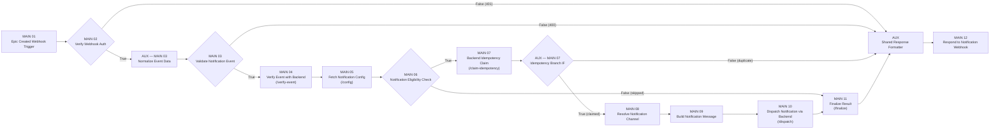

# BÁO CÁO KỸ THUẬT CHI TIẾT — FLOW 11: AUTOMATED EPIC NOTIFICATION ENGINE

**Dự án:** AI Requirement-to-Jira Agent  
**Workflow ID:** `Flow11NotifyEpic`  
**Tên Workflow:** `AI Jira Agent - Flow 11 Automated Epic Notification Engine`  
**File Workflow:** `n8n/workflows/flow-11-epic-notification.json`  
**Ngày lập báo cáo:** 2026-11-12  
**Trạng thái kiểm thử thực tế:** ✅ **46/46 Tests Passed (100%)** qua `backend/src/tests/test_flow_11.js`

---

## I. TỔNG QUAN FLOW 11

**Flow 11 (Automated Epic Notification Engine)** là luồng tự động hóa gửi thông báo đa kênh ngay khi hệ thống tạo thành công **Epic** trên Jira Cloud (kích hoạt bất đồng bộ từ **Flow 7**) hoặc khi người dùng bấm kiểm tra kết nối thông báo tại trang **Cài đặt (Settings)**.

### 1.1. Mục tiêu thiết kế & Nguyên tắc kiến trúc
Flow 11 được xây dựng theo mô hình **n8n Orchestrator + Backend Dispatch & Database Idempotency**:
- **Tách biệt trách nhiệm:** n8n đóng vai trò điều phối (kiểm tra auth, validate schema, gọi Backend xác minh, đánh giá điều kiện, định dạng bản tin theo kênh và trả HTTP response), còn **Backend ExpressJS** chịu trách nhiệm toàn bộ phần truy vấn PostgreSQL, giải quyết cấu hình nhạy cảm, chống trùng lặp (Idempotency) và thực thi gửi tin ra bên ngoài.
- **Bảo mật tuyệt đối:** Không chứa node PostgreSQL trực tiếp trong n8n, không chứa node Discord/Slack/Gmail trực tiếp trong n8n, và không lưu bất kỳ Webhook URL bí mật hay mật khẩu SMTP nào trong file JSON workflow.
- **Non-blocking với Flow 7:** Mọi lỗi mạng, timeout hoặc cấu hình sai ở Flow 11 đều được bắt gọn trong `NotificationService.sendEpicCreatedNotification()`, tuyệt đối không làm hỏng hoặc rollback quá trình tạo issue trên Jira của Flow 7.
- **Tinh gọn chuẩn 15 Node:** Workflow hiện tại đã được tối ưu còn **15 node vật lý** (**12 MAIN Nodes + 3 AUX Nodes**), đảm bảo ngưỡng tối đa $\le 16$ node.

### 1.2. Các kênh thông báo được hỗ trợ
| Kênh (`channel`) | Định dạng bản tin (MAIN 09) | Cơ chế gửi thực tế (Backend `dispatch`) |
|---|---|---|
| **Discord** (`discord`) | `content` markdown + Discord Rich Embed (`color: 5814783`, fields Project, Created by, Description, Link Jira, Footer Event ID) | `axios.post(discord_webhook_url, discordPayload)` |
| **Slack** (`slack`) | `text` fallback + Slack Block Kit (`header`, 2 `section`, `context`) | `axios.post(slack_webhook_url, slackPayload)` |
| **Email** (`email`) | `to`, `subject`, Responsive `html` template + `text` fallback | `EmailService.sendEmail()` qua Nodemailer (`smtp.gmail.com:465` mặc định) |

---

## II. KIẾN TRÚC TỔNG THỂ & LUỒNG DỮ LIỆU END-TO-END

### 2.1. Hai điểm kích hoạt từ Hệ thống
1. **Kích hoạt tự động sau Flow 7 (`JiraService.pushToJira` — `backend/src/services/jira.service.js`):**
   - Sau khi Jira Cloud tạo issues thành công và lưu DB, Backend lọc các issue có `type.trim().toLowerCase() === 'epic'`.
   - Với mỗi Epic được tạo, Backend gọi bất đồng bộ (`.catch(...)` không `await` chặn luồng) tới `NotificationService.sendEpicCreatedNotification({ userId, projectKey, epic, projectId: null })`.
2. **Kích hoạt thử nghiệm từ Settings (`ConfigController.testNotification` — `POST /api/config/test-notification`):**
   - Người dùng chọn kênh trên `SettingsPage.jsx` và bấm **"Gửi thông báo thử nghiệm"**.
   - Backend gọi `NotificationService.sendTestNotification(userId, channel)` với `isTest: true`, `projectKey: 'DEMO'`, `epicKey: 'DEMO-101'`, `eventType: 'jira.epic.created'` (bản ghi DB lưu `event_type: 'jira.epic.test'`).

### 2.2. Sơ đồ luồng thực thi n8n Flow 11 (15 Nodes)

---

## III. PHÂN TÍCH CHI TIẾT 15 NODE TRONG N8N WORKFLOW

File định nghĩa: [`flow-11-epic-notification.json`](file:///home/tmthang/Downloads/ai-jira-agent/n8n/workflows/flow-11-epic-notification.json) (`active: true`, `executionOrder: "v1"`).

### 3.1. Bảng tổng hợp 12 MAIN Nodes

| STT | Tên Node | Type & Version | Vai trò & Logic thực thi | Đầu ra / Kết nối |
|---|---|---|---|---|
| **01** | `MAIN 01 — Epic Created Webhook Trigger` | `n8n-nodes-base.webhook` (v2) | Tiếp nhận HTTP `POST` tại path `epic-created-notification`, chế độ `responseMode: "responseNode"`. | `MAIN 02` |
| **02** | `MAIN 02 — Verify Webhook Authentication` | `n8n-nodes-base.if` (v2) | Kiểm tra secret trong `headers['x-webhook-secret']`, `X-Webhook-Secret`, `x-notification-secret`, `x-internal-service-key` hoặc `body.internalSecret` có thuộc `["ai_jira_agent_notification_secret_key_2026", "ai_jira_agent_internal_secret_2026"]`. | True $\rightarrow$ `AUX — MAIN 03` False $\rightarrow$ `AUX — Shared Response Formatter` (401) |
| **03** | `MAIN 03 — Validate Notification Event` | `n8n-nodes-base.if` (v2) | Kiểm tra cờ boolean `$json.isValidEvent === true` do node `AUX — MAIN 03 — Normalize Event Data` tính toán. | True $\rightarrow$ `MAIN 04` False $\rightarrow$ `AUX — Shared Response Formatter` (400) |
| **04** | `MAIN 04 — Verify Event with Backend` | `n8n-nodes-base.httpRequest` (v4.2) | Gọi `POST {backendUrl}/api/internal/notifications/verify-event` (timeout 8s, `neverError: true`, header `X-Webhook-Secret`) với `{ eventId, eventType, projectKey, projectId, userId, epicKey, isTest }`. | `MAIN 05` |
| **05** | `MAIN 05 — Fetch Notification Configuration` | `n8n-nodes-base.httpRequest` (v4.2) | Gọi `POST {backendUrl}/api/internal/notifications/config` (timeout 8s, `neverError: true`) với `{ userId, projectKey, eventId }` để lấy trạng thái bật/tắt, kênh ưu tiên và cờ `is_channel_configured`. | `MAIN 06` |
| **06** | `MAIN 06 — Notification Eligibility Check` | `n8n-nodes-base.if` (v2) | Kiểm tra đồng thời 3 điều kiện (hoặc `isTest` cho phép đi qua ở từng vế): 1. `MAIN 04` trả `verified === true` 2. `MAIN 05` trả `notification_enabled !== false` 3. `MAIN 05` trả `is_channel_configured === true`. | True $\rightarrow$ `MAIN 07` False $\rightarrow$ `MAIN 11` (ghi trạng thái `skipped`) |
| **07** | `MAIN 07 — Backend Idempotency Claim` | `n8n-nodes-base.httpRequest` (v4.2) | Gọi `POST {backendUrl}/api/internal/notifications/claim-idempotency` (timeout 8s, `neverError: true`) kèm thông tin event và full normalized `payload` để khóa quyền xử lý duy nhất trên PostgreSQL. | `AUX — MAIN 07 — Idempotency Branch IF` |
| **08** | `MAIN 08 — Resolve Notification Channel` | `n8n-nodes-base.code` (v2) | Hợp nhất dữ liệu từ `AUX — MAIN 03`, `MAIN 05`, `MAIN 07`; chuẩn hóa kênh trong tập `["discord", "slack", "email"]` (mặc định fallback `"discord"`), gán `targetEmail` và `channelResolvedAt`. | `MAIN 09` |
| **09** | `MAIN 09 — Build Notification Message` | `n8n-nodes-base.code` (v2) | Xây dựng object `formattedMessage` tương ứng cho Discord (content + embed), Slack (text + Block Kit) hoặc Email (`to`, `subject`, `html`, `text`). Mô tả dài > 200 ký tự được cắt gọn khi hiển thị trên Discord/Slack. | `MAIN 10` |
| **10** | `MAIN 10 — Dispatch Notification via Backend` | `n8n-nodes-base.httpRequest` (v4.2) | Gọi `POST {backendUrl}/api/internal/notifications/dispatch` (timeout 12s, `neverError: true`) với `{ eventId, channel, formattedMessage, userId, isTest }` để Backend trực tiếp gửi qua Discord/Slack/SMTP. | `MAIN 11` |
| **11** | `MAIN 11 — Finalize Notification Result` | `n8n-nodes-base.httpRequest` (v4.2) | Gọi `POST {backendUrl}/api/internal/notifications/finalize` (timeout 8s, `neverError: true`). Tự phân biệt nhánh: nếu từ `MAIN 10` (`$json.delivered !== undefined`) sẽ gán `sent` hoặc `failed`; nếu đi tắt từ `MAIN 06` False sẽ gán `skipped` kèm `skipReason` cụ thể. | `AUX — Shared Response Formatter` |
| **12** | `MAIN 12 — Respond to Notification Webhook` | `n8n-nodes-base.respondToWebhook` (v1.5) | Trả `responseBody: "={{ $json.content }}"` với header `Content-Type: application/json` và dynamic `responseCode: "={{ $json._statusCode || 200 }}"`. | Kết thúc workflow |

### 3.2. Chi tiết 3 AUX Nodes

| STT | Tên AUX Node | Type & Version | Nhiệm vụ chi tiết |
|---|---|---|---|
| **01** | `AUX — MAIN 03 — Normalize Event Data` | `n8n-nodes-base.code` (v2) | Bóc tách `body` từ webhook, chuẩn hóa `backendUrl` (mặc định `http://localhost:5000`), viết hoa `projectKey` và `epicKey`, gán fallback mô tả/tiêu đề/URL. Đồng thời validate: bắt buộc có `eventId`, `eventType` (`jira.epic.*`), `epic.key`; và khi `!isTest` bắt buộc có `projectKey` và `epic.url`. Sinh cờ `isValidEvent` và `validationError`. |
| **02** | `AUX — MAIN 07 — Idempotency Branch IF` | `n8n-nodes-base.if` (v2) | Kiểm tra `{{ $json.isDuplicate === false && $json.claimed === true }}`. Nếu `True` $\rightarrow$ đi tiếp `MAIN 08` để gửi thông báo; nếu `False` $\rightarrow$ rẽ sang `AUX — Shared Response Formatter` trả `duplicate_skipped` (HTTP 200) mà không gửi lại. |
| **03** | `AUX — Shared Response Formatter` | `n8n-nodes-base.code` (v2) | Điểm gom phản hồi hợp nhất cho **4 nhánh kết thúc**: 1. **401 Unauthorized** (từ `MAIN 02` False) 2. **400 Validation Error** (từ `MAIN 03` False) 3. **200 `duplicate_skipped`** (từ `AUX — MAIN 07` False) 4. **200 `sent` / `skipped` hoặc 502 `failed`** (từ `MAIN 11`). Đóng gói sẵn chuỗi JSON `content` và `_statusCode` để `MAIN 12` trả về nguyên vẹn. |

---

## IV. HỆ THỐNG BACKEND EXPRESSJS PHỤC VỤ FLOW 11

### 4.1. Danh sách 5 Internal Notification APIs (`/api/internal/notifications/*`)
Tất cả 5 route trong [`internal-notification.routes.js`](file:///home/tmthang/Downloads/ai-jira-agent/backend/src/routes/internal-notification.routes.js) đều được bảo vệ bởi [`internalAuthMiddleware`](file:///home/tmthang/Downloads/ai-jira-agent/backend/src/middleware/internal-auth.middleware.js) (kiểm tra header `x-internal-service-key`, `x-webhook-secret`, hoặc query `internalSecret`; trả `401` nếu không hợp lệ).

| Endpoint | Method | Controller Method | Xử lý nghiệp vụ chính |
|---|---|---|---|
| `/api/internal/notifications/verify-event` | `POST` | `InternalNotificationController.verifyEvent` | Kiểm tra `eventId`, `eventType` (`jira.epic.*`), `epicKey`. Cho phép đi qua ngay nếu `isTest` hoặc `projectKey === 'DEMO'`. Với dự án thật, tìm trong bảng `projects` theo `(projectId, userId)`, `(projectKey, userId)`, `projectId`, hoặc `UPPER(project_key)`; nếu không có bản ghi nhưng `projectKey.length >= 2` vẫn cho phép verify hợp lệ. |
| `/api/internal/notifications/config` | `POST` / `GET` | `InternalNotificationController.getConfig` | Xác định `targetUserId` theo thứ tự ưu tiên: truyền trực tiếp $\rightarrow$ tra `notification_events` theo `eventId` $\rightarrow$ tra `projects.user_id` theo `projectKey` $\rightarrow$ fallback user đầu tiên trong DB. Truy vấn `ConfigModel.findByUserId` và chỉ trả về các cờ boolean an toàn (`notification_enabled`, `notification_channel`, `is_channel_configured`, `has_discord`, `has_slack`, `has_email`, `target_email`, `jira_domain`). **Không bao giờ trả về webhook URL hoặc token/password.** |
| `/api/internal/notifications/claim-idempotency` | `POST` | `InternalNotificationController.claimIdempotency` | Thực hiện kiểm tra và khóa atomic trên `notification_events` (xem mục V.2). |
| `/api/internal/notifications/dispatch` | `POST` | `InternalNotificationController.dispatch` | Lấy cấu hình thật từ `ConfigModel.findByUserId` trong DB và thực hiện gửi: - **Discord / Slack:** Nếu URL chứa `mock`, `example.com`, `test` hoặc bắt đầu bằng `test://` $\rightarrow$ trả về giả lập thành công (`note: 'Mock delivery...'`); ngược lại `axios.post` tới Webhook URL thật (timeout 10s), lỗi trả HTTP `502`. - **Email:** Gọi `EmailService.sendEmail` tới `targetEmailOverride || formattedMessage?.to || config?.notification_email || config?.jira_email`. |
| `/api/internal/notifications/finalize` | `POST` | `InternalNotificationController.finalize` | Cập nhật trạng thái cuối của bản ghi trong `notification_events`: `sent` (gọi `markEventSent`), `failed` (gọi `markEventFailed` + tăng `retry_count`), hoặc `skipped`/`duplicate_skipped` (lưu `status`, `response_data`, `error_message`). |

### 4.2. Các API & Service hỗ trợ khác
- **User APIs (yêu cầu JWT Auth qua `config.routes.js`):**
  - `POST /api/config/test-notification` $\rightarrow$ `ConfigController.testNotification` $\rightarrow$ `NotificationService.sendTestNotification(userId, channel)`.
  - `GET /api/config/notifications/history?limit=20` $\rightarrow$ `ConfigController.getNotificationHistory` $\rightarrow$ `NotificationService.getHistory(userId, limit)`.
- **Endpoint legacy/alias:** `POST /api/notifications/dispatch-email` ([`notification.controller.js`](file:///home/tmthang/Downloads/ai-jira-agent/backend/src/controllers/notification.controller.js)) vẫn được giữ tại `routes/index.js:41` với xác thực `X-Webhook-Secret`, nhưng luồng 11 chuẩn hiện nay gọi thống nhất qua `POST /api/internal/notifications/dispatch`.
- **Cơ chế `postToN8n` (`notification.service.js:20-38`):** Tự động fallback giữa `/webhook-test/` và `/webhook/` khi gặp HTTP `404` từ n8n.
- **Email fallback an toàn (`notification.service.js:265-294` & `430-454`):** Nếu kênh là `email` và response từ n8n chưa có `deliveryDetails` / `status !== 'sent'`, `NotificationService` có tầng dự phòng gọi trực tiếp `EmailService.sendEmail` qua SMTP.
- **SMTP Service (`email.service.js`):** Dùng `nodemailer`, cấu hình qua biến môi trường `SMTP_HOST` (mặc định `smtp.gmail.com`), `SMTP_PORT` (`465`), `SMTP_SECURE`, `SMTP_USER`, `SMTP_PASS`, `SMTP_FROM`. Nếu thiếu `SMTP_USER`/`SMTP_PASS`, trả về `501` với thông báo hướng dẫn cấu hình; lỗi xác thực 535 báo rõ lỗi Gmail App Password.

---

## V. CƠ SỞ DỮ LIỆU POSTGRESQL & CƠ CHẾ IDEMPOTENCY

### 5.1. Cấu trúc dữ liệu (`006_create_notification_events_table.sql`)
1. **Mở rộng bảng `configurations`:**
   - `notification_enabled` (`BOOLEAN DEFAULT true`)
   - `notification_channel` (`VARCHAR(50) DEFAULT 'discord'`)
   - `discord_webhook_url` (`TEXT`)
   - `slack_webhook_url` (`TEXT`)
   - `notification_email` (`VARCHAR(255)`)
2. **Bảng `notification_events`:**
   - Khóa chính `id` (`UUID`), khóa duy nhất **`event_id` (`VARCHAR(100) NOT NULL UNIQUE`)**.
   - Thông tin ngữ cảnh: `event_type`, `user_id` (`FK -> users`), `project_id` (`FK -> projects`), `project_key`, `epic_key`, `epic_summary`, `channel`.
   - Trạng thái & audit: `status` (`pending`, `processing`, `sent`, `failed`, `skipped`, ...), `retry_count`, `error_message`, `payload` (`JSONB`), `response_data` (`JSONB`), `created_at`, `updated_at`.
   - **5 Index:** `idx_notification_events_event_id`, `idx_notification_events_user_id`, `idx_notification_events_status`, `idx_notification_events_epic_key`, `idx_notification_events_created_at`.

### 5.2. Cơ chế Atomic Idempotency Claim (Chống gửi trùng & Race Condition)
Tại `InternalNotificationController.claimIdempotency`:
1. Nếu `event_id` đã tồn tại với `status` là `'sent'` hoặc `'completed'` $\rightarrow$ trả về `claimed: false, isDuplicate: true`.
2. Nếu `event_id` đang ở trạng thái `'processing'` và `updated_at` trong vòng **2 phút gần nhất** $\rightarrow$ chặn xử lý song song (`claimed: false, isDuplicate: true`).
3. Nếu `event_id` ở trạng thái `'pending'`, `'failed'` (hoặc `'processing'` quá 2 phút) $\rightarrow$ cập nhật `status = 'processing'` và cấp quyền (`claimed: true, isDuplicate: false`).
4. Nếu `event_id` chưa có bản ghi $\rightarrow$ thực hiện `INSERT ... ON CONFLICT (event_id) DO NOTHING RETURNING *`. Nếu `rows.length === 0` do 2 request tới cùng microsecond (race condition), request đến sau tự động bị chặn với `claimed: false, isDuplicate: true`.

### 5.3. Thống kê dữ liệu thực tế trong PostgreSQL (2026-11-12)
Truy vấn trực tiếp bảng `notification_events` trên database `ai_jira_agent` ghi nhận **333 bản ghi** sự kiện:

| Trạng thái (`status`) | Kênh (`channel`) | Số lượng |
|---|---|---:|
| `sent` | `discord` | 171 |
| `pending` | `discord` | 68 |
| `sent` | `email` | 36 |
| `failed` | `discord` | 33 |
| `processing` | `discord` | 15 |
| `failed` | `email` | 10 |
| **Tổng cộng** | | **333** |

*(Ghi chú: Một phần bản ghi `pending`/`processing`/`failed` phát sinh trong quá trình chạy các kịch bản kiểm thử tự động trước đây).*

---

## VI. TÍCH HỢP FRONTEND

Tại [`SettingsPage.jsx`](file:///home/tmthang/Downloads/ai-jira-agent/frontend/src/pages/SettingsPage.jsx) (Mục **3. Cấu hình Thông báo Tự động**, dòng 571–792) và [`configApi.js`](file:///home/tmthang/Downloads/ai-jira-agent/frontend/src/api/configApi.js):
- **Bật/Tắt thông báo:** Toggle `#notification-toggle` gắn với `notificationEnabled`.
- **Chọn kênh ưu tiên:** 3 thẻ lựa chọn trực quan (`Discord Webhook`, `Slack Webhook`, `Email (SMTP)`).
- **Che giấu dữ liệu nhạy cảm:** Webhook URL đã lưu được Backend che dạng `********...` (`discord_webhook_url_masked`, `slack_webhook_url_masked`) khi trả về Frontend; ô input cho phép bỏ trống để giữ nguyên URL cũ.
- **Kiểm tra nhanh:** Nút `#btn-test-notification` gọi `configApi.testNotification(notificationChannel)`, hiển thị spinner và feedback thành công/lỗi trực tiếp.
- **Điểm cần lưu ý:** Hàm `configApi.getNotificationHistory(limit)` và API `GET /api/config/notifications/history` đã sẵn sàng, tuy nhiên trên giao diện `SettingsPage.jsx` hiện chưa có bảng hiển thị lịch sử gửi thông báo cho người dùng cuối.

---

## VII. KẾT QUẢ KIỂM THỬ THỰC TẾ (`test_flow_11.js`)

Chạy trực tiếp bộ kiểm thử [`test_flow_11.js`](file:///home/tmthang/Downloads/ai-jira-agent/backend/src/tests/test_flow_11.js) với PostgreSQL và container n8n đang hoạt động:

| Nhóm kiểm thử | Nội dung xác minh | Kết quả |
|---|---|---:|
| **Phần 1: Cấu trúc Workflow JSON** | Kiểm tra tồn tại file, cú pháp JSON, ID `Flow11NotifyEpic`, đúng 12 MAIN + 3 AUX = 15 nodes, 0 PostgreSQL/Discord/Slack/Gmail node trực tiếp, 0 secret hardcoded, 0 broken connections. | **12/12 PASS** |
| **Phần 2: 5 Backend Internal APIs & Auth** | Từ chối `401` khi thiếu/sai `X-Webhook-Secret`; kiểm tra `verify-event` (DEMO, project thật, 400 thiếu field), `config` (không lộ secret), `claim-idempotency`, `dispatch` (mock Discord/Slack, 400 kênh lạ), `finalize` (`sent`/`failed`). | **14/14 PASS** |
| **Phần 3: n8n Webhook E2E** | Gọi trực tiếp `http://localhost:5678/webhook/epic-created-notification`: kiểm tra `401`, `400`, luồng `sent` thành công với `dispatchedByBackend = true`, xác minh DB đổi sang `sent`, kiểm tra gửi lại cùng `eventId` trả về `duplicate_skipped`. | **10/10 PASS** |
| **Phần 4: Nhánh bỏ qua (Disabled)** | Khi `notification_enabled = false`: n8n webhook trả `status: "skipped"` qua nhánh `MAIN 06 False -> MAIN 11`; `NotificationService.sendEpicCreatedNotification` trả về `null` an toàn. | **3/3 PASS** |
| **Phần 5: Test Notification & History** | Gọi `NotificationService.sendTestNotification` kênh `discord` và truy vấn `NotificationService.getHistory`. | **4/4 PASS** |
| **Phần 6: Chịu lỗi, Concurrency & Masking** | `sendEpicCreatedNotification` không làm hỏng Flow 7; 2 request `claim-idempotency` đồng thời chỉ có đúng 1 request claim thành công (`claimedCount === 1`); `ConfigService.getConfig` che giấu `discord_webhook_url_masked`. | **3/3 PASS** |
| **TỔNG CỘNG** | | **46/46 PASS (100%)** |

---

## VIII. ĐÁNH GIÁ TỔNG KẾT & KHUYẾN NGHỊ

### 8.1. Điểm mạnh đã đạt được
1. **Kiến trúc chuẩn hóa và an toàn:** Tuân thủ đúng quy chuẩn 15 nodes (12 MAIN + 3 AUX), cô lập toàn bộ secrets (Discord/Slack Webhook URL, Gmail SMTP App Password) tại Backend & `.env`.
2. **Chống trùng lặp mức Database:** Cơ chế `claim-idempotency` dùng `ON CONFLICT (event_id) DO NOTHING` xử lý triệt để cả trùng lặp tuần tự lẫn race condition đồng thời.
3. **Vận hành độc lập, không ảnh hưởng Flow 7:** Kể cả khi n8n gặp sự cố hoặc người dùng tắt thông báo, Flow 7 Push-to-Jira vẫn hoàn tất bình thường.
4. **Kiểm chứng E2E đầy đủ:** 100% test cases (46/46) chạy thực tế qua n8n và PostgreSQL đều đạt.

### 8.2. Đề xuất hoàn thiện nhỏ (Tùy chọn)
1. **Hiển thị Notification History trên UI:** Bổ sung bảng nhỏ ở cuối Section 3 trong `SettingsPage.jsx` gọi `configApi.getNotificationHistory(10)` để người dùng xem trạng thái `sent`/`failed`/`skipped` ngay trên giao diện thay vì chỉ kiểm tra qua API/DB.
2. **Dọn dẹp endpoint alias cũ:** Cân nhắc đánh dấu deprecated hoặc gộp `POST /api/notifications/dispatch-email` (`notification.controller.js`) nếu toàn bộ hệ thống đã chuyển hẳn sang `/api/internal/notifications/dispatch`.
3. **Bảo mật secret mặc định khi lên Production:** Hiện tại workflow JSON và code fallback có giá trị secret mặc định (`ai_jira_agent_notification_secret_key_2026`); khi triển khai thực tế nên bắt buộc cấu hình qua biến môi trường riêng theo từng môi trường.

