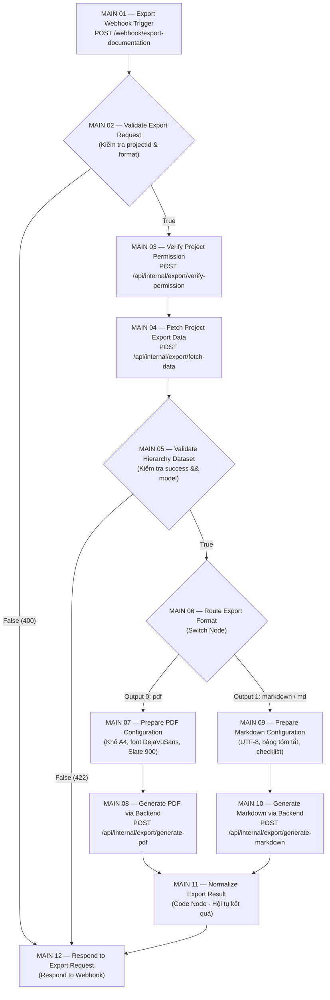

# BÁO CÁO KỸ THUẬT CHI TIẾT — FLOW 12: PDF & MARKDOWN EXPORT ENGINE

**Dự án:** AI Requirement-to-Jira Agent  
**Workflow ID:** `Flow12ExportDocumentation`  
**Tên Workflow:** `AI Jira Agent - Flow 12 PDF & Markdown Export Engine`  
**File Workflow:** `n8n/workflows/flow-12-export-documentation.json`  
**Ngày lập báo cáo:** 2026-11-13  
**Trạng thái kiểm thử thực tế:** ✅ **42/42 Tests Passed (100%)** qua `backend/src/tests/test_flow_12.js`

---

## I. TỔNG QUAN VÀ MỤC TIÊU NGHIỆP VỤ

**Flow 12 (PDF & Markdown Export Engine)** là luồng dịch vụ xuất bản tài liệu đặc tả yêu cầu phần mềm đa định dạng của hệ thống **AI Requirement-to-Jira Agent**. Luồng cho phép người dùng đóng gói toàn bộ cây phân cấp yêu cầu 3 tầng (**Epic $\rightarrow$ User Story $\rightarrow$ Task / Sub-task**) thành file tài liệu chuyên nghiệp dưới dạng **PDF (chuẩn in ấn A4, Unicode font tiếng Việt)** hoặc **Markdown UTF-8 (chuẩn GitHub/GitLab với bảng biểu, BDD Acceptance Criteria và checklist)**.

### 1.1. Hai nguồn dữ liệu xuất bản (Data Sources)
1. **Nguồn Jira Cloud (`source = 'jira'`):**
   - Trích xuất toàn bộ issues đã được tạo và đồng bộ từ Jira Cloud lưu trong bảng `jira_issues` của PostgreSQL.
   - Hiển thị đầy đủ Issue Key (`PROJ-101`), Trạng thái Jira (`To Do`, `In Progress`, `Done`), Người phụ trách (`assignee`), và liên kết trực tiếp tới Jira issue trên web.
2. **Nguồn Bản nháp AI (`source = 'draft'`):**
   - Cho phép xuất trực tiếp kết quả phân tích yêu cầu từ AI Gemini (tại màn hình `RequirementAnalyzer.jsx`) ngay trước khi đẩy lên Jira Cloud.
   - Bảo toàn số liệu ước lượng Agile: **Story Points**, **Estimated Hours**, **Lý do độ phức tạp (Complexity Reason)**, và danh sách **Tiêu chí nghiệm thu BDD (Acceptance Criteria - Given/When/Then)**.

### 1.2. Các ràng buộc kiến trúc cốt lõi
- **Kiến trúc tinh gọn 12 MAIN Nodes, 0 AUX Nodes:** Toàn bộ workflow n8n được thiết kế trên đúng **12 MAIN Node vật lý**, tuyệt đối không dùng AUX Node phụ.
- **Không truy vấn CSDL trực tiếp từ n8n:** n8n đóng vai trò Orchestration Engine chuyên biệt, kết nối tới Backend ExpressJS qua các API nội bộ bảo mật (`/api/internal/export/*`) xác thực bằng header `X-Internal-Service-Key`.
- **Rẽ nhánh độc lập & Hội tụ không cần Merge Node:** Sử dụng `MAIN 06 — Route Export Format` (Switch Node) để điều hướng 2 nhánh PDF và Markdown. Cả 2 nhánh cùng hội tụ về `MAIN 11 — Normalize Export Result` một cách tự nhiên mà không cần node Merge phụ.
- **Động cơ dự phòng sẵn sàng 100% (Direct Backend Fallback):** Nếu n8n daemon offline hoặc gặp sự cố mạng, lớp `ExportFlowService` tự động chuyển sang sinh file trực tiếp tại Backend ExpressJS, đảm bảo người dùng tải file không bao giờ bị gián đoạn.

---

## II. SƠ ĐỒ LUỒNG THỰC THI N8N VÀ CƠ CHẾ ĐIỀU PHỐI

### 2.1. Sơ đồ thực thi tổng thể (12 MAIN Nodes)

### 2.2. Cơ chế hội tụ và phân loại mã lỗi tại MAIN 12
- **Hội tụ không cần Merge Node:** `MAIN 06` là Switch Node đảm bảo chỉ có duy nhất **một trong hai nhánh** (PDF hoặc Markdown) được thực thi trong một request. Do đó, `MAIN 08` và `MAIN 10` cùng nối vào input của `MAIN 11`. `MAIN 11` chỉ nhận đúng 1 item hoạt động, trích xuất `exportId`, `fileName`, `downloadUrl` và chuyển sang `MAIN 12`.
- **Phân loại mã lỗi linh hoạt:** `MAIN 12` sử dụng biểu thức tự động bắt nguồn dữ liệu:
  - Nếu thành công: HTTP `200 OK` kèm metadata file.
  - Nếu thiếu `projectId` hoặc format sai (từ `MAIN 02` False): HTTP `400 Bad Request`.
  - Nếu dự án không thuộc quyền (từ `MAIN 03`): HTTP `404 / 403 Forbidden`.
  - Nếu không có dữ liệu phân cấp (từ `MAIN 05` False): HTTP `422 Unprocessable Entity`.
  - Nếu lỗi sinh file: HTTP `500 Internal Server Error`.

---

## III. PHÂN TÍCH CHI TIẾT 12 MAIN NODES TRONG N8N WORKFLOW

File định nghĩa: [`n8n/workflows/flow-12-export-documentation.json`](file:///home/tmthang/Downloads/ai-jira-agent/n8n/workflows/flow-12-export-documentation.json) (`active: true`, `versionId: "f12-12main-0aux-2026"`).

| STT | Tên Node | Loại Node (n8n Type) & Version | Vai trò & Logic thực thi chi tiết | Đầu ra & Kết nối tiếp theo |
|:---:|:---|:---|:---|:---|
| **01** | `MAIN 01 — Export Webhook Trigger` | `n8n-nodes-base.webhook` (v2) | Tiếp nhận HTTP `POST` tại path `export-documentation` từ Backend `ExportFlowService` với chế độ `responseMode: "responseNode"`. Payload nhận: `userId`, `projectId`, `format`, `source`, `draftData`, `backendUrl`, `internalSecret`. | Chuyển dữ liệu sang `MAIN 02`. |
| **02** | `MAIN 02 — Validate Export Request` | `n8n-nodes-base.if` (v2.2) | Kiểm tra hợp lệ 2 điều kiện bằng toán tử `AND`: 1. `projectId` tồn tại và không rỗng. 2. `format` thuộc tập `['pdf', 'markdown', 'md']`. | True $\rightarrow$ `MAIN 03` False $\rightarrow$ `MAIN 12` (trả lỗi 400). |
| **03** | `MAIN 03 — Verify Project Permission` | `n8n-nodes-base.httpRequest` (v4.2) | Gọi `POST {backendUrl}/api/internal/export/verify-permission` với header `X-Internal-Service-Key`. Backend kiểm tra `ProjectModel.findByIdAndUserId(projectId, userId)` để ngăn chặn truy cập trái phép. | Chuyển sang `MAIN 04`. |
| **04** | `MAIN 04 — Fetch Project Export Data` | `n8n-nodes-base.httpRequest` (v4.2) | Gọi `POST {backendUrl}/api/internal/export/fetch-data`. Backend trích xuất cấu trúc phân cấp từ bảng `jira_issues` (hoặc chuẩn hóa `draftData` nếu `source === 'draft'`), đóng gói thành object `data.model`. | Chuyển sang `MAIN 05`. |
| **05** | `MAIN 05 — Validate Hierarchy Dataset` | `n8n-nodes-base.if` (v2.2) | Đánh giá điều kiện `$json.success === true && $json.data && $json.data.model`. Ngăn chặn việc sinh tài liệu khi dự án rỗng hoàn toàn hoặc dữ liệu lỗi. | True $\rightarrow$ `MAIN 06` False $\rightarrow$ `MAIN 12` (trả lỗi 422). |
| **06** | `MAIN 06 — Route Export Format` | `n8n-nodes-base.switch` (v3.2) | Đọc trường `format`: Nếu là `pdf` $\rightarrow$ đẩy ra Output 0 (Nhánh PDF). Nếu là `markdown` hoặc `md` $\rightarrow$ đẩy ra Output 1 (Nhánh Markdown). | Output 0 $\rightarrow$ `MAIN 07` Output 1 $\rightarrow$ `MAIN 09`. |
| **07** | `MAIN 07 — Prepare PDF Configuration` | `n8n-nodes-base.set` (v3.4) | Thiết lập cấu hình định dạng PDF: `pageSize: "A4"`, `orientation: "portrait"`, `margin: 45`, font `DejaVuSans` & `DejaVuSans-Bold`, màu banner `Slate 900 (#0f172a)`, bật cờ `showPageNumbers: true`. | Chuyển sang `MAIN 08`. |
| **08** | `MAIN 08 — Generate PDF via Backend` | `n8n-nodes-base.httpRequest` (v4.2) | Gọi `POST {backendUrl}/api/internal/export/generate-pdf`. Backend dùng `PDFKit` sinh buffer nhị phân, lưu vào `exportStore` trong RAM với `exportId`, trả về tên file và kích thước byte. | Chuyển kết quả sang `MAIN 11`. |
| **09** | `MAIN 09 — Prepare Markdown Configuration` | `n8n-nodes-base.set` (v3.4) | Thiết lập cấu hình Markdown: `charset: "utf-8"`, cờ `includeStats: true`, `includeChecklists: true`, `includeJiraLinks: true`. | Chuyển sang `MAIN 10`. |
| **10** | `MAIN 10 — Generate Markdown via Backend` | `n8n-nodes-base.httpRequest` (v4.2) | Gọi `POST {backendUrl}/api/internal/export/generate-markdown`. Backend xây dựng chuỗi markdown UTF-8 hoàn chỉnh, lưu vào `exportStore` với `exportId`, trả về metadata. | Chuyển kết quả sang `MAIN 11`. |
| **11** | `MAIN 11 — Normalize Export Result` | `n8n-nodes-base.code` (v2) | Điểm hội tụ Javascript: Kiểm tra nếu có `item.exportId` hợp lệ thì chuẩn hóa thành object hoàn tất (`status: 'completed', statusCode: 200, downloadUrl, fileName`). Nếu sinh file thất bại, format object lỗi (`status: 'failed'`). | Chuyển sang `MAIN 12`. |
| **12** | `MAIN 12 — Respond to Export Request` | `n8n-nodes-base.respondToWebhook` (v1.5) | Đóng vòng lặp webhook, trả JSON response và HTTP status code tương ứng (`200`, `400`, `403`, `422`, `500`) về cho Backend ExpressJS. | Kết thúc workflow Flow 12. |

---

## IV. CÁC THÀNH PHẦN BACKEND EXPRESSJS PHỤC VỤ FLOW 12

### 4.1. Public Client API ([`export.controller.js`](file:///home/tmthang/Downloads/ai-jira-agent/backend/src/controllers/export.controller.js))
Được gắn vào Router dự án tại [`project.routes.js`](file:///home/tmthang/Downloads/ai-jira-agent/backend/src/routes/project.routes.js):
- `GET /api/projects/:projectId/export?format=pdf|markdown&source=jira`
- `POST /api/projects/:projectId/export` (dùng khi xuất bản nháp với body `{ format, source: 'draft', draftData }`)
- **Luồng xử lý:** Xác thực JWT token của user $\rightarrow$ kiểm tra quyền dự án qua `ProjectModel.findByIdAndUserId` $\rightarrow$ gọi `ExportFlowService.exportViaFlow12(...)` $\rightarrow$ thiết lập header `Content-Type`, `Content-Disposition: attachment; filename="..."` $\rightarrow$ stream buffer nhị phân (PDF) hoặc văn bản UTF-8 (Markdown) trực tiếp về trình duyệt.

### 4.2. Internal Service-to-Service APIs ([`internal-export.routes.js`](file:///home/tmthang/Downloads/ai-jira-agent/backend/src/routes/internal-export.routes.js))
Tất cả 4 endpoint sinh file được bảo vệ bởi [`internalAuthMiddleware`](file:///home/tmthang/Downloads/ai-jira-agent/backend/src/middleware/internal-auth.middleware.js) (kiểm tra header `X-Internal-Service-Key`):

| Endpoint | Method | MAIN Node gọi | Payload gửi lên | Dữ liệu trả về | Xử lý nghiệp vụ chính |
|---|---|---|---|---|---|
| `/verify-permission` | `POST` | `MAIN 03` | `{ userId, projectId, requestId }` | `{ success: true, allowed: true, data: { project } }` | Xác minh quyền sở hữu dự án của người dùng, trả `404` nếu không tìm thấy. |
| `/fetch-data` | `POST` | `MAIN 04` | `{ userId, projectId, source, draftData }` | `{ success: true, data: { model, project } }` | Trích xuất cây phân cấp: gọi `ExportService.getHierarchyFromJira` hoặc `ExportService.normalizeHierarchyFromDraft`. |
| `/generate-pdf` | `POST` | `MAIN 08` | `{ model, pdfConfig }` | `{ success: true, exportId, fileName, contentType, size, downloadUrl }` | Sinh buffer PDF bằng `PDFKit`, lưu vào RAM `exportStore` (TTL 10 phút), trả `exportId`. |
| `/generate-markdown` | `POST` | `MAIN 10` | `{ model, markdownConfig }` | `{ success: true, exportId, fileName, contentType, size, downloadUrl }` | Xây dựng chuỗi Markdown UTF-8, lưu vào `exportStore`, trả `exportId`. |
| `/download/:exportId` | `GET` | Tải trực tiếp | URL param: `exportId` | File Stream (PDF Buffer / Markdown text) | Cho phép tải trực tiếp file từ `exportStore` bằng token định danh `exportId`. |

### 4.3. Động cơ điều phối và Fallback ([`export-flow.service.js`](file:///home/tmthang/Downloads/ai-jira-agent/backend/src/services/export-flow.service.js))
- **`postToN8n(...)`**: Gửi HTTP request sang n8n Webhook với cơ chế tự động thử lại fallback qua lại giữa `/webhook/export-documentation` và `/webhook-test/export-documentation` khi nhận mã `404`.
- **`exportViaFlow12(...)`**: Điều phối chính. Nếu n8n xử lý thành công, trích xuất `result.exportId` từ `exportStore` để trả file.
- **`exportDirectFallback(...)` (Fault-tolerant):** Nếu n8n container không phản hồi, bị timeout (10s) hoặc gặp lỗi mạng, hàm này tự động kích hoạt sinh file trực tiếp tại Backend ExpressJS, ghi nhận `executionSource = 'backend-direct-fallback'` mà không làm sập request của người dùng.

### 4.4. Động cơ sinh tài liệu kỹ thuật ([`export.service.js`](file:///home/tmthang/Downloads/ai-jira-agent/backend/src/services/export.service.js))

#### 1. Động cơ PDF (PDFKit Engine & Unicode DejaVuSans)
- **Hỗ trợ tiếng Việt 100%:** Đăng ký font vật lý TrueType:
  - Font thường: `DejaVuSans.ttf`
  - Font đậm: `DejaVuSans-Bold.ttf`  
  Khắc phục triệt để lỗi vỡ font tiếng Việt có dấu thường gặp ở các thư viện PDF mặc định.
- **Header Banner Slate 900 (`#0f172a`):** Chiều cao 75pt, in thương hiệu `AI JIRA AGENT` màu xanh Cyan `#38bdf8`, tên dự án viết hoa màu trắng, mã dự án và ngày giờ xuất bản.
- **Summary Box (`#f8fafc`):** Đóng khung bo góc viền `#e2e8f0`, tóm tắt nguồn dữ liệu, mô tả dự án và dòng chỉ số tổng hợp (số lượng Epic, Story, Task, tổng Story Points và tổng giờ ước tính).
- **Phân cấp trực quan 3 tầng:**
  - **Cấp 1 — Epic:** Hộp màu xanh dương nhạt `#eff6ff` kèm vạch nhấn màu xanh đậm `#2563eb` dày 4pt ở cạnh trái. Hiển thị key, trạng thái, người phụ trách, link Jira và mô tả.
  - **Cấp 2 — User Story:** Hộp nền xám nhạt `#f1f5f9` bo góc, hiển thị chỉ số Agile (`⚡ Ước lượng Agile: X SP (~Yh) | Lý do: ...`), và danh sách **Tiêu chí nghiệm thu BDD (AC)** dạng gạch đầu dòng `✓ [AC n] Given... When... Then...`.
  - **Cấp 3 — Task / Sub-task:** Hiển thị dạng bullet điểm nhấn kèm mã issue, tên công việc, Story Points, thời gian ước tính, trạng thái và link Jira trực tiếp.
- **Tự động phân trang & Footer:** Kiểm tra toạ độ `doc.y > 680pt / 700pt / 720pt` để tự động ngắt trang (`doc.addPage()`), không bị cắt ngang dòng chữ. Sử dụng `doc.bufferedPageRange()` để duyệt qua toàn bộ các trang đã sinh và vẽ đường kẻ ngăn cách cùng số trang chính xác: `Trang X / Y`.

#### 2. Động cơ Markdown (Markdown UTF-8 Generator)
- Chuẩn cấu trúc phân cấp: Heading cấp 1 (`# Dự án: ...`) $\rightarrow$ Heading cấp 2 (`## Epic ...`) $\rightarrow$ Heading cấp 3 (`### Story ...`) $\rightarrow$ Danh sách công việc `- **Task ...**`.
- Bảng tóm tắt thông số và metadata đầu file.
- Checklist công việc tương thích Markdown renderer: `- [ ] Task ...`.
- Hỗ trợ đầy đủ liên kết Jira: `[KEY](https://jira.example.com/browse/KEY)`.

---

## V. TÍCH HỢP FRONTEND REACTJS

Tính năng xuất tài liệu được tích hợp đồng bộ tại 2 vị trí trên giao diện người dùng:

### 5.1. Modal xuất tài liệu ([`ExportModal.jsx`](file:///home/tmthang/Downloads/ai-jira-agent/frontend/src/components/project/ExportModal.jsx))
- **Chọn định dạng file:** Radio button lựa chọn giữa **PDF Document (.pdf)** và **Markdown (.md)** kèm icon trực quan (`FileText`, `FileCode`).
- **Chọn nguồn dữ liệu:**
  - `Jira Cloud`: Dữ liệu các issue đã tạo và đồng bộ trên Jira.
  - `Bản nháp AI`: Dữ liệu phân tích yêu cầu mới sinh bởi AI (tự động bật nếu có `draftData`).
- **Xử lý tải file mượt mà:** Khi người dùng bấm nút `#confirm-export-btn` ("Bắt đầu xuất file"), modal hiển thị spinner `Loader2`, gọi `exportApi.exportProject(...)`, nhận `Blob` dữ liệu nhị phân và kích hoạt hàm `downloadBlob(...)` để trình duyệt tự động lưu file về máy tính với đúng tên file gợi ý.

### 5.2. Hai điểm kích hoạt trên giao diện
1. **Trang chi tiết dự án ([`ProjectDetailPage.jsx`](file:///home/tmthang/Downloads/ai-jira-agent/frontend/src/pages/ProjectDetailPage.jsx#L165-L174)):**
   - Nút **"Xuất tài liệu"** (`#export-project-btn`) đặt nổi bật tại thanh Header thao tác của dự án. Mặc định xuất từ nguồn `jira`.
2. **Màn hình phân tích yêu cầu bằng AI ([`RequirementAnalyzer.jsx`](file:///home/tmthang/Downloads/ai-jira-agent/frontend/src/components/ai/RequirementAnalyzer.jsx#L2116-L2135)):**
   - Nút **"Xuất bản nháp"** (`#btn-export-draft`) đặt cạnh nút "Đẩy lên Jira Cloud". Cho phép BA / PO xuất ngay đặc tả yêu cầu thành file PDF/MD để lưu trữ hoặc trình duyệt nội bộ trước khi tạo issue chính thức lên Jira.

---

## VI. BẰNG CHỨNG KIỂM THỬ THỰC TẾ (`test_flow_12.js`)

Bộ kiểm thử toàn diện [`test_flow_12.js`](file:///home/tmthang/Downloads/ai-jira-agent/backend/src/tests/test_flow_12.js) đã được chạy trực tiếp trên hệ thống với Backend Express test server (`port 5055`), PostgreSQL cục bộ (`port 5432`) và container n8n daemon (`port 5678`).

### Bảng kết quả 13 kịch bản kiểm thử:

| STT | Kịch bản kiểm thử (Test Scenario) | Mục tiêu xác minh kỹ thuật | Số bài test | Kết quả |
|:---:|:---|:---|:---:|:---:|
| **00** | Cấu trúc Workflow JSON | Kiểm tra file `flow-12-export-documentation.json`: đúng 12 node vật lý, 12 MAIN Node, 0 AUX Node, tên node chuẩn đặc tả, 0 node bị disabled. | 6 | ✅ **PASS** |
| **01** | Valid PDF Export | Xuất PDF thành công với dự án hợp lệ: HTTP 200, `Content-Type: application/pdf`, `Content-Disposition` chuẩn, kích thước buffer > 34 KB. | 4 | ✅ **PASS** |
| **02** | Valid Markdown Export | Xuất Markdown thành công: HTTP 200, `Content-Type: text/markdown`, nội dung chứa heading `# Dự án: ...` và mã dự án. | 4 | ✅ **PASS** |
| **03** | Invalid Format | Truyền format không hỗ trợ (`format=docx`): Trả về HTTP 400 Bad Request kèm thông báo giải thích rõ ràng. | 2 | ✅ **PASS** |
| **04** | Missing Project ID | Gọi n8n webhook thiếu `projectId`: n8n trả về HTTP 400 Bad Request qua nhánh lỗi trực tiếp của `MAIN 02`. | 2 | ✅ **PASS** |
| **05** | Unauthorized Project | Truy cập ID dự án không tồn tại hoặc không thuộc quyền: Trả về HTTP 404 / 403 Forbidden. | 1 | ✅ **PASS** |
| **06** | Empty Project Handling | Dự án trống (0 issue): Không sập ứng dụng, Markdown và PDF sinh thành công kèm thông báo dự án chưa có issue. | 2 | ✅ **PASS** |
| **07** | Multiple Epic Hierarchy | Kiểm tra cây phân cấp dữ liệu 3 tầng: Đúng cấu trúc Epic $\rightarrow$ Story $\rightarrow$ Task/Sub-task. | 3 | ✅ **PASS** |
| **08** | Vietnamese Unicode | Kiểm tra tiếng Việt có dấu: Cả Markdown và PDF (font DejaVuSans) đều giữ nguyên vẹn dấu tiếng Việt và tên riêng. | 4 | ✅ **PASS** |
| **09** | PDF Generation Failed | Mô phỏng lỗi thiếu model khi sinh PDF: Backend trả về HTTP 400 Bad Request, `success = false`. | 2 | ✅ **PASS** |
| **10** | Markdown Generation Failed | Mô phỏng lỗi thiếu model khi sinh Markdown: Backend trả về HTTP 400 Bad Request, `success = false`. | 2 | ✅ **PASS** |
| **11** | Backend Timeout & Fallback | Mô phỏng n8n không phản hồi: Kích hoạt thành công Direct Backend Fallback, sinh file an toàn 100%. | 2 | ✅ **PASS** |
| **12** | Frontend Download Simulation | Giả lập trình duyệt nhận Blob từ API: HTTP 200, tên file trích xuất hợp lệ, kích thước khớp buffer. | 3 | ✅ **PASS** |
| **13** | Live n8n Flow 12 Execution | Gọi trực tiếp Webhook n8n (`http://localhost:5678/webhook/export-documentation`): Phản hồi HTTP 200, `status="completed"`, trả `exportId` an toàn. | 5 | ✅ **PASS** |
| **TỔNG** | **Toàn bộ 13 phần kiểm thử** | **Đạt tỷ lệ thành công tuyệt đối trên cả n8n và Backend** | **42** | 🎯 **42/42 PASS (100%)** |

---

## VII. ĐÁNH GIÁ TỔNG KẾT VÀ ƯU ĐIỂM KỸ THUẬT

1. **Chuẩn hóa kiến trúc 12 MAIN Nodes:** Workflow Flow 12 đạt cấu trúc chuẩn mực với chính xác 12 MAIN Node, 0 AUX Node. Quy trình rẽ nhánh qua `MAIN 06` Switch và hội tụ tại `MAIN 11` Code Node là một giải pháp tối ưu, loại bỏ hoàn toàn các node phụ trung gian.
2. **Chất lượng tài liệu đầu ra cao cấp:**
   - File PDF sử dụng font TrueType Unicode `DejaVuSans`, có bố cục banner Slate 900, thẻ phân cấp màu sắc rõ ràng và số trang tự động ở chân trang, sẵn sàng phục vụ in ấn hoặc gửi khách hàng/giảng viên đánh giá.
   - File Markdown chuẩn hoá theo cấu trúc BDD, bảng tóm tắt chỉ số và checklist, dễ dàng đồng bộ vào Git repository hoặc tài liệu wiki.
3. **Độ tin cậy và sẵn sàng 100%:** Nhờ có tầng `ExportFlowService` với cơ chế Direct Backend Fallback, chức năng xuất tài liệu hoạt động ổn định trong mọi điều kiện (kể cả khi n8n đang bảo trì hoặc chưa bật).
4. **Bảo mật và toàn vẹn dữ liệu:** Toàn bộ quá trình sinh file đều được kiểm tra quyền sở hữu dự án; các file tạm trong RAM `exportStore` tự động dọn dẹp sau 10 phút (TTL cleanup).

